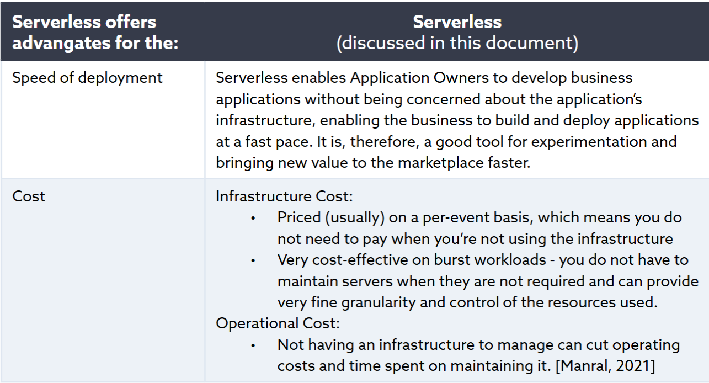
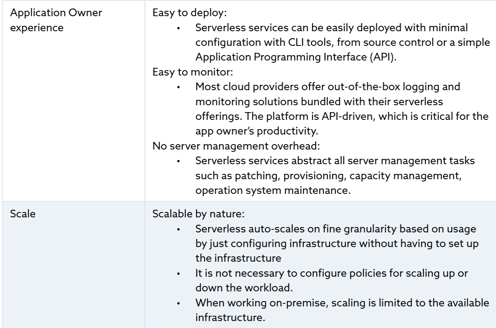
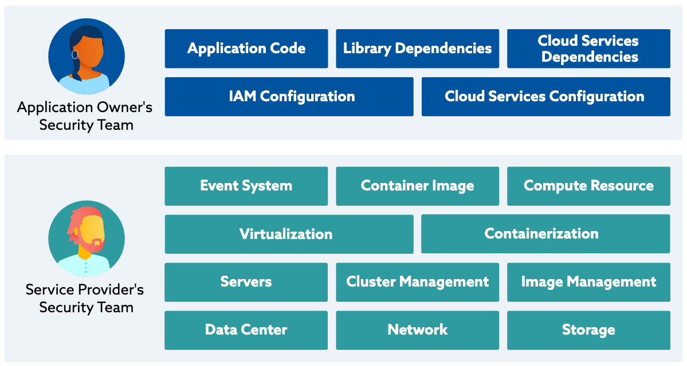
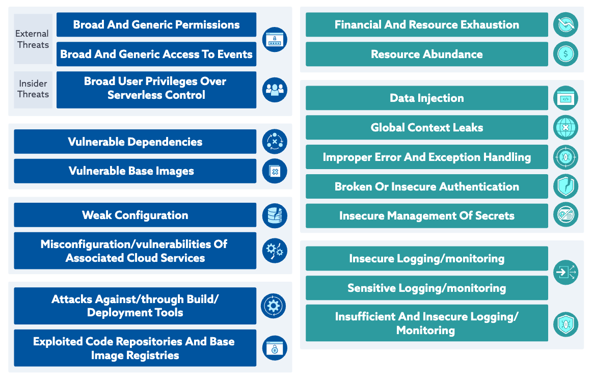
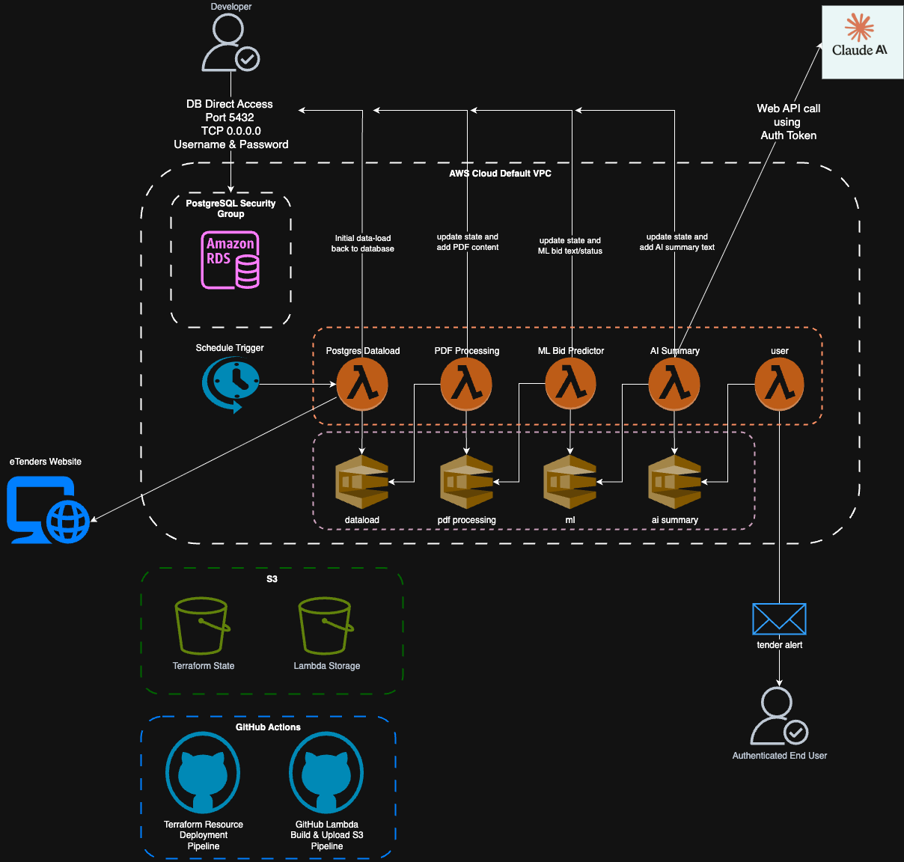
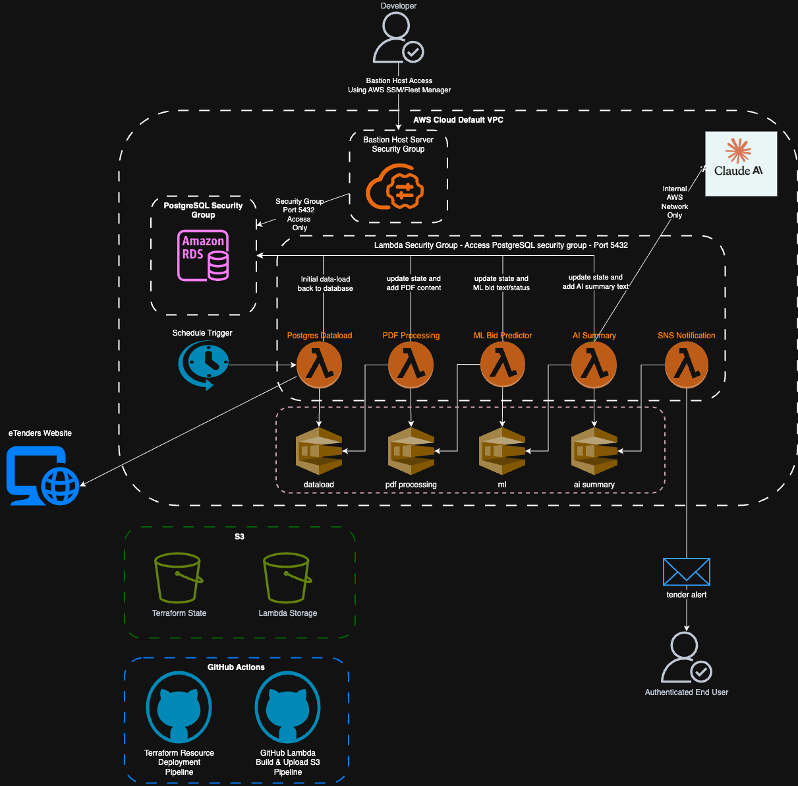
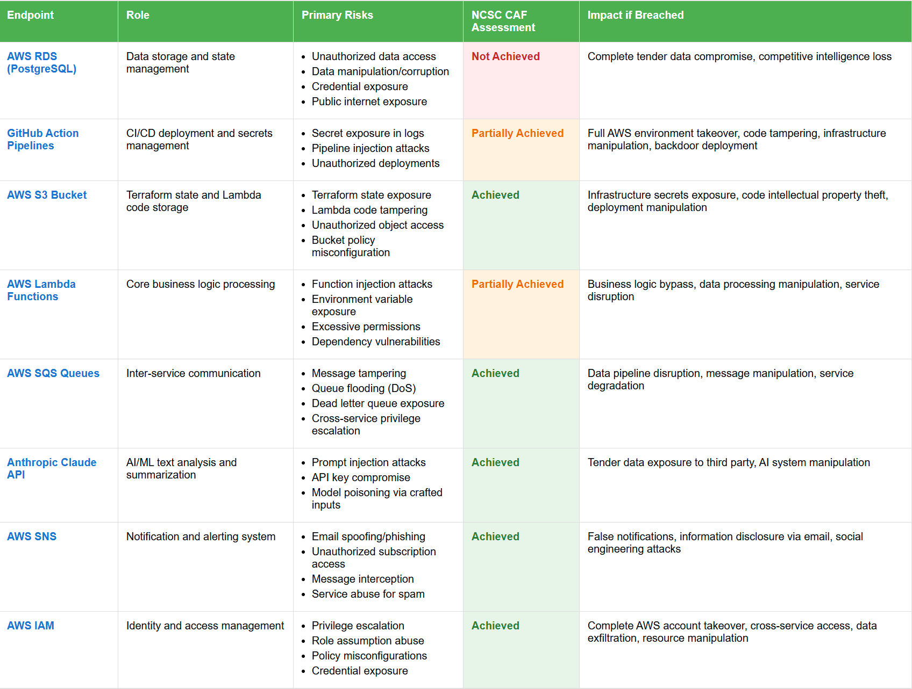
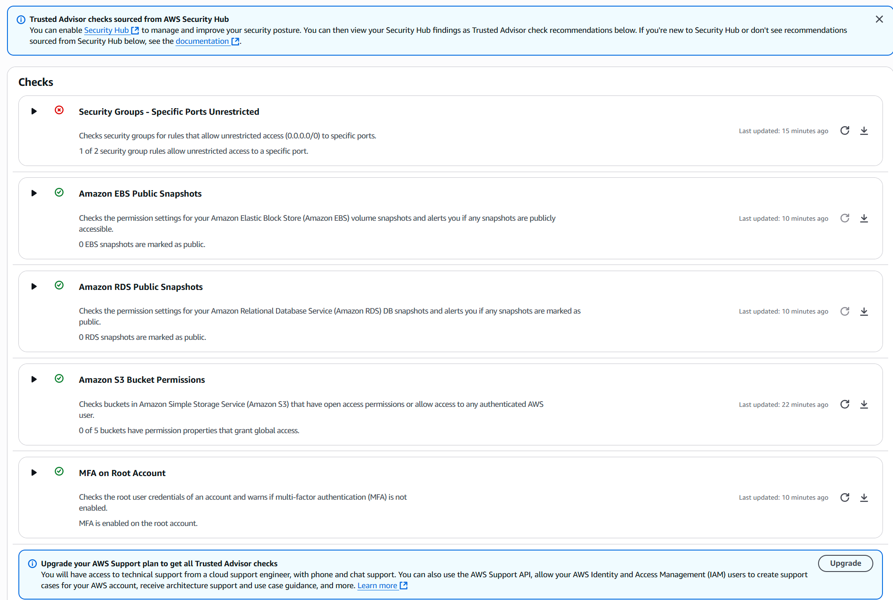
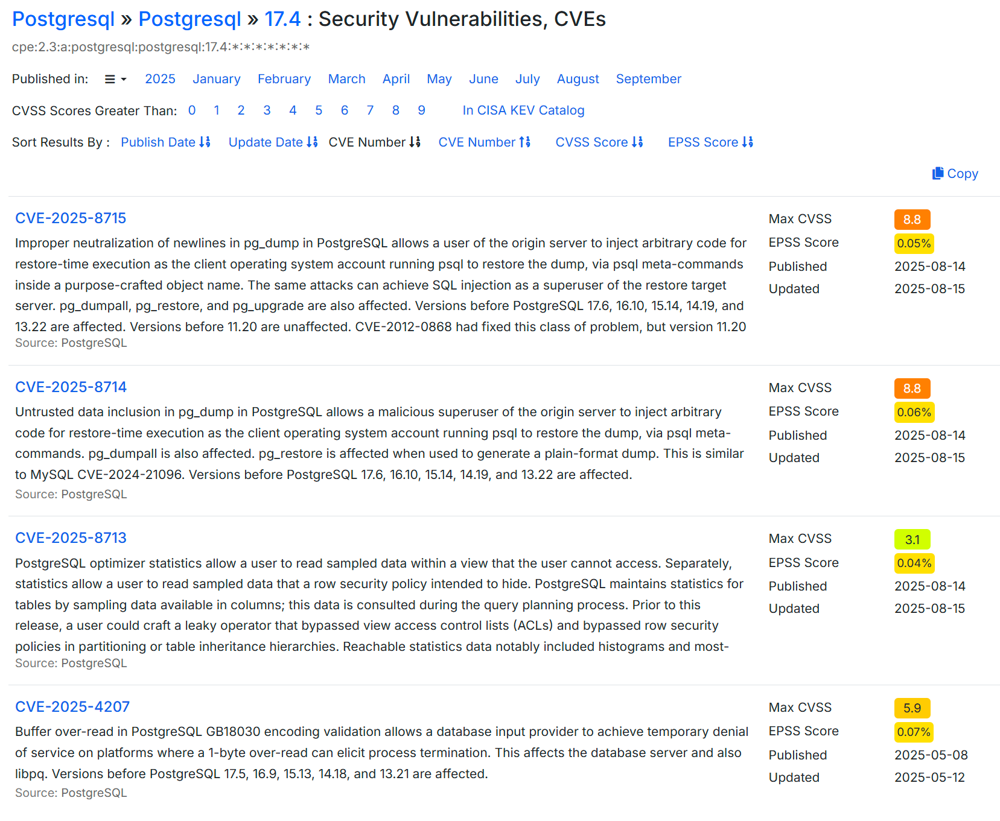

# Project 1 - Cybersecurity & Software Development

## Context
##### Role and Project Impact

The eTenders project (robertsweetman, 2025) has allowed me to really expand my programming skills around AWS, automation, serverless functions and AI/ML.

The project is automatically built in Amazon's cloud (AWS) and relies on a number of secret keys. As the sole developer of this application it's been my responsibility to make sure any secrets or sensitive information doesn't immediately leak because this would allow someone to create their own infrastructure for free in the root AWS account. 

If, for example the Claude API key wasn't in a GitHub secret but had been (mistakenly) included in a commit then someone would be able to use this to pose their own questions to Claude for free. Exposure of some secrets would also potentially allow a bad actor to compromise the project's AWS RDS PostgreSQL database or delete things from it even. 

The initial architecture, while developer friendly, now needs changing to enforce security best practice.

## K12: [Pass] Explains core technical concepts for digital and technology solutions, including: Data gathering, data management, and data analysis
### Evidence

###### AWS RDS (PostgreSQL) db connection
The first serverless function `postgres_dataload` gets the latest electronic tenders and stores them in the database. 

The database is updated by subsequent functions as the tender information passes through the ML/AI pipeline. 

It also records each Lambda step to help debugging the data manipulation pipeline. 

In future it could be used to drive further ML improvements via reinforcement learning or to expand the amount of model training data.

It's currently open to the internet for ease of development from Windows machine via the PgAdmin4 PostgreSQL client (www.pgadmin.org, n.d.). 

## K16: [Pass] Explains core technical concepts for digital and technology solutions, including: Computer networking concepts
### Evidence

#### Evaluation of Current State
Evaluating serverless application security differs from traditional networks but their use is justified by advantages they confer, especially related to cost and maintenance.



Figure 1 : Serverless Advantages (Cloud Security Alliance: 2023: 10)

Serverless architecture means developers focus on the application while everything else is abstracted away or becomes the responsibility of the cloud platform provider.


Figure 2 : Serverless Responsibility (Cloud Security Alliance 2023:11)

Note that there is still _shared_ responsibility because although many vulnerabilities have been removed there are new and unique issues in serverless applications.


Figure 3 : Setup and Deployment Stage Threats (Cloud Security Alliance 2023:20)

Committing secrets to code would be a "deployment stage" threat and a cloud provider wouldn't be liable for this type of mistake.

##### Endpoint Inventory


Figure 4: Initial Application Diagram

Our application consists of serverless functions, an event-driven chain and PostgreSQL data store/state record.  

###### AWS RDS (PostgreSQL) db connection
The first serverless function `postgres_dataload` gets the latest electronic tenders and stores them in the database. 

The database is updated by subsequent functions as the tender information passes through the ML/AI pipeline. 

It also records each Lambda step to help debugging the data manipulation pipeline. 

In future it could be used to drive further ML improvements via reinforcement learning or to expand the amount of model training data.

It's currently open to the internet for ease of development from Windows machine via the PgAdmin4 PostgreSQL client (www.pgadmin.org, n.d.). 

###### GitHub action pipelines
Pipelines deploy Terraform defined resources into AWS, build the Lambdas (written in Rust) and upload them to S3. These pipelines use action secrets so that no password or other sensitive values are ever committed to the repository for attackers to re-use.

###### AWS S3
The terraform state file is stored in S3 so multiple developers can work on the project simultaneously, rather than maintaining their own local state copy.

The S3 bucket is also where the AWS Lambdas are uploaded to when built. 

Each Lambda function grabs the .zip file from it's bucket and runs it as part of it's execution process.

###### AWS Lambda functions & queues
All the Lambda functions exist within AWS. AWS Simple Queue Service is used to trigger and initialize new function instances when a message they're interested in lands on the queue and each Lambda post results onto the next queue in the chain.

Due to the way the Rust language is designed all the messages passed into and between the lambda's must conform to a pre-defined schema. It's not possible to inject or co-opt the messages because of this validation and data-integrity checking.  

###### Anthropic Claude API endpoint
The AI Summary Lambda calls Claude's API endpoint via https. It is secured via an API Key that has been stored in the GitHub action secrets that is passed in to the AWS Lambda environment at the point the build pipeline runs. This secret isn't exposed in the build logs or anywhere else. 

###### AWS Simple Notification Service
The sales team receives an alert to a potential bid via a list of validated email receivers. For security, the SNS service also uses a domain validated DNS account.

###### AWS IAM 

Clearly identity and access management is the key to securely deploying, monitoring and managing any cloud-base application. Without a robust policy, use of least privilege and enforcement any account could come under attack and be taken over. 

AWS and Azure both enforce 2FA for increased account security (AWS, n.d.) with Microsoft going as far as mandating it from October 1st 2025 as announced in their recent blog (Shah, 2025) which contains this interesting data point.

```text
Microsoft research shows that multifactor authentication (MFA) can block more than 99.2% of account compromise attacks, making it one of the most effective security measures available.
```

## S12: [Pass] Demonstrates the use of core technical concepts for digital and technology solutions, including: plans, designs and manages simple computer networks
### Evidence

##### Architectural changes

An approach that is often overlooked is to reduce the overall attack surface by making architectural changes.

We could make two modifications to create a black box with just an internal schedule trigger to fetch the eTender data and a daily outbound email. There would be no access to anything other than via GitHub or AWS account compromise which, having set up 2FA on both, is extremely unlikely.

###### Replace external Anthropic API call with AWS Bedrock

Bedrock is Amazon's cloud hosted AI platform. Using this would mean that the `ai_summary` lambda traffic doesn't need to leave the internal network at all. This would also reduce our reliance on Anthropic's external API remaining un-changed or allow us more flexibility to potential replace the call to Claude with something else, possibly cheaper.

Plugging into Bedrock likely also means we get more logging which would further enhance our troubleshooting ability.

###### Remove the PostgreSQL database

The database holds whereabouts our eTender record is in the pipeline and could be used for ML model retraining but we could also decide it's not needed.

We get logging from the Lambda functions themselves and could instead look at the SQS queue outputs to understand whether something was processed successfully or not. 

Now that we have the application running we could remove the database altogether.

###### Replace the PostgreSQL database with Aurora DB instead

If we at least want to retain the DB, mainly for ML model retraining later, we could at least replace it with Aurora DB because this has an in-built AWS Query UI. 

This would allow us to interrogate it without having to maintain a bastion server to run the PostgreSQL client. 

There's also an Aurora Serverless offering which only runs when it needs to and since we're just running `postgresql_dataload` once per day this _might_ be cheaper. (Amazon Web Service, 2025) 

This costs $0.14 per hour while running our current RDS instance is costing $20 per month so it appears we could reduce this to about $3 per month...

These sorts of changes should definitely be considered longer term.

##### Proposal Summary


Figure 8: Final Application Diagram

As can be seen in this diagram we've removed the two main external security risks, logging into the database over the open internet and sending our AI summary payload out to Anthropic's external facing API. 


<!-- 
* Based on your analysis, propose strategic enhancements to address identified vulnerabilities

* Research, evaluate and propose new security technologies such as advanced threat detection systems and robust encryption methods to effectively bridge current security gaps.

* Discuss scalability, reliability and security of the overall network architecture enhancements, justifying your proposal

* Explain how you would communicate proposal details to technical and non-technical stakeholders to gain buy in.

-->

<!-- MARKING RUBRIC

DESIGN A SIMPLE DIGITAL AND/OR DATA NETWORK
* Develop a well thought out digital and/or data network design based on industry standards and regulations
* INCLUDE concise explanations of the design principals and considerations for...
  * building a secure digital and/or data network with additional insights and examples

THIS APPLIES TO CURRENT_STATE_EVALUATION also

-->


#### Proposal and Impact Story

To help communicate the changes to a non technical audience we can use the NCSC framework and say allows us to say  our proposed changes reach **Achieved** level across all requirements: 

* **Database access** - Internal staff only via bastion server
* **Monitoring** - Real time alerts for application issues
* **Security scanning** - AWS config and resource issues
* **API security** - Migrate to AWS Bedrock from external API

Now the only external interaction the AWS hosted environment has is to send the "respond to this tender" message and this is only ever an outbound email. This, combined with ongoing logging & scanning results in a very secure application

##### Implementation Costs

| Item | Monthly Cost | Notes |
|------|------|-------|
| Base cost | £20 | Historical 3 month average |
| EC2 bastion server | +£15 | ($0.025 per hour x 744 hours) @ 0.75 pounds per USD (AWS, 2025) |
| Move to AWS Bedrock | £0 | Cost neutral vs. current API |
| Enhance Logging/Monitoring | +£10 | Increases data flow |
| Developer Time | estimate 1 -5 hours | one off cost |

Even doubling the running cost of the app by adding a bastion server isn't nearly as damaging as suffering reputational damage.

##### Risk vs Investment

Failure to act, especially in the case of a consultancy, means any reputational damage is likely to be significant.

Global Cyberattacks are only increasing in frequency (CheckPoint, 2024) with reputation being something that would be impacted (CYE Insights, 2024)

It only takes one decision maker hesitating on a contract award to make a £5-100 million dent in a companies revenue because reputation has a huge impact on the contract awards process and likelihood of a positive outcome.

## K11: [Pass] Critically evaluates the nature and scope of common vulnerabilities in digital and technology solutions
### Evidence

##### Cybersecurity Analysis

We can use the **NCSC Cyber Assessment Framework (CAF)** (NCSC, 2024) and **ISO 27001:2022**, which evaluates each endpoint against UK cybersecurity best practices. 

For AI/ML we can use the **OWASP LLM Top 10** (OWASPLLMProject Admin, 2024) and **ENISA's AI Cybersecurity Guidelines** (ENISA, 2023) which cover risks in AI systems and data processing.

There's also some pretty good overviews to help us with GitHub Action pipeline vulnerabilities (Singh, 2024)

###### Risk Assessment Matrix

The following table uses the **NCSC CAF outcome assessments** outcomes to evaluate current security. 

- **Not Achieved**: Significant security gaps, immediate attention required
- **Partially Achieved**: Some controls in place but issues that need addressing
- **Achieved**: Security effectively implemented and maintained


Figure 5: Risk Assessment Table

Where endpoints are assessed as **Achieved** this is primarily through the use of 2 Factor Authentication to access AWS and GitHub.

AWS also have their own security review tooling which looks at the underlying infrastructure. 


Figure 6: AWS Security Review - _clearly highlights PostgreSQL open port risk_

At the database level, while there _are_ vulnerabilities they are at such a low possibility of being exploited that it's not worth worrying about.


Figure 7: PostgreSQL vulnerabilities

Very low EPSS scores indicate that these exploits are unlikely to be effectively executed in the wild (FIRST — Forum of Incident Response and Security Teams, 2025)

It's often security **misconfiguration** that leads to vulnerabilities (Huntress, 2025) so automated tools (e.g. AWS Security Review) can point out common issues that might lead to data compromise.

Assessing the CI/CD/GitHub pipeline as **Partially Achieved** is possibly harsh. Use of  2FA means that developer access, secrets management and the deployment pipeline are all very secure but it's not just about secrets...

There might be issues within the resources deployed by Terraform, especially within their configuration, as well as the Rust code or the crates (libraries) the Lambdas are built from.

We can also make some architectural changes to mitigate issues further and address "platform risk" (www.startupillustrated.com, n.d.) which is the over-reliance on a particular platform or service for something to work.


<!-- 
 * draw IO for network diagram
 * look at OWASP AI/LLM stuff
 * explain topology i.e. ALL CLOUD or STAR or something else
 * what are the key concepts on the diagram
 * argue for why improvements made, justify decisions
 * diagram for after, for example
 * support the WHY with industry best practice
  * GDPR is that's relevant
  * CVE's severity etc.

MILESTONE 3 - score the likelyhood of a breach vs. a framework. 
-->

<!--
* Create an Inventory of accessible network endpointscategorized by role, operating system and significance, using advanced scanning tools

* Create a basic network diagram that can include components like routers, switches, servers and workstations
-->

<!-- 
* Provide an overview of existing accessible and relevant protection mechanisms such as anti-virus, anti-malware and EDR systems, encryption and access controls

* Analyse the efficiency of these tools, highlight their advantages and disadvantages

* Analyse the effectiveness of protections and IDS/IPS systmes such as firewalls, VPNs, and endpoint protection software.

* Identify areas needing improvement, focusing on deficiencies that could expose endpoints to threats.

* My project is endpoint and data protection, out of the examples

-->

<!-- MARKING RUBRIC

CONDUCTS COMPREHENSIVE RESEARCH
* clear and detailed explanation of the network design, management and security
* include insightful examples and best practices
* create a detailed and well organised network diagram which...
  * accurately represents the network endpoints and their roles

EVALUATE A DIGITAL OR DATA NETWORK FOR COMMON VULNERABILITIES AND RISKS
* Conduct a thorough vulnerability assessment using industry standard tools
* analyze findings and identifies common vulnerabilities and risks in...
  * a clear and concise manner with...
  * additional insights and examples 

All this needs to be evidenced in this section

-->

## S9: [Pass] Demonstrates the use of core technical concepts for digital and technology solutions, including: security and resilience techniques
### Evidence

#### Digital and Data Network Security Proposal 

##### Secure the PostgreSQL database access

We can easily remove public access to the database and put the Lambda's in a security group so they can still access it but that means we restrict local developers from running queries or looking at the data themselves. 

Unless we move over to AWS Aurora (which can be queried via the AWS Console UI) we have to create a bastion server to control access to the AWS environment and run a PostgreSQL client from there. These steps do immediately address the biggest issue with the application and environment security overall.

Even though the older versions of the PGAdmin client has a few CVE's there are no new ones in 2025 and not for the latest version. We can still confidently use this, especially as it will now be running _behind_ the AWS 2FA boundary.

##### Database backup 

Add secure automated backups to the database settings so that if an issue occurs we can at least roll back to the last known good state.

##### Deploy additional checks as part of the GitHub Terraform deployment pipeline

We can add static code analysis tools (Trivy.dev, 2025) to the github CI/CD pipeline which will check all terraform files for vulnerabilities and misconfigurations of the resources we're building automatically in AWS. 

##### Deploy additional code checks to examine GitHub commits for passwords

Automated secret scanning (Gitguardian.com, 2025) can be added because even if you delete a secret from a commit it'll remain in the git history and therefore accessible.

##### Check AWS Lambda crates for malicious code

Recently spoof emails, purportedly from the Rust Foundation, led to attempts to corrupt some Rust libraries (Rogers, 2025). Developers must make conscious checks on libraries used to build applications nowadays. Rust has mitigations the library manifest requires packages to pin version numbers but this attack vector is definitely not a solved issue.

##### Increase and enhance AWS Lambda logging

Part of the design of a secure serverless application (‌Cloudsecurityalliance.org, 2023) should include comprehensive logging and monitoring. 

At the moment there _are_ logs being generated by the various lambdas as part of the Rust Serverless crate but without associated alarms in AWS for errors/issues there's no notification coming back to the developer (or end user) when something goes wrong. Everything will just fail silently.

Manual testing might turn up something or the end-user might wonder where their emails have gone if they don't see any for a week or so but other than that there's nothing set up to surface a problem. No-one should sit there watching logs...

So with this in mind we need to investigate what can be done with the lambda logs, maybe something to look at the queues and come up with monitoring solution. Probably the first one would be if the initial `postgres_dataload` lambda can't get the eTenders information and the second alarm should be if the request to Claude (AI) fails or returns an error.

##### Subscribe to Amazon's Security Hub CSPM

This AWS tool (Amazon.com, 2025 - Introduction to AWS Security Hub CSPM) provides a more in-depth view of your ongoing security position as well as an assessment of your deployed resources against industry standards and best practices. While we have "some" visibility from the Trusted Advisor checks (see next improvement) this would massively increase our confidence to deploy and maintain a secure application as well as protect the contents of our database on an ongoing basis.

While this would increase the application's running cost  we are still sitting on top of a bunch of serverless functions that are "pay on execution" so already we're not spending that much. Having some automatic scanning of the resources in the environment would help enormously.

##### Upgrade AWS Support plan to get ALL Trusted Advisor Checks

As part of the basic AWS package you get "some" Trusted Advisor checks but upgrading means you also benefit from a much wider set of scans. The default Security Advisor package gets you 5 checks (see Figure 4 earlier) while the Upgraded Support plan gets you more than 50 security checks as well as Performance, Cost Optimization and Fault Tolerance advisories. This can also be set up to send to an email address so developers/maintainers don't miss possible issues.

##### Introduce mandatory user access/event logging

Since the initial `postgres_dataload` Lamda triggers on a timer the only other serious access point is the PostgreSQL database itself. It's currently configured for access via a username & password but since it's hosted we can turn on user access logging. (Amazon.com, 2025. RDS for PostgreSQL database log files)

This depends on changing the database connection process to use AWS IAM database authentication instead but doing so means you're using connection parameters that are stored in AWS Secrets Manager, further increasing security.

## B4: [Pass] Explains how teams work effectively to produce a digital and technology solution applying relevant organisational theories using up to date awareness of trends and innovations
### Evidence

##### Role and Project Impact

The eTenders project (robertsweetman, 2025) has allowed me to really expand my programming skills around AWS, automation, serverless functions and AI/ML. 

The project is automatically built in Amazon's cloud (AWS) and relies on a number of secret keys. As the sole developer of this application it's been my responsibility to make sure any secrets or sensitive information doesn't immediately leak because this would allow someone to create their own infrastructure for free in the root AWS account. 

If, for example the Claude API key wasn't in a GitHub secret but had been (mistakenly) included in a commit then someone would be able to use this to pose their own questions to Claude for free. Exposure of some secrets would also potentially allow a bad actor to compromise the project's AWS RDS PostgreSQL database or delete things from it even. 

The initial architecture, while developer friendly, now needs changing to enforce security best practice.

###### Appendix

All the code etc. derives from the implementation of the AI/ML project in module 2 available on GitHub [here](https://github.com/robertsweetman/module_2)

This includes a full Terraform deployment pipeline so resources that would ordinarily only be visible via the AWS UI are described and deployed from code.

## B7: [Pass] Explains how teams work effectively to produce a digital and technology solution applying relevant organisational theories using up to date awareness of trends and innovations
### Evidence

##### Cybersecurity Significance

Nowadays there's no aspect of our lives that don't rely on robust cybersecurity to protect valuable information about ourselves, our employer or our clients. 

Unfortunately new technology doesn't arrive fully "battle tested" and best practices take time to become established. Results below from scanning AWS S3 buckets from 7 years ago (Rzepa, 2018): 

```text
For 24652 scanned buckets I was able to collect files from 5241 buckets (21%) and to upload arbitrary files to 1365 buckets (6%). 
```

Of course things will have improved but they're still not great according to Tenable (2025)

```text
The number of organizations with triple-threat cloud instances — “publicly exposed, critically vulnerable and highly privileged” — declined from 38% between January and June 2024 to 29% between October 2024 and March 2025.
```

Similarly unguarded access to Internet of Things (IoT) devices has allowed hackers to control huge "botnets", computers acting together to launch Denial Of Service attacks at targets. 

These botnets are often state-sponsored and designed to take opposition sites and services off-line at critical periods (Godwin, 2024).

While spending on AI (capital investment) has balloned and it's contribution to US GDP so far this year has exceeded US consumer spending. (Kawa, 2025)

Cybersecurity as it relates to AI is a new field that is already challenging to keep up with. Here are some recent incidents that will no doubt keep Chief Information Security Officers awake: 

* AI exfiltrating passwords from Chrome password manager (Winder, 2025)

* Enthusiastic vibe coders committing API keys to repos (Jackson, 2025)

* AI enabling a huge increase in ransomware (Winder, 2025)

* Private AI chats leaking into google search results (Arstechnica.com, 2025) 

Finally, the overall picture from the Cloud Security Alliance (cloudsecurityalliance.org, 2025:13) provides a particularly uncomfortable statistic.

```text
More than a third of organizations with AI workloads (34%) have already experienced an AI-related breach, raising urgent questions about AI security readiness and risk management
```

So while it's clear that AI can contribute to profitability and deliver value it's certainly not all roses.


#### References

Amazon.com. (2025). Introduction to AWS Security Hub CSPM - AWS Security Hub. [online] Available at: https://docs.aws.amazon.com/securityhub/latest/userguide/what-is-securityhub.html#securityhub-benefits [Accessed 12 Sep. 2025].

Amazon.com. (2025). RDS for PostgreSQL database log files - Amazon Relational Database Service. [online] Available at: https://docs.aws.amazon.com/AmazonRDS/latest/UserGuide/USER_LogAccess.Concepts.PostgreSQL.html [Accessed 12 Sep. 2025].

Amazon Web Services, Inc. (n.d.). Amazon Aurora Pricing | MySQL PostgreSQL Relational Database | Amazon Web Services. [online] Available at: https://aws.amazon.com/rds/aurora/pricing/.

AWS (2025). EC2 Instance Pricing – Amazon Web Services (AWS). [online] Amazon Web Services, Inc. Available at: https://aws.amazon.com/ec2/pricing/on-demand/.

‌‌‌‌‌Arstechnica.com. (2025). This content is blocked! [online] Available at: https://arstechnica.com/tech-policy/2025/08/chatgpt-users-shocked-to-learn-their-chats-were-in-google-search-results/.

AWS (n.d.). Using multi-factor authentication (MFA) in AWS - AWS Identity and Access Management. [online] docs.aws.amazon.com. Available at: https://docs.aws.amazon.com/IAM/latest/UserGuide/id_credentials_mfa.html.

Check Point (2024). Check Point Research Reports Highest Increase of Global Cyber Attacks seen in last two years – a 30% Increase in Q2 2024 Global Cyber Attacks. [online] Check Point Blog. Available at: https://blog.checkpoint.com/research/check-point-research-reports-highest-increase-of-global-cyber-attacks-seen-in-last-two-years-a-30-increase-in-q2-2024-global-cyber-attacks/.

‌Cloudsecurityalliance.org. (2023). How to Design a Secure Serverless Architecture in 2023 | CSA. [online] Available at: https://cloudsecurityalliance.org/artifacts/how-to-design-a-secure-serverless-architecture [Accessed 12 Sep. 2025].

Cloudsecurityalliance.org. (2025). The State of Cloud and Al Security 2025 | CSA. [online] Available at: https://cloudsecurityalliance.org/artifacts/the-state-of-cloud-and-ai-security-2025 [Accessed 12 Sep. 2025].

CYE Insights (2024). The Hidden Costs of a Cyberattack: The Impact on Reputation | CYE Insights [online] Available at: https://cyesec.com/blog/hidden-costs-cyberattack-impact-reputation [Accessed 20 Aug. 2025].

ENISA. (2023). Cybersecurity of AI and Standardisation. [online] Available at: https://www.enisa.europa.eu/publications/cybersecurity-of-ai-and-standardisation.

FIRST — Forum of Incident Response and Security Teams. (2025). Exploit Prediction Scoring System (EPSS). [online] Available at: https://www.first.org/epss/.

Gitguardian.com. (2025). Where should you scan for secrets in the SDLC? | GitGuardian documentation. [online] Available at: https://docs.gitguardian.com/secrets-detection/core-concepts/where-to-implement-secrets-detection [Accessed 12 Sep. 2025].

‌‌‌‌‌Goodin, D. (2024). Massive China-state IoT botnet went undetected for four years—until now. [online] Ars Technica. Available at: https://arstechnica.com/security/2024/09/massive-china-state-iot-botnet-went-undetected-for-four-years-until-now/.

Huntress. (2025). What is Security Misconfiguration? | Huntress. [online] Available at: https://www.huntress.com/cybersecurity-101/topics/what-is-security-misconfiguration.

‌‌‌Jackson, M. (2025). Vibe Check: The vibe coder’s security checklist. [online] Aikido.dev. Available at: https://www.aikido.dev/blog/vibe-check-the-vibe-coders-security-checklist [Accessed 10 Sep. 2025].

Kawa, L. (2025). The AI spending boom is eating the US economy. [online] Sherwood News. Available at: https://sherwood.news/markets/the-ai-spending-boom-is-eating-the-us-economy/.

‌Microsoft (n.d.). What is two-factor authentication (2FA)? | Microsoft Security. [online] www.microsoft.com. Available at: https://www.microsoft.com/en-ie/security/business/security-101/what-is-two-factor-authentication-2fa.

NCSC (2024). Cyber Assessment Framework. [online] www.ncsc.gov.uk. Available at: https://www.ncsc.gov.uk/collection/cyber-assessment-framework.

OWASPLLMProject Admin (2024). OWASP Top 10 for LLM Applications 2025 - OWASP Top 10 for LLM & Generative AI Security. [online] OWASP Top 10 for LLM & Generative AI Security. Available at: https://genai.owasp.org/resource/owasp-top-10-for-llm-applications-2025/.

‌‌Pawel Rzepa (2018). Exploring 25K AWS S3 buckets. [online] Medium. Available at: https://medium.com/securing/exploring-25k-aws-s3-buckets-f22ec87c3f2a [Accessed 10 Sep. 2025].

www.pgadmin.org. (n.d.). pgAdmin - PostgreSQL Tools. [online] Available at: https://www.pgadmin.org.

Rogers, E. (2025). Rust Developers Targeted in Phishing Scam on Crates.io for GitHub Credentials. [online] WebProNews. Available at: https://www.webpronews.com/rust-developers-targeted-in-phishing-scam-on-crates-io-for-github-credentials/ [Accessed 14 Sep. 2025].

robertsweetman (2025). GitHub - robertsweetman/module_2. [online] GitHub. Available at: https://github.com/robertsweetman/module_2 [Accessed 14 Sep. 2025].

Shah, J. (2025). Azure mandatory multifactor authentication: Phase 2 starting in October 2025 | Microsoft Azure Blog. [online] Microsoft Azure Blog. Available at: https://azure.microsoft.com/en-us/blog/azure-mandatory-multifactor-authentication-phase-2-starting-in-october-2025/.

Singh, S. (2024). Unveiling GitHub Actions Vulnerabilities: A Comprehensive Technical Guide to Attack Vectors and Mitigations. [online] Medium. Available at: https://medium.com/@simardeep.oberoi/unveiling-github-actions-vulnerabilities-a-comprehensive-technical-guide-to-attack-vectors-and-6a26a83e9fb2.

‌www.startupillustrated.com. (n.d.). What is platform risk and how do I mitigate it? [online] Available at: https://www.startupillustrated.com/Archive/Platform-Risk/.

‌Tenable Cloud Security Risk Report 2025. (n.d.). Available at: https://dam.tenable.com/6cca4c3f-05bf-402b-a6af-b2fb013263df/tenable-cloud-security-risk-report-2025.pdf [Accessed 10 Sep. 2025].

Trivy.dev. (2025). Trivy - Terraform. [online] Available at: https://trivy.dev/dev/docs/coverage/iac/terraform/ [Accessed 12 Sep. 2025].

‌Winder, D. (2025). Massive Surge In Ransomware Attacks—AI And 2FA Bypass In Crosshairs. [online] Forbes. Available at: https://www.forbes.com/sites/daveywinder/2025/03/25/massive-surge-in-ransomware-attacks-ai-and-2fa-bypass-to-blame/.

Winder, D. (2025). New AI Attack Compromises Google Chrome’s Password Manager. [online] Forbes. Available at: https://www.forbes.com/sites/daveywinder/2025/03/21/google-chrome-passwords-alert-beware-the-rise-of-the-ai-infostealers/.
