# Project 4 - Integrating Machine Learning and AI to Drive Business Value

## Context

##### Overview
The Irish Government releases a huge range of tenders daily via email. These range from bin collection, recruitment services, building managment all the way through to ones we are interested in - IT services/consulting contracts. 

Wading through this firehose of information manually is time-consuming, inefficient and can lead to missed opportunities. 

By training an ML model on the tenders data we should be able to answer the question "Which ones should we 'actually' bid on?" as opposed to having someone wade through 50 new tender opportunities per day.

## K6: [Pass] Explains core technical concepts for digital and technology solutions, including: The approaches and techniques used throughout the digital and technology solution lifecycle and their applicability to an organisation's standards and pre-existing tools

### Evidence

#### Machine Learning and AI principles

##### ML and AI in this use-case
Let's clarify the difference between Machine Learning (ML) and AI since ML has been very much been run over by AI hype.

AI as offered by ChatGPT, Anthropic Claude etc. relies on exposure to huge amounts of data with the goal of developing a more general response to a much wider range of questions across different subjects. 

Machine learning uses past data, algorithms and pattern identification to predict some sort of future state given data that hadn't been seen before. This is usually within a specific realm or narrow topic and takes one of three general approaches - supervised, un-supervised and semi-supervised.

Supervised learning seems most appropriate because by labelling the data we can teach the model what is important so that it can recognise the difference between tenders to bid on and not to bid on. 

Since we're asking a simple question ("Is this tender suitable to make a bid on or not?") that isn't something we can assume will work with un-supervised learning because there's no inherent pattern to learn/discover. We're primarily going to rely on one feature (title in tender_records) which isn't sufficient for an un-supervised approach to work. 

Similarly, semi-supervised learning isn't appropriate yet because we only have labelled records. In six, twelve or twenty-four months it might be well worth taking the baseline supervised model and re-running the training.

##### Integration into existing digital solution lifecycle

One of the key aspects of software development that especially applies to ML is quick iterations to see what may give a useful result. 

We can use jupyter notebooks and Python's ML libraries for this 'prototyping and analysis' phase. This can sit very easily within the larger project and quickly drive the 'ML' part of the solution.

Breaking the delivery down into two week sprints, setting stage goals, reviewing the work on a regular basis with the stakeholders are all part of modern software delivery. An agile approach allows developers to change direction when faced with new information or requirements.

Developers can independently work on the ML part without relying on or becoming a bottleneck for other components like hosting, access, deployment etc.

#### Developing AI and ML apps

##### Application development 

We're going to go through app development stages which map onto the Project Gantt chart in [Team Collaboration and Communication](#team-collaboration-and-communication-plan)

###### Requirements Gathering
Stakeholders, in this case Version 1's Sales Team for Ireland, would clearly love to avoid trawling through un-related tenders of no interest to an IT consultancy. However, there is a significant opportunity cost to missing relevant tenders. This translates into a solid requirement where we're trying to reduce workload BUT not at the expense of a huge false negative rate where the model elects to mark a tender as 'no-bid' when it might be hugely valuable. 

###### Prototype

#### Data Gathering
We can automate data gathering, manipulation and storage by leveraging infrastructure as code (IaC) tools like Terraform. This brings up an AWS RDS PostgreSQL database in the cloud, uses AWS Lambdas (written in Rust for speed and cheapness) (Loige.co 2023) to get the data and pipe the data into the database.

To avoid the "it works on my machine" problem we should use GitHub Actions to drive cloud deployment, Lambda updates and ultimately ML execution/testing/training. Using action runners means anyone in the team can update the application, following appropriate review of course.

#### Model Selection
Python's wide range of ML libraries, and Jupyter notebooks allow us to quickly iterate on a data-frame and most importantly validate what the model might be doing or missing. 

It's not simply a case of throwing some data at a model, getting a nice looking F1 score (or something else) and deploying it. We absolutely have to take into account the business requirements.

Here's where the key testing and investigation work around ML happens.

###### Development
Following architectural design and planning this phase runs in 2 week sprints to fulfill user stories that deliver incremental value. This ensures that if any blockers do arise they're identified early and don't derail the entire project in the last weeks. 

A key section in here is testing that 'all' tender records can be ingested, and making sure there are schema checks around data ingestion. As we're using Rust for a lot of the data pipeline it's type and compiler checking add a lot of value here.

###### Deployment
Before official 'go-live' everything runs in the cloud environment as a 'smoke test' but the results are private and highly scrutinised by the development team. Once they're happy a go/no-go decision can be made in consultation with the stakeholders, based on the results from running the ML model and reviewing the tenders it's suggesting, as well as those it's rejected. 

We can extend the automation already used in the prototyping phase to actually deploy the production components, update the ML model, update various Lambda functions and add functionality like informing the sales team that a bid should be looked at. 

After the deployment is live we might find users have feedback or there might be updates needed to deal with unforseen issues. Since the deployment pipeline is now automated this shouldn't prove too challenging.

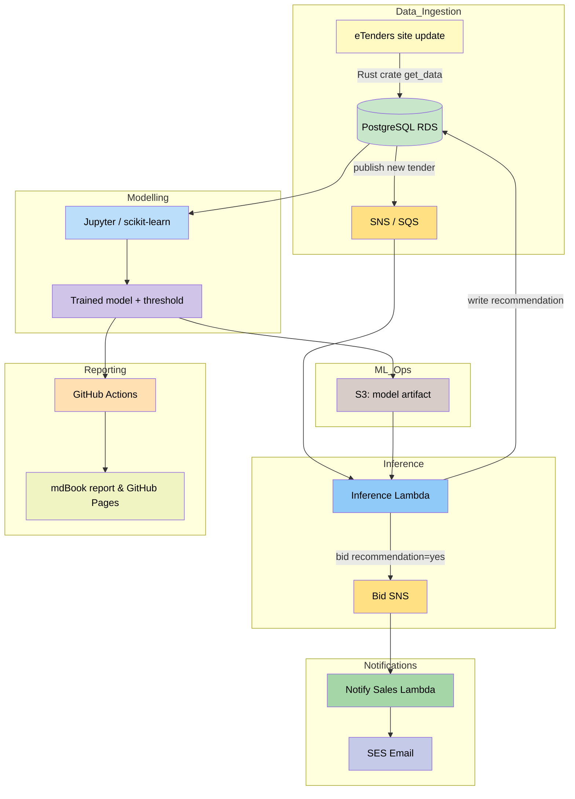

##### Model selection and methodologies

We're looking to make a decision ("bid on this or not?") so it seemed immediately obvious to start our investigation using a decision tree. However, there's a fundamental issue with that assumption because our main piece of data on which to answer this bid/no-bid question is the tender title, which is all text. Additionally our data is highly weighted towards 'no-bid' as an outcome which makes using decision trees problematic. (Otten, 2024)

Think of it this way, the text field is going to be turned into a large list of numbers with one dimension per possible word, most of which aren't useful so end up being zero.

In a decision tree every split asks about the value of a word but we're doing this on very sparse data where there's far more "mostly zero" features that don't impact on whether a tender should be considered a bid opportunity. This means that if a word appears only once it easily lets the tree recognise a single record. Additionally it will perform very well on data it's already seen but badly on new records and it won't know what to do with tender titles that contain words it hasn't seen before.

With this in minde we need to look at what's better at least for this type of data. We still have only two possible outcomes and linear regression can also cope with this as well as being better dealing with the short text strings we have in our 'tender title' field.

If we use a Logistic (linear) Regression instead, every text feature is treated independently and there's no branching that the model might memorise. Also, having a lot of 'non-interesting' words doesn't have a massive impact as well as being better able to handle words it's not seen before. You get enough of a signal from words it does know about as opposed to a decision tree where if something doesn't appear in a tree 'branch' it fails to generate a score at all. This approach copes a lot better with previously unseen titles.

We will see this tendency for decision trees to over-fit in the analysis later.

## K7: [Pass] Reviews the roles, functions and activities relevant to technology solutions within an organisation

### Evidence

##### How AI and ML integration impacts organisational change

As with any new technology a huge factor associated with it's introduction is trust.

Primarily, can users rely on what they're being told? Can we assemble a body of evidence in the training of tools like this to prove it will work as intended, save on 'drudge' filtering work and not negatively impact the business?

There are many instances where software has been used as a smokescreen for dodging accountability, the Post Office scandal (Lehrer, 2024) being the most egregious recent example. 

Adding AI increases the temptation to simply offload governance entirely to a "black box". Consumers are already abdicating responsibility for major life decisions to AI (‌Dupré, 2025) sometimes very much to their own detriment. Businesses may end up being no different if ethics aren't adhered to.

To address these issues we can take some concrete steps: -

* Making sure that the ML model's workings are explained simply (see Appendix for links to Jupyter Notebooks).

* Appointing an Owner specifically responsible for the behaviour of the AI/ML aspect of the solution. 

* Adding feedback loops and an update schedule so that, even after it's deployed, it can be re-trained and upgraded. 

##### Scope and Objectives
The report outlines the various approaches to this problem from an ML/AI point of view, including possible training methods and models, data cleaning steps and most importantly whether the solution achieves is business objectives.

Up-front let's say we need to get a fairly high degree of accuracy but not at the expense of missing out possible multi-million euro tender opportunities. We need to keep an eye on the false negative rate while saving the cost of manual effort to filter out tenders we're not interested in.

##### Projected Benefits 
Having ML and AI provide a 'first look' screening of tenders will save Sales teams time spent on initial screening which translates into focussing only on relevant bids and having more signal & less noise should reduce the chance of missing any opportunities. 

#### Team Collaboration and Communication plan

##### Collaboration
Modern software development now sits on top of a whole tool chain to surface work, encourage transparency and foster communication. In this type of project we'd keep all the code in source control (Git), all the tasks in Jira and run a daily agile-type stand-up to share progress or air any blockers. 

There's usually a chat app like Slack or Teams for quick threads to tackle particular issues or problems.

Outside the feature development being carried out by developers there would be a Team Lead, nominally set with tasking individuals with work as well as acting as an arbiter on technical direction. Possibly there would be a Software Architect fulfilling this role but if it's a smaller project this might be unnecessary. 

The Team Lead would also likely interface to the Project Manager who would have overall responsibility for reporting outwards as to the state of the development, especially in relation to time to completion. Their role involves understanding the true state of the project and communicating this to stake-holders. Expectation management is key here, especially if something un-expected comes up and there _might_ be a possible delay. 

You could easily use dashboards to broadcast the current project state, identify key milestones and plot progress along a gantt chart (see below)

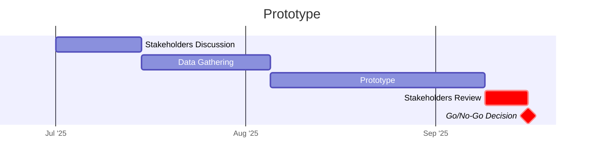

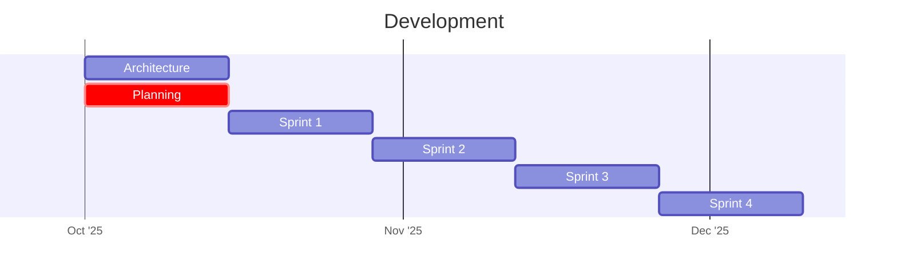

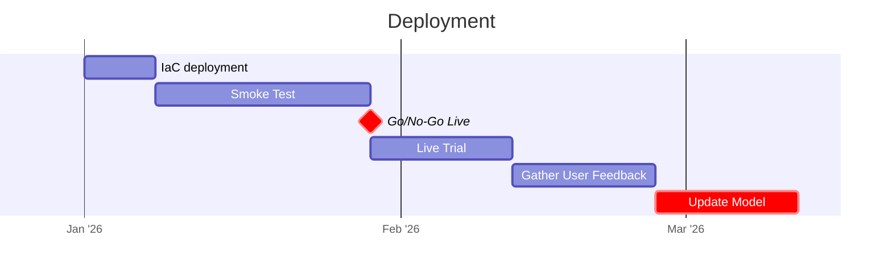

There are stage gates following prototype delivery and after the model has been deployed (smoke test) for a number of weeks. This first gate gives stakeholders the opportunity to see how the application would work in theory. The second gate is for developers to check that the solution actually works in practice before 'go-live'. 

Then, once it's been running for two to four weeks updates can be made based on live data and user feedback. Maybe there's some part of the performance that needs tweaking?

##### Sharing Best Practices
From my experience within Version 1 the primary way that best practices are shared is via 'lunch and learn' sessions. It's always challenging to pull people's attention from client work so recorded sessions make the information more accessible. 

Keeping these up-to-date might mean creating your own internal news letter, blog or wiki that updates the same topic when new or better ways of doing things come to light. Making this content public also massively boosts the organisations visibility and credibility in the wider world.

## K13: [Pass] Demonstrates the use of core technical concepts for digital and technology solutions, including: applies the principles of data analysis for digital and technology solutions

### Evidence

##### Data Ingestion, Investigation and Prep

Each record consists of the following:-

**tender records** table
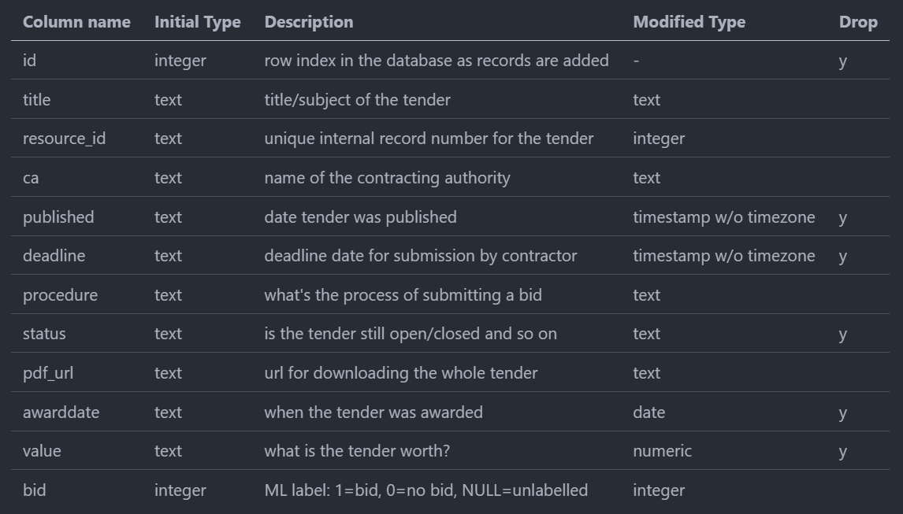

All this has been pulled into PostgreSQL database for easy manipulation. We'll 'drop' all the date columns as they're irrelevant to our question.

Then we can go through each column and decide whether it needs further attention.

###### Labelling the 'bid' column for Supervised learning

To train a supervised learning model on this data we've had to manually label 2000+ records with bid (1) or no bid (0), which took around 2 hours.

###### Data Manipulation/Cleanup

#### id
This can be removed since `resource_id` is unique, we don't need another id. 

###### title
This is the key field we're looking at training the model on to predict whether we should bid (1) or not (0). Happily EVERY record has a title field so we don't have to deal with null data in this case. 

###### contracting authority (ca)
CA has a finite number of possibilities so we're going to one-hot encode this.

###### procedure
Procedure has a finite number of possibilities so we're going to one-hot encode this.

###### pdf_url
Not relevant so can be removed from the training data. We could _maybe_ turn this into a data point but this is problematic as 25% of tenders don't have a PDF attached to them.

###### value
Again nearly 50% of records don't have a value and making any assumptions about these (filling in values, adding a mean) would likely only introduce innacuracies. Conversely there might be multi-million pound values hidded in the PDF content. So with this in mind we can't rely on value as a feature of the tender data for ML training. 

## K19: [Pass] Applies relevant legal, ethical, social and professional standards to digital and technology solutions considering both technical and non-technical audiences and in line with organisational guidelines

### Evidence

##### Ethical Considerations

Training ML models should pay attention to local laws & statutes (i.e. GDPR), ensure the data is used in an ethical way and aim for transparency when it comes to any decisions that are underpinned by any sort of AI or ML training process.

Version 1 also has a AI Governance framework (Transforming AI Governance, 2025) that goes through a number of discovery steps to ensure directives around AI are adhered to, maintain compliance and ensure any ethical and social implications are made clear to all parties involved.

##### Regulatory Compliance

Version 1 (V1) is already signed up to access the eTenders data and respond so there is no part of the proposed usage that prohibits it's use, other than onward transmission to third parties. 

That said, for this to be more than a proof of concept/demo it would be appropriate to obtain permission from the Office of Government Procurement (OGP) to do anything further. At this stage everything is being used for learning and study, not commercial application.

However, with this in mind, it's already been proposed internally within V1 to respond to the OGP's question about how AI/ML might help them manage the tender process, increase transparency and modernise how they publish tenders by sharing this project/proof of concept with them. 

## K24: [Pass] Describes how to interpret and implement a design, compliant with functional, non-functional and security requirements

### Evidence

###### Requirements Gathering
Stakeholders, in this case Version 1's Sales Team for Ireland, would clearly love to avoid trawling through un-related tenders of no interest to an IT consultancy. However, there is a significant opportunity cost to missing relevant tenders. This translates into a solid requirement where we're trying to reduce workload BUT not at the expense of a huge false negative rate where the model elects to mark a tender as 'no-bid' when it might be hugely valuable. 

##### Scope and Objectives
The report outlines the various approaches to this problem from an ML/AI point of view, including possible training methods and models, data cleaning steps and most importantly whether the solution achieves is business objectives.

Up-front let's say we need to get a fairly high degree of accuracy but not at the expense of missing out possible multi-million euro tender opportunities. We need to keep an eye on the false negative rate while saving the cost of manual effort to filter out tenders we're not interested in.

## S4: [Pass] Demonstrates the use of core technical concepts for digital and technology solutions, including: initiate, design, code, test and debug a software component for a digital and technology solution

### Evidence

###### Development
Following architectural design and planning this phase runs in 2 week sprints to fulfill user stories that deliver incremental value. This ensures that if any blockers do arise they're identified early and don't derail the entire project in the last weeks. 

A key section in here is testing that 'all' tender records can be ingested, and making sure there are schema checks around data ingestion. As we're using Rust for a lot of the data pipeline it's type and compiler checking add a lot of value here.

###### Deployment
Before official 'go-live' everything runs in the cloud environment as a 'smoke test' but the results are private and highly scrutinised by the development team. Once they're happy a go/no-go decision can be made in consultation with the stakeholders, based on the results from running the ML model and reviewing the tenders it's suggesting, as well as those it's rejected. 

We can extend the automation already used in the prototyping phase to actually deploy the production components, update the ML model, update various Lambda functions and add functionality like informing the sales team that a bid should be looked at. 

After the deployment is live we might find users have feedback or there might be updates needed to deal with unforseen issues. Since the deployment pipeline is now automated this shouldn't prove too challenging.

#### Appendix

There's a large GitHub repo with many moving parts associated with this project.

module_2 repo
* https://github.com/robertsweetman/module_2
* Repository for all the code used in this project
  * aws_backend_bootstrap
    * set up S3 backend state bucket for terraform
  * aws_deploy_infrastructure 
    * deploy all AWS resources using infrastructure as code
  * crates - rust based AWS Lambda code for actually running the pipeline
    * get_data
      * get the etenders data
      * format it correctly with the correct types
      * store content in an AWS RDS PostgreSQL database
      * if there's a PDF for the tender, get that as well
      * if there's a PDF, count how many IT related codes there are in the PDF text
      * record the text, number of codes and what they are if there is a PDF, add these to the PostgreSQL database
    * pdf_processing (see note 1)
    * postgres_dataload (see note 1)
  * mc-server
    * wrote a (minimally functional) MCP server to show other ways that data in the AWS RDS Postgresql db could be queried
  * mdbook 
    * source for PDF creation for the submission
      * also hosts the content on https://robertsweetman.github.io/module_2/
  * python 
    * db_utils.py make the database content available as a dataframe
    * etenders.ipynb - see below

##### etenders.ipynb 
* https://github.com/robertsweetman/module_2/blob/main/python/etenders.ipynb
* Initial investigative ML model workbook, sets out all the learning and discovery steps as well as model validation & hyper-parameter tuning

##### decision_tree_model.ipynb
* https://github.com/robertsweetman/module_2/blob/main/python/decision_tree_model.ipynb
* Looking at decision tree approach and why this won't work in this case, with diagrams/plots for proof

##### baseline_text_models.ipynb
* https://github.com/robertsweetman/module_2/blob/main/python/baseline_text_models.ipynb
* Checking out various text parameterization methods

##### hybrid_text_model_main.ipynb
* https://github.com/robertsweetman/module_2/blob/main/python/hybrid_text_model_main.ipynb
* Looking at hyper-parameter tuning on training data

##### tfidf_linearSVM.ipynb
* https://github.com/robertsweetman/module_2/blob/main/python/tfidf_linearSVM.ipynb
* Final model selection and validation, using TF-IDF vectorization and linear SVM classifier

##### tfidf_linearSVM_pdf_content.ipynb
* https://github.com/robertsweetman/module_2/blob/main/python/tfidf_linearSVM_pdf_content.ipynb
* Adding more content from the tenders with PDF's to enhance the conclusion

##### comparison.ipynb
* https://github.com/robertsweetman/module_2/blob/main/python/comparison.ipynb
* Comparing the tfidf_linearSVM training with adding the PDF content

##### codes.txt
* https://github.com/robertsweetman/module_2/blob/main/codes.txt
* tender codes that we, as a consultancy are interested in.

**Note 1**: postgres_dataload and pdf_processing Lambda functions were an attempt to use AWS Simple Queue Service (SQS) to asynchronously handle the 'pdf_processing' part of the data ingest pipeline. The idea being that we could add other POST(s) to the queue for a different lambda to process and keep the separation of concerns whereby one Lambda function executes one task. 

However, running out of time this was abandoned as an approach as it wasn't possible to properly test whether ALL pdf_processing requests were being handled correctly when pulled from SQS. Ideally this would be the way to do things and should be the goal, with a bit more experience of queueing systems!

## S7: [Pass] Explains how teams work effectively to produce a digital and technology solution applying relevant organisational theories using up to date awareness of trends and innovations

### Evidence

#### Team Collaboration and Communication plan

##### Collaboration
Modern software development now sits on top of a whole tool chain to surface work, encourage transparency and foster communication. In this type of project we'd keep all the code in source control (Git), all the tasks in Jira and run a daily agile-type stand-up to share progress or air any blockers. 

There's usually a chat app like Slack or Teams for quick threads to tackle particular issues or problems.

Outside the feature development being carried out by developers there would be a Team Lead, nominally set with tasking individuals with work as well as acting as an arbiter on technical direction. Possibly there would be a Software Architect fulfilling this role but if it's a smaller project this might be unnecessary. 

The Team Lead would also likely interface to the Project Manager who would have overall responsibility for reporting outwards as to the state of the development, especially in relation to time to completion. Their role involves understanding the true state of the project and communicating this to stake-holders. Expectation management is key here, especially if something un-expected comes up and there _might_ be a possible delay. 

You could easily use dashboards to broadcast the current project state, identify key milestones and plot progress along a gantt chart (see below)

There are stage gates following prototype delivery and after the model has been deployed (smoke test) for a number of weeks. This first gate gives stakeholders the opportunity to see how the application would work in theory. The second gate is for developers to check that the solution actually works in practice before 'go-live'. 

Then, once it's been running for two to four weeks updates can be made based on live data and user feedback. Maybe there's some part of the performance that needs tweaking?

##### Sharing Best Practices
From my experience within Version 1 the primary way that best practices are shared is via 'lunch and learn' sessions. It's always challenging to pull people's attention from client work so recorded sessions make the information more accessible. 

Keeping these up-to-date might mean creating your own internal news letter, blog or wiki that updates the same topic when new or better ways of doing things come to light. Making this content public also massively boosts the organisations visibility and credibility in the wider world.

## S10: [Pass] Demonstrates the use of core technical concepts for digital and technology solutions, including: initiates, designs, implements and debugs a data product for a digital and technology solution

### Evidence

##### Decision Tree
Remember from [Model Selection and Methodologies](./3_developing_ai_and_ml_apps.html#model-selection-and-methodologies) that we don't believe Decision Trees will actually work well. Can we show this? 

Refer to [decision_tree_model.ipynb](https://github.com/robertsweetman/module_2/blob/main/python/decision_tree_model.ipynb) preview view for the code. 

Here's what we get initially...

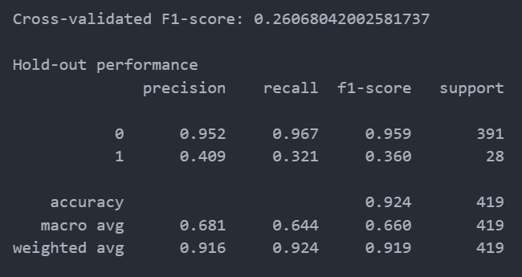

This approach really falls down when looking for bids. We're only hitting 41% of real bids (precision) and recall is also really low. So we can say the model is excellent at recognising 'no-bids' but it's missing two-thirds of real bids and miss-labelling many non-bids as bids (low f1-score).

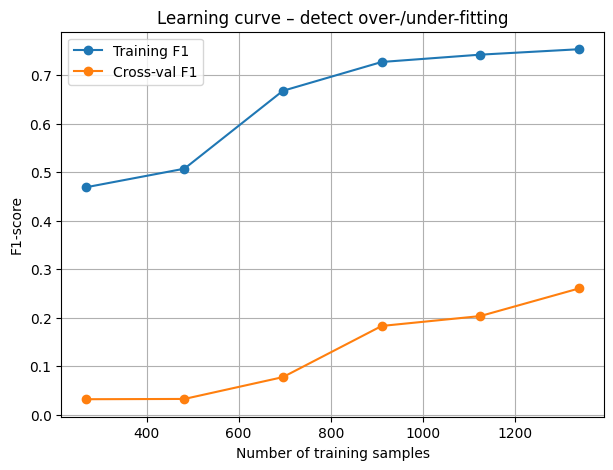

We can also show visually how this type of approach over-fits quite badly by plotting the learning curve. The model performs much better on data it's seen before (blue) than new data (orange). The curves don't converge and they should if the fit was good. 

Most importantly, even when you add more training data the gap doesn't close which indicates the model has learnt patterns based on that only, rather than a general pattern.

##### Final TFIDF + Linear SVM model

Refer to [tfidf_linearSVM.ipynb](https://github.com/robertsweetman/module_2/blob/main/python/tfidf_linearSVM.ipynb) for the code.

Let's take everything we've learned about our problem space and put it into play.

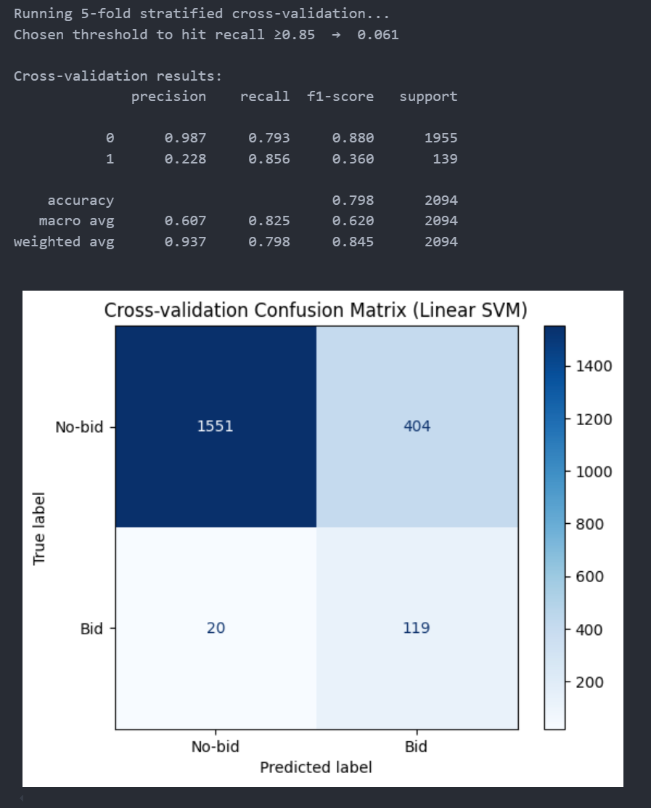

What we see is that we're now hitting few false negatives and have a high recall but to get this we've had to set our probability threshold very low indeed, meaning workers are still having to review 25% of bids, given the high false positive rate.

We can attempt to add a cost weighting to false negatives but at this threshold level that has zero impact. Changing the threshold directly impacts the decision boundary so we can impact false negatives that way BUT we've now got to a point where it's clear that the model needs more data. 

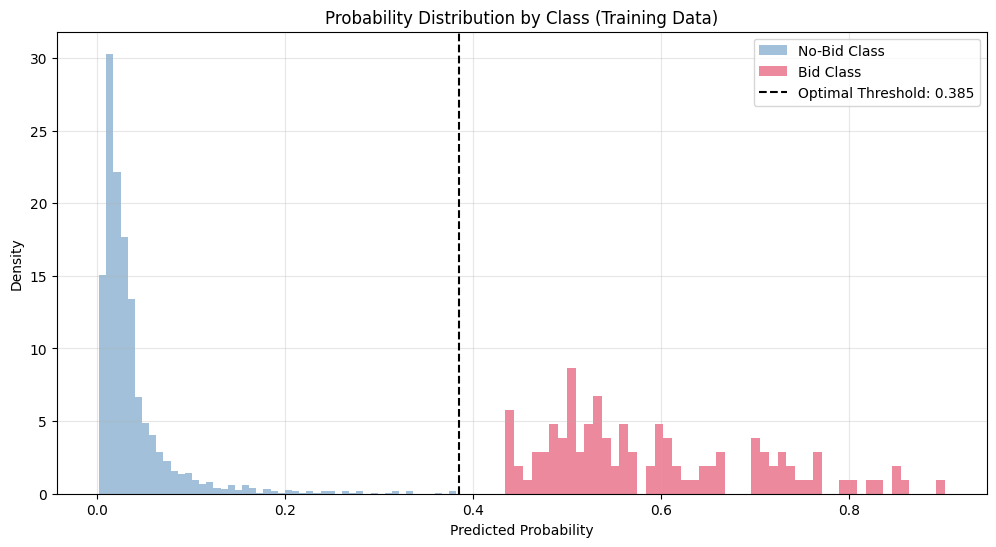

Around the 0.385 threshold there's nothing we can do to influence the model further. 

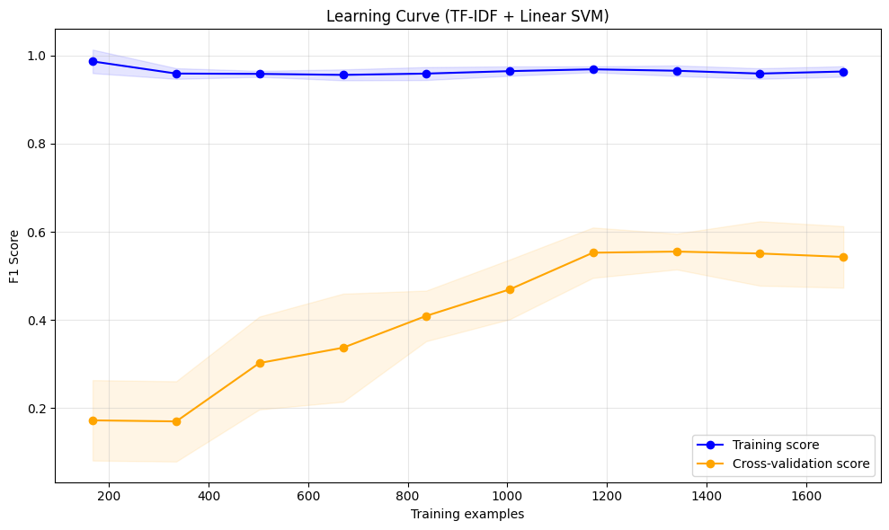

Since the scores are still a way away and haven't converged this also suggests we could do with more data... However, on the positive side it's not over or under-fitting like the Decistion Tree.

More on how to improve things in the [Recommendations and Conclusions](#recommendations-and-conclusions) section.

#### Recommendations and Conclusions

##### Model Summary

We made a good start trying to pick bid opportunites from the tender title only but this resulted in too many false negatives. 

We should manually review 25% of the tenders that don't have PDFs and add more context to the training process for the others by including the following additional data: 

* Tender codes from the PDF - via One Hot Encoding
  * We know, as a business, which tender codes we're interested in so there's a selection machanism here. (see appendix)
* A count of the number of codes we find in a PDF
* Additional amount of text from the PDF's
  * The "Lot 5.x.x" section of the PDF contains more details about the requirements

Then it's pretty simple to run a comparison. Refer to links to **tfidf_linearSVM_pdf_content.ipynb** and **comparison.ipynb** in the appendix for the code.

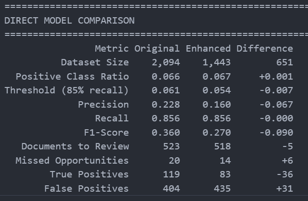

By enhancing the model we've reduced the number of missed opportunities by nearly a third. 

This does mean manually reviewing more bids but we've still cut that by 50% and are in a good place when it comes to false negatives.  

##### Conclusion

Recommend deploying this and re-running the training monthly to update it as new tenders are published.

##### Further Improvements and Ongoing Evaluation

At some point an additional step would be to cross reference the bid/tenders database with "actual bids won" as well. This could add another layer to the entire exercise whereby it might also be possible to further increase the accuracy of our tender submission scanning and (with enough wins) possibly predict, based on past successes, whether a new tender is likely something we might win also.

## S11: [Pass] Determine and use appropriate data analysis techniques. For example, Text, Statistical, Diagnostic or Predictive Analysis to assess a digital and technology solutions

### Evidence

##### Linear Regression Investigation

Refer to [etenders.ipynb](https://github.com/robertsweetman/module_2/blob/main/python/etenders.ipynb) preview for the code.

After we've pulled in the data to create a dataframe using a helper script it's worth taking some time to look at the data including words that push the model to 'bid' or 'no-bid'

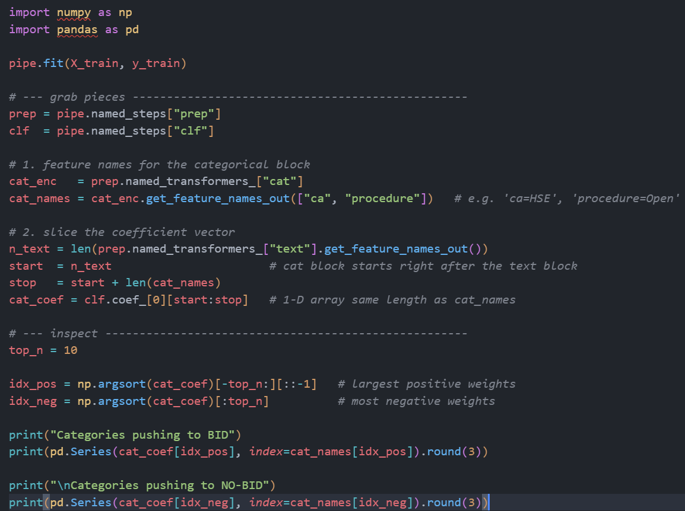

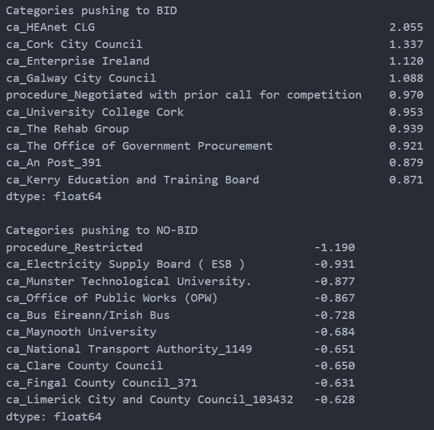

We're looking at text, categorical values and numeric fields. It might also be interesting to see if the numeric field ('has-pdf') is adding any value here at all.

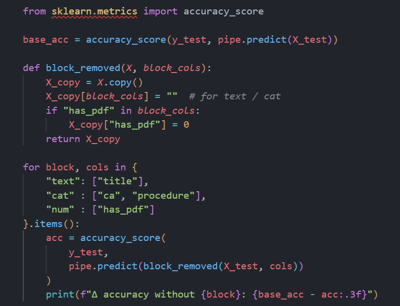

* accuracy without text: -0.017
* accuracy without cat: -0.031
* accuracy without num: -0.007

Looks like we can basically remove the 'has_pdf' column from the data.

We can also look at what individual categories most impact or detract from a tender being market as a bid.

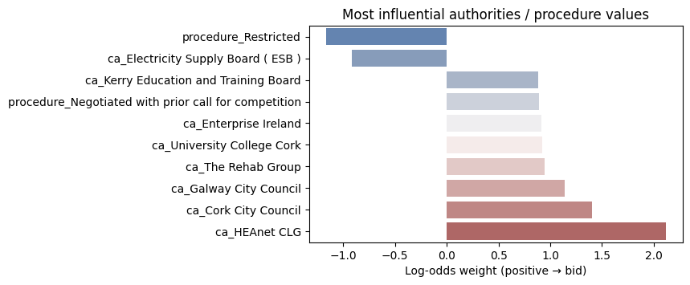

However, once we start looking at the outcomes (via a confusion matrix) we begin running into the issue with the title data as the starting point and our goal of reducing false positives and the overall 'filtering' workload.

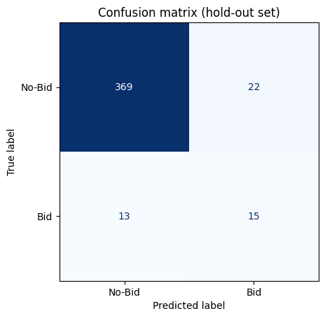

With a default threshold of 50% we're getting 13 Bids labelled as No-Bid i.e. a pretty high false-negative rate. Since a false negative might be worth a few million Euros this doesn't justify saving someone time doing the filtering because at this point that saving doesn't equate to the missed opportunities value...

##### Do tokenizer choices have a big impact?
As an exercise I decided to look at whether tokenizer choices made an impact on this problem.

Refer to [baseline_text_models.ipynb](https://github.com/robertsweetman/module_2/blob/main/python/baseline_text_models.ipynb) for the code.

Just off the bat we can rule out TF-IDF + LogReg and Hashing + Log reg on the basis of the huge number of false positives which would waste our sales people's time.

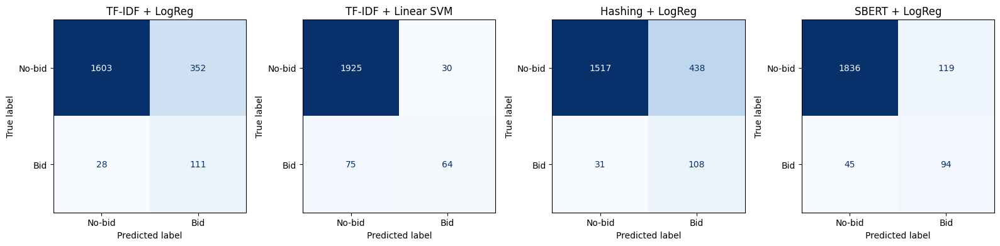

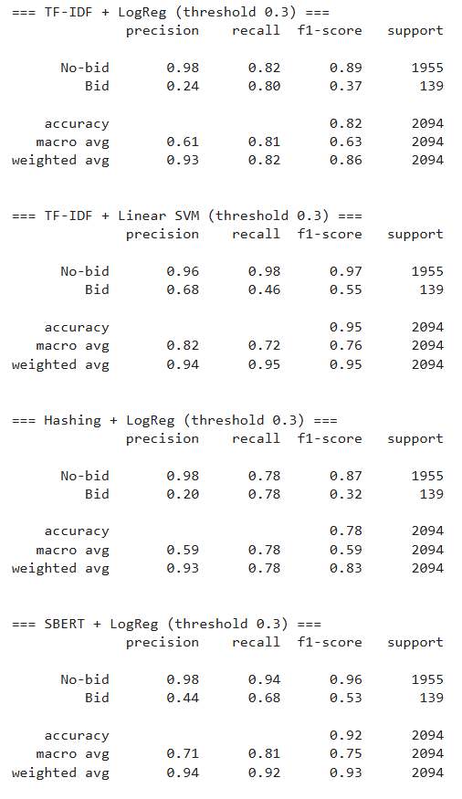

TFIDF + Linear SVM looks like the best overall candidate as while the false negative rate on the confusion matrix is higher than with SBERT + LogReg the false positive (time-wasting) number starts far lower. TFIDF + Linear SVM also has a higher `Bid Precision` F1 score.

##### Final TFIDF + Linear SVM model

Refer to [tfidf_linearSVM.ipynb](https://github.com/robertsweetman/module_2/blob/main/python/tfidf_linearSVM.ipynb) for the code.

Let's take everything we've learned about our problem space and put it into play.

What we see is that we're now hitting few false negatives and have a high recall but to get this we've had to set our probability threshold very low indeed, meaning workers are still having to review 25% of bids, given the high false positive rate.

We can attempt to add a cost weighting to false negatives but at this threshold level that has zero impact. Changing the threshold directly impacts the decision boundary so we can impact false negatives that way BUT we've now got to a point where it's clear that the model needs more data. 

Around the 0.385 threshold there's nothing we can do to influence the model further. 

Since the scores are still a way away and haven't converged this also suggests we could do with more data... However, on the positive side it's not over or under-fitting like the Decistion Tree.

More on how to improve things in the [Recommendations and Conclusions](#recommendations-and-conclusions) section.

## S15: [Pass] Applies relevant legal, ethical, social and professional standards to digital and technology solutions considering both technical and non-technical audiences and in line with organisational guidelines

### Evidence

##### Ethical Considerations

Training ML models should pay attention to local laws & statutes (i.e. GDPR), ensure the data is used in an ethical way and aim for transparency when it comes to any decisions that are underpinned by any sort of AI or ML training process.

Version 1 also has a AI Governance framework (Transforming AI Governance, 2025) that goes through a number of discovery steps to ensure directives around AI are adhered to, maintain compliance and ensure any ethical and social implications are made clear to all parties involved.

##### Regulatory Compliance

Version 1 (V1) is already signed up to access the eTenders data and respond so there is no part of the proposed usage that prohibits it's use, other than onward transmission to third parties. 

That said, for this to be more than a proof of concept/demo it would be appropriate to obtain permission from the Office of Government Procurement (OGP) to do anything further. At this stage everything is being used for learning and study, not commercial application.

However, with this in mind, it's already been proposed internally within V1 to respond to the OGP's question about how AI/ML might help them manage the tender process, increase transparency and modernise how they publish tenders by sharing this project/proof of concept with them. 

## B2: [Pass] Applies relevant legal, ethical, social and professional standards to digital and technology solutions considering both technical and non-technical audiences and in line with organisational guidelines

### Evidence

##### How AI and ML integration impacts organisational change

As with any new technology a huge factor associated with it's introduction is trust.

Primarily, can users rely on what they're being told? Can we assemble a body of evidence in the training of tools like this to prove it will work as intended, save on 'drudge' filtering work and not negatively impact the business?

There are many instances where software has been used as a smokescreen for dodging accountability, the Post Office scandal (Lehrer, 2024) being the most egregious recent example. 

Adding AI increases the temptation to simply offload governance entirely to a "black box". Consumers are already abdicating responsibility for major life decisions to AI (‌Dupré, 2025) sometimes very much to their own detriment. Businesses may end up being no different if ethics aren't adhered to.

To address these issues we can take some concrete steps: -

* Making sure that the ML model's workings are explained simply (see Appendix for links to Jupyter Notebooks).

* Appointing an Owner specifically responsible for the behaviour of the AI/ML aspect of the solution. 

* Adding feedback loops and an update schedule so that, even after it's deployed, it can be re-trained and upgraded. 

##### Scope and Objectives
The report outlines the various approaches to this problem from an ML/AI point of view, including possible training methods and models, data cleaning steps and most importantly whether the solution achieves is business objectives.

Up-front let's say we need to get a fairly high degree of accuracy but not at the expense of missing out possible multi-million euro tender opportunities. We need to keep an eye on the false negative rate while saving the cost of manual effort to filter out tenders we're not interested in.

##### Projected Benefits 
Having ML and AI provide a 'first look' screening of tenders will save Sales teams time spent on initial screening which translates into focussing only on relevant bids and having more signal & less noise should reduce the chance of missing any opportunities. 

##### Ethical Considerations

Training ML models should pay attention to local laws & statutes (i.e. GDPR), ensure the data is used in an ethical way and aim for transparency when it comes to any decisions that are underpinned by any sort of AI or ML training process.

Version 1 also has a AI Governance framework (Transforming AI Governance, 2025) that goes through a number of discovery steps to ensure directives around AI are adhered to, maintain compliance and ensure any ethical and social implications are made clear to all parties involved.

##### Regulatory Compliance

Version 1 (V1) is already signed up to access the eTenders data and respond so there is no part of the proposed usage that prohibits it's use, other than onward transmission to third parties. 

That said, for this to be more than a proof of concept/demo it would be appropriate to obtain permission from the Office of Government Procurement (OGP) to do anything further. At this stage everything is being used for learning and study, not commercial application.

However, with this in mind, it's already been proposed internally within V1 to respond to the OGP's question about how AI/ML might help them manage the tender process, increase transparency and modernise how they publish tenders by sharing this project/proof of concept with them. 

#### References

Transforming AI Governance into a strategic advantage In partnership with Credo AI. (n.d.). Available at: https://www.version1.com/wp-content/uploads/2025/07/AI-governance-datasheet.pdf [Accessed 5 Jul. 2025].

‌Dupré, M.H. (2025). People Are Being Involuntarily Committed, Jailed After Spiraling Into ‘ChatGPT Psychosis’. [online] Futurism. Available at: https://futurism.com/commitment-jail-chatgpt-psychosis.

Lehur, C. (2024). Software failure: UK Post Office’s Misplaced Technology Trust. [online] Vaultinum. Available at: https://vaultinum.com/blog/software-failure-uk-post-office#The_human_cost_of_blind_technology_trust [Accessed 29 Jun. 2025].

Loige.co. (2023). Why you should consider Rust for your Lambdas. [online] Available at: https://loige.co/why-you-should-consider-rust-for-your-lambdas/ [Accessed 7 Jul. 2025].

‌‌Otten, N.V. and Otten, N.V. (2024). Decision Trees In ML Complete Guide [How To Tutorial, Examples, 5 Types & Alternatives]. [online] Spot Intelligence. Available at: https://spotintelligence.com/2024/05/22/decision-trees-in-ml/#Advantages_and_Disadvantages_of_Decision_Trees.

‌

‌

## B6: [Pass] Explains how teams work effectively to produce a digital and technology solution applying relevant organisational theories using up to date awareness of trends and innovations

### Evidence

#### Team Collaboration and Communication plan

##### Collaboration
Modern software development now sits on top of a whole tool chain to surface work, encourage transparency and foster communication. In this type of project we'd keep all the code in source control (Git), all the tasks in Jira and run a daily agile-type stand-up to share progress or air any blockers. 

There's usually a chat app like Slack or Teams for quick threads to tackle particular issues or problems.

Outside the feature development being carried out by developers there would be a Team Lead, nominally set with tasking individuals with work as well as acting as an arbiter on technical direction. Possibly there would be a Software Architect fulfilling this role but if it's a smaller project this might be unnecessary. 

The Team Lead would also likely interface to the Project Manager who would have overall responsibility for reporting outwards as to the state of the development, especially in relation to time to completion. Their role involves understanding the true state of the project and communicating this to stake-holders. Expectation management is key here, especially if something un-expected comes up and there _might_ be a possible delay. 

You could easily use dashboards to broadcast the current project state, identify key milestones and plot progress along a gantt chart (see below)

There are stage gates following prototype delivery and after the model has been deployed (smoke test) for a number of weeks. This first gate gives stakeholders the opportunity to see how the application would work in theory. The second gate is for developers to check that the solution actually works in practice before 'go-live'. 

Then, once it's been running for two to four weeks updates can be made based on live data and user feedback. Maybe there's some part of the performance that needs tweaking?

##### Sharing Best Practices
From my experience within Version 1 the primary way that best practices are shared is via 'lunch and learn' sessions. It's always challenging to pull people's attention from client work so recorded sessions make the information more accessible. 

Keeping these up-to-date might mean creating your own internal news letter, blog or wiki that updates the same topic when new or better ways of doing things come to light. Making this content public also massively boosts the organisations visibility and credibility in the wider world.
