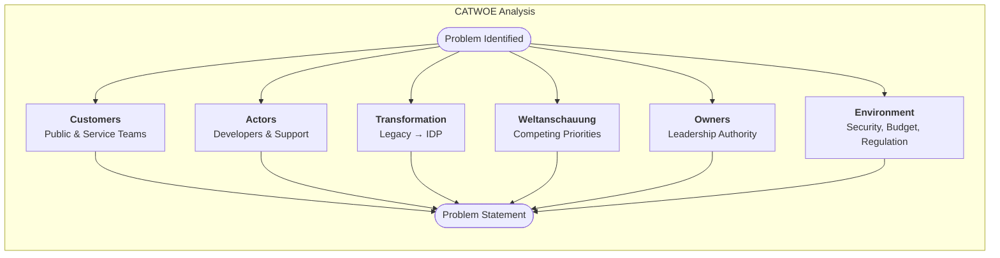
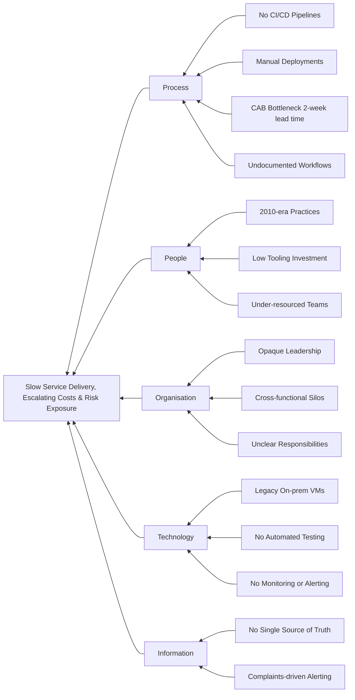
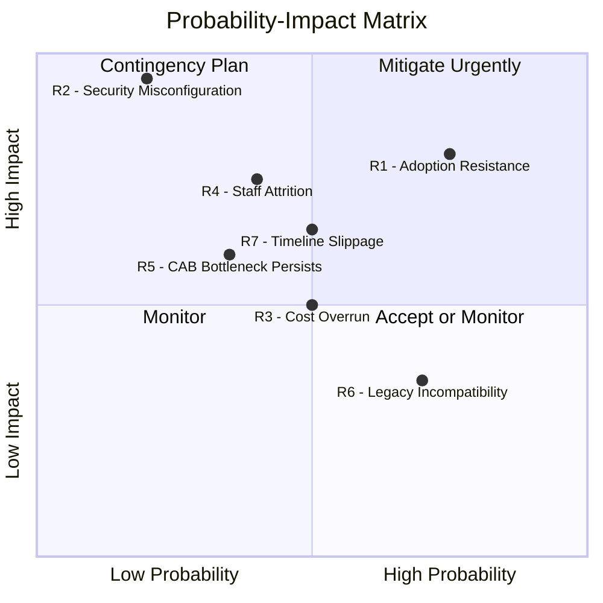
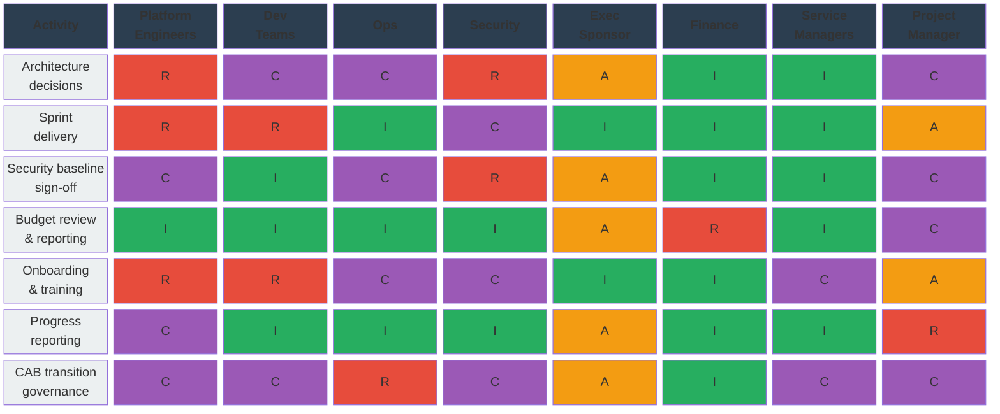

# Project 5 - Managing Software Transformation Projects

## Context
#### Business Case <!-- 850 words: Root Cause Analysis ~450 + Solution & Goal ~400 -->

The client engagement is based on modernising council service delivery to the public.

The council recognises that legacy systems cannot be supported indefinitely and outdated software delivery processes are hampering service delivery and innovation.  

## S23: [Pass] Describes how they extend and update software development knowledge with evidence from professional and academic sources by undertaking appropriate research to inform best practice and lead improvements in the organisation
### Evidence

#### Business Case <!-- 850 words: Root Cause Analysis ~450 + Solution & Goal ~400 -->

The client engagement is based on modernising council service delivery to the public.

The council recognises that legacy systems cannot be supported indefinitely and outdated software delivery processes are hampering service delivery and innovation.  

##### Root Cause Analysis

There are many ways to analyse an organisation's state (Phillips, 2026) but not all are applicable here.

SWOT addresses strengths and weaknesses but doesn't handle conflicting perspectives. PESTLE focuses on external inputs whereas this is an internal transformation. Porter's Five Forces and SC Analysis assume a competitive marketplace.

CATWOE (Customers, Actors, Transformation, Worldview, Owners and Environment) is geared towards "messy" problems (Umbrex 2026) in public bodies where stakeholders hold competing priorities.

CATWOE seeks to surface various stakeholders assumptions amid changing political, budgetary, technical and service delivery constraints.

<!-- 
Table Section: Root Cause Analysis (~450 words)
Problem Analysis, Business Transformation types, and Internal/External factors

This section should: 
 
●  Illustrate the context. 
●  State and discuss the problem. 
●  Include a problem statement that clearly defines the scope and focus of the business problem you will investigate.
●  Analyze business transformation types relevant to the problem.
●  Identify internal and external factors affecting the organization.
-->

###### Problem Analysis & Problem Statement

Applying the CATWOE framework, the transformation can be defined as moving from a set of legacy services to a platform that empowers faster service delivery, increases security and maintains trust in the organisation.

Stakeholders perceptions are based on their Worldview, the W in CATWOE.

For example, Developers see the issues in terms of technical debt, manual deployment processes and their challenges in supporting legacy software.

Executives and Finance team members look through a lens of cost and sustainability as well as needing to react quickly to changing governmental policy.

Service managers would prioritise customer experience, ease of service support and the security concerns that come with running something that's public facing.

Considering all of these perspectives results in the following problem statement:

> *The council's current software development practices are insufficiently standardised, poorly governed and difficult to secure, resulting in slow service delivery, escalating costs and exposure to risk.*

###### Business Transformation Types

The T (Transformation) in CATWOE is driven by Development Process Improvements nested inside a wider Software Transformation Process. The first includes things like adopting CI/CD, automated testing and standardised environments on which the transformation process depends.

In the book "Accelerate" (Forsgren, Humble and Kim, 2018) the authors show how mastering the fundamentals of automating deployments is a pre-requisite for transforming software delivery and then business outcomes. The continuous feedback loop which DevOps enables avoids what Humble and Farley (2011) term "integration hell" where change freeze periods are required to stabilise the environment after new software is deployed.

A foundational research discovery of the early DevOps papers (Dora.dev, 2021) was that Development teams return better business outcomes if they improve the following metrics:

* Change Lead Time - how fast does a change move from code check in to prod?
* Deployment Frequency - how often are changes deployed to production?
* Failed Deployment Recovery Time - if something does fail, for how long?
* Change Fail Rate - if a change is made, how often is it rolled back?
* Deployment Rework Rate - ratio of deployments that happen because of some unplanned issue in production

A useful way to summarise these points would be that as friction preventing the deployment of software reduces, the Development Process improves which inevitably accelerates Software Transformation, regardless of exactly what type it is.

<!-- 

Development Process Improvement	

- Development process improvement refers to changes in how software is planned, developed, tested, and deployed. This includes adopting new methodologies (like Agile or DevOps), implementing CI/CD pipelines, or improving quality assurance practices.

Software Transformation Process	

- Specifically focuses on changes or upgrades made to an organisation's software systems, applications, development processes, and technical infrastructure. This could involve modernising legacy systems, implementing new development methodologies, or adopting cloud-native architectures.
-->

###### Internal Factors

The analysis here is all about who is impacted inside the organisation (Actors) versus those with authority over its direction (Owners).

Developers & Support staff function as Actors subject to the competing priorities of the Owner class who are focussed on topics like budgets, political deadlines and internal politics.

###### Adopting Best Practice

Developers might aim to implement best practice but can only do so within the constraints set by *owners*. If owners insist on an unrealistic timeline to meet a political promise this might risk introducing technical debt or security issues.

At some point one or both sides must compromise or deal with their own disappointment. It's important these dynamics and challenges are discussed within the organisation in an open and transparent manner.

###### External Factors

The E (Environment) and C (Customers) part of CATWOE are both external factors.

###### Security

Security is a key external factor driving the adoption of a standard set of practices, development environments, deployment pipelines and other tools.

"Highly Significant" cyber attacks rose by 50% in 2025 (Booth, 2025) alongside the ramping up of malicious activity by criminals and even nation-state actors.

Loss of confidence in the organisation should it become compromised impacts (Customer) trust and damages internal morale as well.

###### Finances

Government finances with respect to IT projects have not been well managed historically.

Most recently the National Savings & Investment (NS&I) transformation program is already £1.3 billion over budget and four years late (Clark, 2026)

Taking steps within the STP to surface the costs of implementing and managing the various services must be part of the transformation project.

###### Customers

Ultimately, if voters receive a sub-par service, council staff will receive negative feedback and there could be wider political fallout.

The public expect the same level of digital (self) service that they would get from an Amazon or any commercial organisation (Gov.UK, 2025)

##### Solution & Goal

We propose adopting Platform Engineering practices through the deployment of an Internal Developer Platform (IDP).

Platform Engineering, according to juliakm (2023), is "a practice built up from DevOps principles that seeks to improve each development team's security, compliance, costs, and time-to-business value through improved developer experiences and self-service within a secure, governed framework. It's both product-based mindset shift and a set of tools and systems to support it."

<!--
Solution Consideration, SMART Goal Statement, and Justification

This section should:
●  Argue why the transformation solution is needed.  
●  Demonstrate the impact it could have on the organization.
●  Create a core goal (SMART Goal Statement) for the project.
●  Provide justification for the chosen solution.
-->

###### Solution Consideration

We have to balance the competing forces highlighted by the various CATWOE elements, keep their disparate requirements in mind and report on progress across all of these axes.

###### Figure 1: Shows how the CATWOE framework pulls the individual narratives into a Smart Goal

###### SMART Goal Statement

**Goal:** Within 12 months of start, enroll three project teams into the IDP, reduce change lead time by 50% using repeatable deployment pipelines and baseline their performance against the DORA metrics.

###### Justification

An IDP becomes the vehicle each different stakeholder group can support, because it delivers what they're interested in at an individual level.

Reducing change lead time reduces delays which lowers the cost of making changes. Improving service delivery improves (external) customer satisfaction and increases public perception that the organisation is succeeding in serving their needs.

The entire council organisation will benefit because the organisational, process and technical changes needed to deliver an IDP mean that application modernisation, security and other internal/external concerns will be addressed.

<!--
RUBRIC C:
Shows foundational understanding with basic application of business analysis and project management principles.
Identifies and superficially analyses business problems, constructing a rudimentary business case.
Uses minimal research and references at least one organisational theory or best practice to illustrate effective teamwork in digital solutions.

RUBRIC B:
Clearly explains and effectively applies business analysis and project management principles in a systematic manner.
Analyses business problems with marked accuracy, developing a coherent business case informed by both professional and academic sources.
Demonstrates effective team collaboration strategies through an understanding of current practices.

RUBRIC A:
Strategically integrates business analysis and project management principles to address complex business challenges.
Critically analyses optimised solutions and a thorough business case.
Proposes ambitious organisational improvements with strategic planning to maximise team effectiveness and collaboration.
-->

#### Business Analysis Methodology <!-- 800 words -->

We've framed the problem using CATWOE to understand the competing stakeholders world views and inform a problem statement. DORA shows us what measurable success looks like against a software delivery maturity model which feeds into our SMART goal.

However, we still need to analyse the problem further and deliver the solution.

##### Analysis Models

<!--
Table Section: Analysis Models (~600 words)
POPIT Model and Fishbone Diagram analysis summaries

This section should:
●  Apply business analysis tools to understand the problem.
●  Use POPIT Model to analyze People, Organization, Process, Information, Technology.
●  Apply Fishbone Diagram to identify root causes.
●  Evaluate a range of potential tools and approaches, and justify your choice.
-->

###### POPIT Model

POPIT (People, Organisation, Process & Information Technology) decomposes the CATWOE perspective into operational dimensions. Interviews with staff and reviews against best practice uncovered the following.

###### Processes

Developers report poorly documented processes, inconsistent coding standards and absent CI/CD pipelines — largely because solutions were formerly delivered by third parties.

Application changes go through two process gates - DDA (Digital Design Authority) and then to the CAB (Change Advisory Board) however this effectively introduces a 2 week change lead time.

The CAB is a governance bottleneck, operating under the ITIL v3 framework (2007) which predates ITIL v4 (2019) advances such as DevOps, automated change approvals and decentralised decision-making (Williams, 2025).

Developers must create a document for DDA (takes 2-4 people a week) and then another one tailored towards risk and business justification for the CAB which pulls 10-20 people into a one hour meeting every week.

Developers argue that the CAB is operating under misconceptions (ManageEngine, n.d.) including:

> "all changes must go to the CAB and that changes can only be implemented if the CAB agrees".

###### Organisation

Based on my experience so far within the project the technical leadership structure is opaque and hard to navigate. It's not entirely clear who is responsible for what realm and finding out consists of asking team members who to talk to rather than being able to look it up.

Cross-functional issues surface slowly because communication channels are unclear and no-one is accountable for driving resolution.

###### People

The council culture associated with 'technical best practice' sits within the 2010-2019 era of segregated responsibilities and on-prem manual deployments.

Staff report wanting to excel but the necessary investment in tooling, support and training just hasn't materialised.

This further suggests that providing a platform (IDP) that follows best practices and security would support development team members to embrace newer ways of working. Introducing Agile, TDD and CI/CD as some of the foundations of iterative and faster service delivery (see DORA findings around high performing organisations: Forsgren, Humble and Kim, 2018) would certainly empower teams to feel more confident in their abilities.

###### Information and Technology

Currently services and applications live on virtual machines hosted on premise which are not properly monitored or maintained. This also hampers operational security because there is no single source of truth about the performance of applications that serve the public. Organisations should find out about service outages via customer complaints.

There are virtually no automated CI/CD (continuous improvement/continuous delivery) pipelines to support rapid change across the estate. This is another factor supporting the proposal to deliver an Internal Developer Platform that includes monitoring and automated testing as part of the feature set.

Automated pipelines promoting changes through dev, test and production environments enable confident releases and rapid rollback when issues arise.

<!-- 

Processes 
Are development processes well-documented?
Have coding standards and deployment procedures been clearly communicated?
Do teams follow consistent development workflows?
Are CI/CD pipelines properly configured and maintained?
Are there any technical workarounds being used that indicate process gaps?

Organisation
What is the technical leadership and governance structure?
Do development teams collaborate effectively across different technical domains?
Is there a clear technical strategy aligned with business goals?
Are technical roles and responsibilities clearly defined?

People 
Do developers and technical staff have the skills they need?
Are teams motivated and engaged with the technical direction?
Are technical stakeholders involved appropriately in system changes?
Do users understand how to effectively use the software systems?

Information and Technology 
Do systems provide the data and functionality needed for operations?
Do technical teams have access to proper monitoring and debugging information?
Are systems scalable, secure, and maintainable?
Do systems integrate effectively with each other?

-->

###### Fishbone Diagram Analysis

We can illustrate the causal factors behind the current state. The root causes (grouped by POPIT category) feed into the [problem statement](1_business_case.md#problem-analysis--problem-statement) established in Section 1: *slow service delivery, escalating costs and exposure to risk.*

###### Figure 2: Underlying causes of the current state

It should now be clear that a change in software development methodology, tooling and associated processes will address the problem.

##### Methodology

In some ways the SDLC decision has already been made since we're following the guide laid out by DORA research and Accelerate.

> Continuous delivery, lean management and a culture of experimentation drive performance.

The IDP is effectively a product that will enable the teams to improve the metrics which predict that the goal will be met. This suggests a flexible approach which can adapt to circumstances. Something Agile is geared towards.

According to the same research other approaches (waterfall, SAFe, ITIL) are too cumbersome.

Waterfall has long feedback loops, excessive up-front planning and big bang releases after a long implementation process.

SAFe (scaled agile framework) contains too much bureaucratic overhead without contributing much to the outcome.

ITIL (as we've already mentioned) correlated to worse outcomes, delays from relying on a CAB and other issues from using this in place of automated testing and deployments.

The reason to go with Agile as an SDLC approach is because according to the DORA analysis consisting of multi-year developer surveys and the results summarised in the book Accelerate, it simply produces the best outcomes over other approaches.

###### Tool choices

Since Azure is the cloud hosting platform being used by the council it's logical to keep to tools that Microsoft support.

We could use Jira, Slack, Github and so on but merging these into a single source of truth to capture the metrics needed to measure progress within the project would result in an additional set of integration work.

Paying for a diverse set of tools, even though developers might prefer Slack over Teams, or GitHub actions over Azure DevOps pipelines just results in a higher per-user cost.

Choosing Azure DevOps means we get integrated access to CI/CD pipelines that can easily connect to Entra ID (user management) and cloud resources in Azure as well as Git repositories, user story creation linked to feature branches in code.

Dashboards can also be created inside Azure DevOps because of the integrated nature of all these tools to show exactly how teams are performing against the DORA metrics which are predictors for software transformation excellence.

<!-- 
Table Section: Methodology (~400 words)
SDLC, Project Management methods (Agile/Waterfall/Hybrid), and Kanban/JIRA

This section will explain the business analysis approach you will take, and the business analysis tools you will use.  
 
You will evaluate a range of potential tools and approaches, and justify your choice.

This section should:
●  Explain the business analysis approach you will take.
●  Evaluate SDLC approaches.
●  Compare project management methods (Agile, Waterfall, Hybrid).
●  Justify your choice of methodology.
●  Explain tools like Kanban/JIRA and why you will use them.

Note: Total table allocation is 1000 words (600+400), but this file has 800 word limit from original brief.
-->

<!-- ### SDLC

###### Project Management Methods

###### Agile

###### Waterfall

###### Hybrid

###### Tools

###### Kanban/JIRA -->

<!--
RUBRIC C:
Describes basic application of business analysis methodologies with foundational competence.
Engages in modest research, utilising some professional and academic sources to inform practice and slightly extend software development knowledge.

RUBRIC B:
Explains and applies business analysis methodologies effectively.
Conducts research that incorporates relevant professional and academic sources to inform best practices and contribute to software development knowledge.

RUBRIC A:
Strategically integrates business analysis methodologies.
Conducts extensive research from a variety of professional and academic sources to effectively inform best practices and significantly extend software development knowledge within the organisation.
-->

#### Justification Statement <!-- 800 words -->

<!-- 
Table Section: Conclusion (~150 words)
Final summary and strategic alignment

In this statement you should articulate a rationale for the decisions 
you have made in planning your project, reflecting on your own 
approach to managing and communicating the project. The following 
questions may to help to guide this section:

●  What are your own reasons and drivers for doing this project?
●  What are the key decisions you will have to make during this project?
●  What tools and methods will you use, and why?
●  What other approaches did you consider, and why did you choose to exclude them?
●  Summarize key decisions and strategic alignment with organizational goals.

Note: Table allocation is 150 words for Conclusion section, but this file has 800 word limit from original brief.
-->

##### Summary

The document addresses a clearly defined problem: the council's software development practices are not standardised, poorly governed (due to the CAB process), difficult to secure and out-dated.

CATWOE analysis was used over SWOT or PESTLE because it captures the competing worldviews of stakeholders within a public-sector organisation where political, budgetary and technical priorities often conflict.

This framework informed the problem statement to help trace subsequent decisions back to a stakeholder requirement.

POPIT then breaks those perspectives into operational dimensions, revealing specific deficiencies in process, organisation, people and technology.

The Fishbone diagram mapped these root causes to the three observable outcomes: slow delivery, escalating costs and risk exposure.

The DORA research provides evidence for selecting Agile over Waterfall, SAFe or ITIL-driven approaches. It demonstrates that continuous delivery and lean management produce measurably superior outcomes.

The SMART goal — onboarding three teams, reducing change lead time by 50 percent and baselining DORA metrics within 12 months — was deliberately scoped to be achievable while still demonstrating measurable value.

Azure DevOps was chosen as the integrated tooling platform because it consolidates repositories, pipelines, boards and dashboards into a single environment, avoiding the integration overhead and increased per-user cost of maintaining disparate tools.

MoSCoW prioritisation ensured that foundational security architecture, the subscription factory and DORA measurement were classified as Must-haves, while desirable but non-essential features were deferred.

Risk treatment strategies were designed around the highest-impact threats: adoption resistance, security misconfiguration and loss of executive support.

The communication plan applies the Elaboration Likelihood Model to tailor messaging — evidence-rich for technical audiences, outcome-focused for executive and finance stakeholders — using Ethos, Pathos and Logos to maintain engagement across groups with fundamentally different priorities.

##### Strategic Alignment

The IDP directly supports the council's organisational objectives of improving public service delivery, reducing operational cost and strengthening security posture.

Each analytical framework employed throughout this plan connects back to these goals: CATWOE ensures stakeholder concerns are addressed, POPIT identifies the operational levers for change, DORA provides the metrics to evidence progress and the CBA demonstrates a credible path to return on investment within eighteen months.

Critically, the platform is designed as a product rather than a one-off project. This means it will continue to evolve, onboarding additional teams and expanding its feature set in response to organisational need.

Embedding best practices into the platform itself like automated pipelines, policy-as-code, security baselines means the council shifts from relying on individual knowledge to implementing modern development standards across the organisation.

<!--
RUBRIC C:
Shows foundational understanding with basic application of business analysis and project management principles.
Describes basic application of business analysis methodologies with foundational competence.

RUBRIC B:
Clearly explains and effectively applies business analysis and project management principles in a systematic manner.
Explains and applies business analysis methodologies effectively.

RUBRIC A:
Strategically integrates business analysis and project management principles to address complex business challenges.
Strategically integrates business analysis methodologies.
Conducts extensive research from a variety of professional and academic sources to effectively inform best practices and significantly extend software development knowledge within the organisation.
-->

#### References

Booth, R. (2025). Cyber-attacks rise by 50% in past year, UK security agency says. [online] the Guardian. Available at: https://www.theguardian.com/technology/2025/oct/14/cyber-attacks-rise-in-past-year-uk-security-agency-says. [Accessed: 3 February 2026]

Clark, L. (2026). NS&I’s IT car crash considers cutting legacy links to stop the bleeding. [online] Theregister.com. Available at: https://www.theregister.com/2026/01/30/nsandi_latest/ [Accessed 16 Feb. 2026].

Dora.dev. (2021). DORA | DORA’s software delivery performance metrics. [online] Available at: https://dora.dev/guides/dora-metrics/. [Accessed: 5 Mar, 2026]

Forsgren, N., Humble, J. and Kim, G. (2018). Accelerate : the science behind DevOps : building and scaling high performing technology organizations. Portland, Oregon: It Revolution.

Department for Science, Innovation and Technology (2025). Independent research on the economic impact of cyber attacks on the UK. [online] GOV.UK. Available at: https://www.gov.uk/government/publications/independent-research-on-the-economic-impact-of-cyber-attacks-on-the-uk. [Accessed 6 Mar, 2026]

Gov.UK (2025). State of digital government review. [online] GOV.UK. Available at: https://www.gov.uk/government/publications/state-of-digital-government-review/state-of-digital-government-review. [Accessed: 1 Mar, 2026]

Humble, J. and Farley, D. (2011). Continuous Delivery: Reliable Software Releases through Build, Test, and Deployment Automation. Upper Saddle River, Nj: Addison-Wesley.

Juliakm (2023) *What is platform engineering?* [Online] Available at: https://learn.microsoft.com/en-us/platform-engineering/what-is-platform-engineering [Accessed: 1 February 2026]

ManageEngine (n.d.). Roles and responsibilities of CAB and ECAB. [online] www.manageengine.com. Available at: https://www.manageengine.com/products/service-desk/it-change-management/cab-change-advisory-board.html. [Accessed: 24 Feb, 2026]

‌Phillips, R. (2026). Choosing the Right Framework: When to Use SWOT, PESTLE, Porter’s Five Forces, and 5C Analysis. [online] Platform Executive. Available at: https://www.platformexecutive.com/knowledge/business-models/competitive-intelligence/choosing-the-right-framework-when-to-use-swot-pestle-porters-five-forces-and-5c-analysis/ [Accessed 15 Feb. 2026].

Williams, S. (2025). 'What is a CAB? Should you still have one?', LinkedIn. Available at: https://www.linkedin.com/pulse/what-cab-should-you-still-have-one-stuart-williams-ep7ve/ [Accessed 21 Feb. 2026].

‌Umbrex (2026). CATWOE analysis. [online] Independent Management Consultants. Available at: https://umbrex.com/resources/frameworks/organization-frameworks/catwoe-analysis/ [Accessed 15 Feb. 2026].

## B7: [Pass] Explains how teams work effectively to produce a digital and technology solution applying relevant organisational theories using up to date awareness of trends and innovations
### Evidence

#### Project Charter <!-- 1000 words -->

##### Scoping & Prioritization

<!--
Table Section: Scoping & Prioritization (~150 words)
MoSCoW Analysis summary and Scope Prioritization

This section will contain an overview plan of the project you are proposing. 
It will build out from the business case by creating a core goal and set of objectives for the project.

This section should:
●  Create a scoping statement.
●  Apply MoSCoW Analysis (Must have, Should have, Could have, Won't have).
●  Prioritize scope to focus on key deliverables.
-->

###### MoSCoW Analysis Summary

The MoSCoW framework prioritises deliverables against the problem statement and SMART goal established in [Section 1](1_business_case.md#problem-analysis--problem-statement).

Each item is justified by its relationship to a root cause identified through the POPIT and Fishbone analyses in [Section 2](2_business_analysis_methodology.md#fishbone-diagram-analysis).

| Priority | Deliverable | Justification |
| --- | --- | --- |
| **Must** | Hub/spoke network design, Entra ID for authentication, security baseline agreed | Without a secure design the platform increases risk exposure — directly contradicting the CATWOE Environmental constraint around public trust and the cyber security findings (Booth, 2025). |
| **Must** | Subscription factory (platform-core): automated provisioning of Terraform backends, pipelines, UAMI and scaffolded repositories | Addresses the primary POPIT Process root causes (no CI/CD, manual deployments, CAB bottleneck) and directly targets DORA Change Lead Time and Deployment Frequency. |
| **Must** | DORA baseline dashboard and onboarding of three pilot teams | Required to evidence the SMART goal. Without measurement the transformation cannot be evaluated (Forsgren, Humble and Kim, 2018) |
| **Should** | Policy-as-code guardrails (Azure Policy, Defender for Cloud) | Shifts security left into the platform, reducing reliance on manual CAB review and supporting the move from ITIL v3 to v4 principles (Williams, 2025) |
| **Should** | Automated testing stages (dev → test → production) in pipeline templates | Identified in the POPIT Technology analysis as absent; essential for improving DORA Change Failure Rate |
| **Could** | Self-service portal UI, cost management dashboards, IaC drift detection | Enhances developer experience but not critical to proving the initial SMART goal within 12 months |
| **Won't** | Multi-cloud support, full legacy application migration, SAFe-scale ceremonies | Out of scope for this phase Legacy migration is a different program of work |

###### Table 1: Shows the 'mvp' deliverables for the Internal Developer Platform

###### Scope Prioritization

The three **Must** have requirements follow sequentially.

Infrastructure architecture decisions need to be made before implementation work starts. Then the pipeline/provisioning can begin (platform-core) where infrastructure as code is enabled to automatically create spoke subscriptions for application teams.

Then the three application teams can be onboarded and taught about the DORA metrics, shown the dashboards and their way of working can be integrated across the tooling - Azure DevOps, Teams, Repos and Deployment pipelines using secure User Assigned Managed Identities

##### Impact Analysis

<!--
Table Section: Impact Analysis (~300 words)
Business Impact Analysis (BIA) and Cost Benefit Analysis (CBA) summaries

This section should:
●  Conduct Business Impact Analysis (BIA) to assess organizational impact.
●  Perform Cost Benefit Analysis (CBA).
●  Create an initial cost estimate.
●  Include budget considerations for the project.
●  Identify the project's key deliverables, milestones, and budget.

Potential features to this section are:
●  A work breakdown structure
●  An initial cost estimate

Note: Total table allocation is 450 words (150+300), but this file has 1000 word limit from original brief.
-->

###### Business Impact Analysis (BIA)

As well as the upside of modernisation the business must also recognise the severe downside of a failure to modernise.

In the rapidly changing IT landscape and increased security threats (Booth, 2025) failure to bring systems, processes and tooling up-to-date leads to further inertia and fear around change.

| Impact Area | Current State Risk | Post-IDP State |
| --- | --- | --- |
| **Service Continuity** | Outages discovered via complaints; no rollback capability | Automated monitoring, blue/green deployments, rollback within minutes |
| **Security & Compliance** | No policy-as-code; manual patching on ageing VMs; no centralised identity governance | Entra ID RBAC, Azure Policy enforcement at subscription creation, Defender for Cloud baselines |
| **Delivery Speed** | 2-week minimum CAB lead time; no CI/CD | Automated pipelines targeting < 1 day lead time; Deployment of changes go through pipelines and automated tests not the CAB |
| **Staff Capability** | 2010-era practices; low confidence | Teams onboarded to modern tooling with guardrails that reduce cognitive load |
| **Financial** | Escalating support costs for legacy VMs; reactive incident response | Predictable Azure consumption model; proactive monitoring reduces mean time to recovery |

Doing nothing increases risk of severe reputational damage and security exposure. It also further codifies the existing mid 2010's practices and approaches to service delivery.

###### Cost Benefit Analysis (CBA)

Some benefits are hard to quantify, for example, reputational risk in the event of a security breach but we can make a few other CBA approximations across a 12 month period.

###### Costs

| Category | Cost Estimate | Notes |
| -------- | ------------- | ----- |
| **Azure costs (infra)** | £100K | Costs in year 1 will be quite low and scale as more applications come on board |
| **Platform Engineers x 2** | £250K | Cost to achieve goal of 3 application teams onboarded |
| **Training** | £20K | Workshops, documentation, onboarding |

Total Costs - £370K approx for 12 months

###### Benefits

| Benefit | Annual Savings | Notes |
| ------- | -------------- | ----- |
| **CAB meeting phased out** | £250K | 10 - 20 attendees time every week, automated change approvals eliminate most meetings |
| **CAB cost of pre-meeting prep** | £90K | 3 days prep per project, costed across the year |
| **Developer productivity increase** | £50-100K | Self service deployments, remove delays waiting for approvals |
| **Risk reduction (security incidents)** | See below | Quantification of this is difficult but it can be classed as potentially millions |
| **Faster service delivery** | | Quantification of this is again difficult |

Quantified Benefits - £400K approx for initial 12 months

While the investment roughly equates to the quantifiable benefit in year one the intangible value of risk reduction and delivering quality services at a higher rate will compound over time. A 12 month ROI completely justifies the initial effort.

Independent research into the economic impact of cyber attacks (DSIT, 2025) records the average as about £195K per incident. Preventing just one breach per year increases the ROI by six months!

We have to keep in mind the escalating risks of inaction and build an evolving platform which delivers features by treating the IDP as a product.

<!--
RUBRIC C:
Applies basic knowledge to identify some constraints and risks with limited detail.
Occasionally acknowledges trends, using them to inform partial integration of best practices.

RUBRIC B:
Explains and analyses key constraints and risks.
Develops a project plan with consistent integration of best practices, showing awareness of current trends and innovations.

RUBRIC A:
Synthesises complex information into a concise and coherent project plan.
Critically evaluates constraints and risks, strategically integrating relevant trends and innovations to drive organisational benefits.
-->

#### Risk Management Plan <!-- 600 words -->

<!-- 
Table Section: Risk Management (~450 words)
Risk Assessment, treatment strategies, and Probability-Impact summary

This section should contain a risk assessment and mitigation plan.
These risks may include potential issues with budget, quality, scope, 
scheduling and more.

This section should:
●  Contain a risk assessment and mitigation plan.
●  Identify risks including potential issues with budget, quality, scope, scheduling and more.
●  Develop treatment strategies for identified risks.
●  Create a Probability-Impact matrix to prioritize risks.
●  Aim to assure stakeholders that the project can be managed and monitored.

Note: Table allocation is 450 words, but this file has 600 word limit from original brief.
-->

##### Risk Assessment

There are several risk domains that need to be managed when building the IDP.

###### Human Centered Risk

If stakeholders don't buy into the goal and strategies required to implement the IDP it is unlikely to succeed.

Participants need to understand _why_ the IDP is required, otherwise they will ignore changes or actively resist the new approach.

Support and training is required to increase the confidence of the participants so that they deploy infrastructure and resources to the cloud via infrastructure as code rather than manually.

###### Executive Support Project Risk

As the project proceeds, executive sponsors will focus on milestones. The delivery team must be transparent about implementation time, savings, costs and business value.

Executives will not engage with technical explanations but _will_ notice when a feature expected to be live and saving money is delayed.

If the executive team starts to perceive the IDP delivery is slipping over budget or burning time they might start interfering, micro-managing or withdraw support from the project.

Similarly, when processes (like the CAB) are de-prioritised those who were previously heavily invested in being part of the governance might feel threatened by their role diminishing.

Appointing a dedicated project manager is mandatory so that milestones, blockers and other communication about progress towards the (SMART) goal is clear to all participants.

###### Technical Risk

Technical risks are actually the least troublesome.

Most challenges can be overcome unless the implementation team is under undue externally imposed time pressure. Again, having someone in charge of project management and communication should offset this.

Agile methodology should give developers the un-interrupted time needed to focus on delivering business value in sprint increments.

The challenge for project management is to translate the work in progress into features that the business can grasp the value of.

##### Treatment Strategies

###### Risk Treatment Strategies

| ID | Risk | Probability | Impact | Strategy | Treatment |
| --- | --- | --- | --- | --- | --- |
| R1 | Teams resist adopting new platform and revert to manual processes | High | High | **Mitigate** | Onboard pilot teams with pair-programming and embed platform engineers; early wins build confidence and create internal advocates (POPIT People). |
| R2 | Hub/spoke networking or Entra ID misconfiguration exposes tenant to breach | Low | Critical | **Mitigate** | Policy-as-code enforced at subscription creation; Defender for Cloud baselines; peer-reviewed Terraform modules. Aligns with BIA security findings (Booth, 2025). |
| R3 | Azure consumption costs exceed CBA estimate | Medium | Medium | **Mitigate** | Budget alerts, cost management dashboards and tagging policy enforced via platform-core; monthly spend reviews with finance. |
| R4 | Platform engineers leave or are reassigned mid-delivery | Medium | High | **Mitigate** | Document all platform-core modules; ensure at least two engineers can operate every Tier 1–2 component; IaC as living documentation reduces bus factor. |
| R5 | CAB process is not reformed and continues to bottleneck automated deployments | Medium | High | **Transfer** | Escalate to programme sponsor (CATWOE Owner); present DORA evidence that automated change approvals outperform manual CAB review (Williams, 2025). Risk ownership sits with governance, not the delivery team. |
| R6 | Legacy applications cannot be containerised or adapted to CI/CD pipelines | High | Medium | **Accept** | Acknowledged in MoSCoW as a Won't-have; legacy migration is a subsequent programme. Platform proves value with greenfield and low-complexity services first. |
| R7 | 12-month SMART goal timeline proves insufficient for three team onboardings | Medium | Medium | **Mitigate** | Agile delivery with two-week sprints allows scope adjustment; MoSCoW Could-haves are descoped first; DORA dashboard provides early visibility of slippage. |

###### Table 2: Risk treatment strategies, probability and impact

##### Probability-Impact Summary

###### Figure 3: Probability-Impact matrix

We can also look at the various impacts and their probability which the communications plan, technical delivery team and executive sponsors need to be aware of. Project managers clearly need to address any Adoption Resistance quickly.

<!--
RUBRIC C:
Applies basic knowledge to identify some constraints and risks with limited detail.
Occasionally acknowledges trends, using them to inform partial integration of best practices.

RUBRIC B:
Explains and analyses key constraints and risks.
Develops a project plan with consistent integration of best practices, showing awareness of current trends and innovations.

RUBRIC A:
Thoroughly evaluates constraints and risks, crafting a detailed plan that addresses them effectively.
Consistently applies best practices informed by up-to-date trends, showing how teams leverage innovations in development.
-->

#### Communication Plan <!-- 800 words -->

One issue identified is the lack of a singular tool for managing stakeholders, development teams and communications. Stakeholders want plans in PowerPoint, risks end up in Excel and development tasks in Azure DevOps.

This lack of a singular platform adds complexity and friction around communications, progress and expectation management.

Project Managers should adopt Azure DevOps Boards, Dashboards and Wiki pages as the single vehicle for communicating progress, increasing transparency by consolidating project information in one location.

##### Stakeholder Analysis & tailored communications

Splitting the stakeholders across the CATWOE Actor/Owner distinction results in:

| Technical (Actor) | Non-Technical (Owner) |
| ----------------- | --------------------- |
| Platform Engineers | Executive Sponsor |
| Development Team(s) | Finance |
| Operations / Support | Service Owners |
| Security | Project Managers |

<!-- markdownlint-disable MD001 -->
###### Table 3: Stakeholder Actor/Owner categorisation using CATWOE
<!-- markdownlint-enable MD001 -->
Having done a practice presentation to my immediate team their feedback was that for an internal 'show and tell' type meeting to non-technical staff the presentation should focus on the improved business outcomes, not the technical implementation.

<!--
Table Section: Stakeholder Analysis (~350 words)
Identification, Categorization (Power-Interest), and RACI summary

This section will identify and analyze the stakeholders involved in the project.

This section should:
●  Identify and analyze the stakeholders involved in the project.
●  Categorize stakeholders using Power-Interest Grid.
●  Create a RACI matrix (Responsible, Accountable, Consulted, Informed).
●  Distinguish between technical and non-technical stakeholders.
-->

This Actor/Owner split reflects a Power-Interest categorisation: Owners hold high power and require managed, outcome-focused communication, whereas Actors hold high interest in implementation detail and need frequent, technically rich engagement.

Technical actors workshop architecture decisions, discuss authentication models, design deployment pipelines, choose solution components through asynchronous and technically dense wiki pages, code reviews and submit proposals for comment.

Executive buy-in demands a clear communication of results in terms of concrete savings, security improvements and service delivery. Tailoring our message to the audience is key.

###### RACI Summary

###### Table 4: RACI matrix assigning responsibility across the stakeholders

We can use this matrix to guide the persuasion and communication steps since this illustrates tensions between various groups.

For example, the Security team is responsible for security baseline sign-off and the Executive team accountable, but Platform Engineering, Project Management and Ops must be consulted as they implement whatever Security proposes.

The tension in this case might well arise between timeframes (Executive requirements), best practice (as proposed by the Security team) and what's practical to implement given the time & expertise of the Platform team.

Competing perspectives like this at the implementation phase reflect back to the CATWOE framework where each stakeholders worldview needs to be managed by the Project Manager, as well as the work itself.

##### Persuasion & Communications

The key Project Manager role has two difficult tasks. Managing the project progress itself and communicating out to stakeholder groups.

We have a selection of audiences with different worldviews so using a single Minto Pyramid which offers a conclusion and supporting arguments is too homogenous for our situation.

ELM helps diagnose how each group processes information while Ethos/Pathos/Logos can be used to persuade stakeholders by talking from the viewpoint that they're interested in.

<!-- 
Table Section: Persuasion & Comms (~350 words)
Minto Pyramid, ELM, and Ethos/Pathos/Logos strategies

It should aim to highlight the strategy, purpose, method, and 
frequency you plan to communicate with and engage different groups 
of technical and non-technical stakeholders.

This section aims to show your project through a range of narrative 
lenses, such as how you would report the project through an impact 
story.

This section should:
●  Highlight the strategy, purpose, method, and frequency you plan to communicate with different groups of stakeholders.
●  Apply Minto Pyramid Principle for structured communication.
●  Use ELM (Elaboration Likelihood Model) to understand persuasion routes.
●  Apply Ethos (credibility), Pathos (emotion), Logos (logic) strategies.
●  Show your project through a range of narrative lenses, such as how you would report the project through an impact story.

Note: Total table allocation is 700 words (350+350), but this file has 800 word limit from original brief.
-->

###### ELM (Elaboration Likelihood Model)

ELM has two processing routes: **central** (audience is motivated and able to scrutinise arguments) and **peripheral** (audience relies on cues such as credibility, brevity or emotional resonance).

The CATWOE worldview analysis from [Section 1](1_business_case.md#problem-analysis--problem-statement) maps naturally onto these routes.

Technical stakeholders (Platform Engineers, Developers, Security, Operations) process via the **central route**. Their worldview centres on technical debt, security posture and implementation feasibility — they will interrogate claims and require evidence such as architecture diagrams, DORA metrics and test results.

Communication with these groups should therefore be frequent (daily stand-ups), detail-rich and structured around technical artefacts in Azure DevOps.

Non-technical stakeholders (Executive Sponsor, Finance, Service Managers) process via the **peripheral route**. They are pressed for time, manage competing priorities, and assess proposals through cues — the credibility of the presenter, headline cost/benefit figures and dashboard summaries.

Communication should be less frequent (weekly or biweekly), concise and framed around business outcomes rather than implementation detail.

This distinction directly informs the Ethos/Pathos/Logos strategy below: central-route audiences respond to logos (evidence), while peripheral-route audiences are more effectively engaged through ethos (credibility) and pathos (impact on services and community).

###### Ethos/Pathos/Logos Strategies

We can refer to the Ethos/Pathos/Logos strategies regularly to remind and persuade stakeholders why we're carrying out the transformation and to keep them engaged emotionally.

* We want to adopt best practices for service delivery as a credible organisation (ethos)
* Which will enable us to better serve our community with services that will enhance their lives (emotion, pathos)
* Failing to do so will lead to increased security risk and make future changes and features harder to implement (logic, logos)

Some groups only need a bi-weekly progress update since they're interested in the big picture. This would be the Executive and Finance Teams who measure progress against business outcomes, not technical ones.

Security and other stakeholders responsible for architecture (operations) require a weekly update where various implementation teams are so that technical decisions aren't made in opposition to their interests.

Platform Team members and Developers run Agile process daily stand-ups so any issues and blockers can be identified and overcome quickly.

The Project Managers role is to communicate issues/timescales/delays upwards as well as facilitate in helping them overcome issues or get guidance from Security or Executive Team members if there happen to be competing priorities.

Both the implementation and Executive/Finance teams will likely need reminding about the (SMART) goal, the timescales and the eventual payoff from achieving this.
<!--
RUBRIC C:
Applies communication strategies effectively, though with some clarity issues.
Occasionally utilises leadership principles.

RUBRIC B:
Explains and justifies effective communication strategies, applying leadership principles.
Understands communication's impact on stakeholder engagement.

RUBRIC A:
Analyses and evaluates sophisticated communication methods, proposing innovative solutions.
Consistently applies leadership principles and professional standards.
-->
