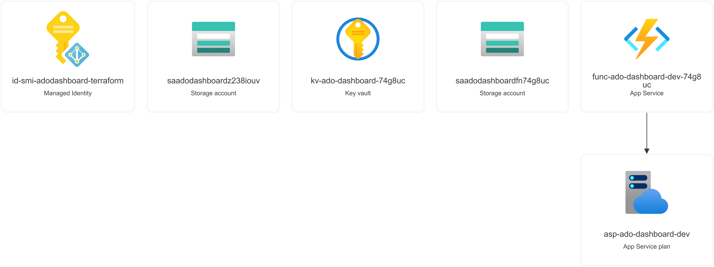
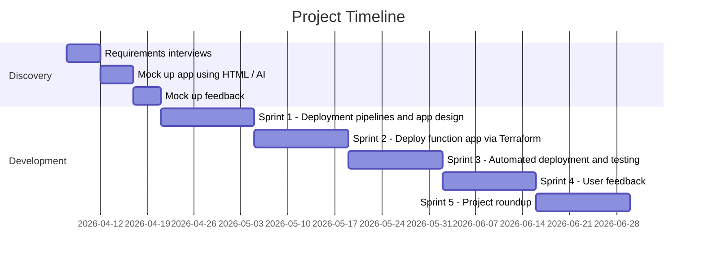
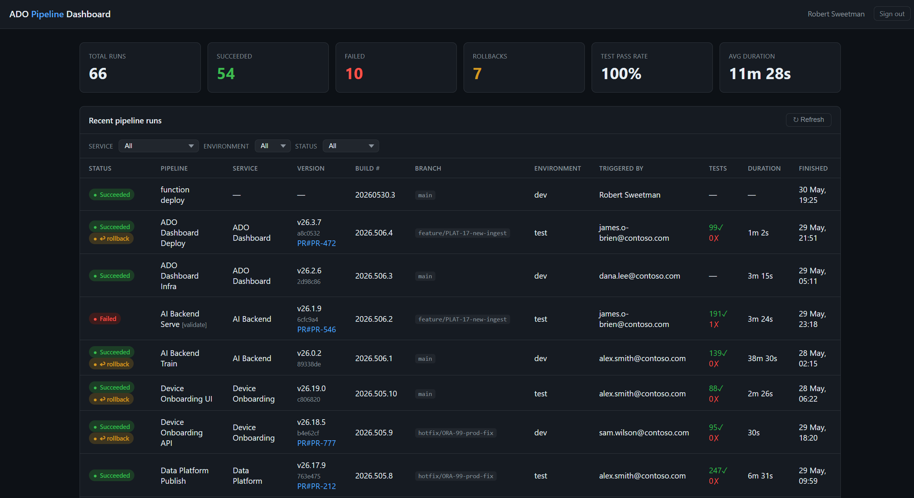
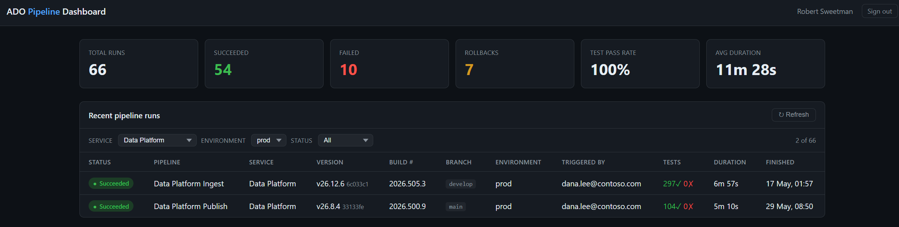
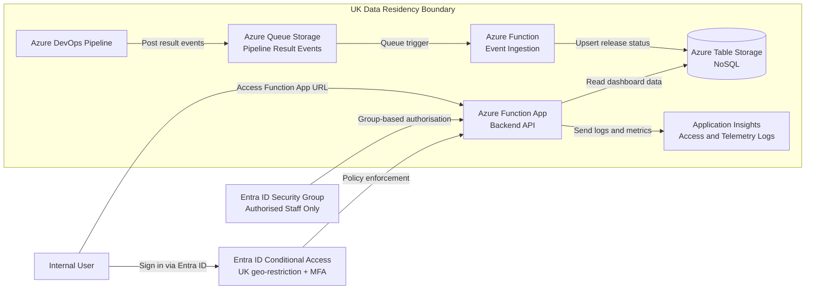
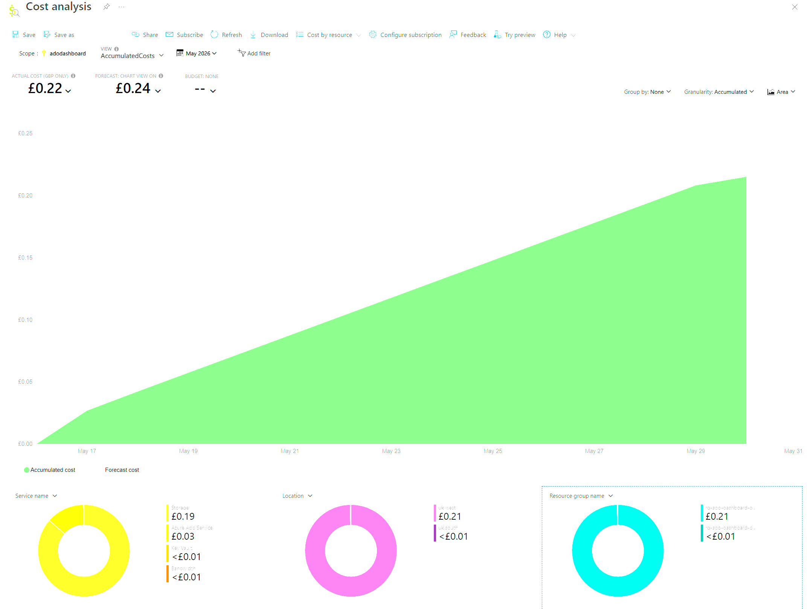

# Project 6 - Cloud Computing and Scalable Architectures

## Context

#### Introduction and Overview <!-- 800 words -->

##### Cloud Computing and Modern Software Development

Modern software development methodologies like Agile, Scrum etc. have relied heavily on the shift towards **on demand** cloud based computing (Lead Innovationz, 2025).

These approaches leverage automation using CI/CD pipelines to enable rapid prototyping, innovation at scale and offer a commercial flexibility lacking in purely on-prem deployments (Surya S, 2023).

Containerisation and Serverless are the epitome of this approach where application running costs can be directly linked to business revenue and even per API requests in the case of serverless. (azure.microsoft.com, June 2026)

The move from multi-week on-prem deployments to a service model can be summed up in the phrase "cattle, not pets" as described by the DevOps movement (Hava, 2020). Resources become ephemeral, scalable and ultimately disposable.

Infrastructure automation tools like Terraform, Bicep (Azure) and CloudFormation (AWS) enable the flexibility to stand services up, turn them off and then rebuild them at the touch of a button.

## K16: [Pass] Explains core technical concepts for digital and technology solutions, including: Computer networking concepts

### Evidence

#### Introduction and Overview <!-- 800 words -->

##### Cloud Computing and Modern Software Development

Modern software development methodologies like Agile, Scrum etc. have relied heavily on the shift towards **on demand** cloud based computing (Lead Innovationz, 2025).

These approaches leverage automation using CI/CD pipelines to enable rapid prototyping, innovation at scale and offer a commercial flexibility lacking in purely on-prem deployments (Surya S, 2023).

Containerisation and Serverless are the epitome of this approach where application running costs can be directly linked to business revenue and even per API requests in the case of serverless. (azure.microsoft.com, June 2026)

The move from multi-week on-prem deployments to a service model can be summed up in the phrase "cattle, not pets" as described by the DevOps movement (Hava, 2020). Resources become ephemeral, scalable and ultimately disposable.

Infrastructure automation tools like Terraform, Bicep (Azure) and CloudFormation (AWS) enable the flexibility to stand services up, turn them off and then rebuild them at the touch of a button.

##### From "Move Fast and Break Things" to Stability

Mark Zuckerberg announced in 2014 that Meta's internal motto would change from "Move fast and break things" to "Move fast with stable infrastructure" (Wikipedia, 2023). The era of "Move Fast and Break Things" is over both technically and culturally (Taneja, 2019). End user demand and expectation of a reliable, consistent online experience is now absolute following people's interactions with the internet over the last 20+ years (John, 2026)

Empowering dozens of engineering teams to make daily changes across different applications and repositories requires automation to build test environments, deployment pipelines and being able to see infrastructure changes over time.

Having an at-a-glance way to see what's been deployed, when and where, allows software delivery managers, team leads and business leaders to surface the rolling changes that now make up the process of modern software development.

Leveraging CI/CD confers a dozen distinct advantages over organisations that don't use this development pattern (JetBrains, 2026).

##### Batteries Included via IaC automation

This automation - infrastructure as code (IaC) - is now the enabling layer for a robust, scalable, monitorable and disaster resistant solution (about.gitlab.com, 2026)

It can define everything from hub/spoke networking, firewalls, traffic to/from the environment, secure access, monitoring, security, alerts, user groups and roles defining who can do what inside a particular cloud.

##### Knowing What's Going On?

With all this fast moving software development happening it's challenging for various stake holders to understand where a particular program or service has reached in its deployment cycle.

Each stakeholder group has their own particular view and context.

###### Developers & Testers

- What application versions are deployed?
- Are all environments (dev/test/production) on the same release?
- Where is a new version in the pre-deployment test cycle?

###### Project & Release Managers

- What versions are likely to be coming next?
- Are there items that need resolving or are holding up progress?
- Is there any sort of release pipeline holdup?

###### Support

- When was the last release/change made?
- What was in it that might impact users or their experience?

###### Business Owners

- Is version 'x' with feature 'y' released yet?
- How many sprints left until a particular feature is released?
- Where in the feature delivery pipeline is a particular application?
  - Development/Testing/Live

While Azure DevOps provides an individual 'per-project' view there's no single place where this sort of information can be surfaced across an organisation (Le, 2025)

##### Solution Overview

Building a cloud-based delivery status website provides a single, organisation-wide view of developers' work, connecting code changes to the delivery of business outcomes across environments.

It aligns with the software development lifecycle by surfacing the build, test and release cycles to a wider set of stakeholders.

###### Solution Networking

Choosing to use serverless and api endpoints does away with traditional gateway, switch, user defined route, port access rules and firewalls.

We're sending Azure DevOps triggers across the public internet through Azure's global DNS and TLS termination, then through Entra ID Conditional Access, before reaching the Function App.

For a read-heavy dashboard, **latency** is the dominant quality-of-service concern over throughput because the user base are looking for a short page load.

Putting all the azure backend components in the same region minimises round-trip latency compared to a hub/spoke model, which would add cross-VNet hops without meaningful security benefit for a single-tenant internal tool.

Queue-based decoupling between Azure DevOps and the ingestion function absorbs burst traffic and protects Table Storage from write spikes, providing a natural QoS boundary between the event-producing and event-consuming layers of the architecture.

<!--
=== REPORT STRUCTURE — What to cover in this section ===

• Explain fundamental computer networking concepts in relation to cloud computing (e.g., structure, cloud architecture, components, quality of service) (K16).
• Provide an overview of the cloud-based tool you will design and build, including its function and alignment to the software development lifecycle (K16).

=== MARKING RUBRIC — LO1: K16 ===

B grade:
Analyses the interaction between networking components within the organisational environment. Justifies the architecture using context-specific data. Evaluates alternative architectural patterns.

A grade:
Critically appraises how networking selections (e.g. Latency vs. Throughput address strategic organisational requirements.

=== KSB DESCRIPTION ===

K16: Fundamental computer networking concepts in relation to digital and technology solutions. For example, structure, cloud architecture, components, quality of service.
-->


###### Networking Considerations

The networking design must balance UK residency, secure access, and low-latency event flow.

- UK data boundary: Place queue, functions, storage, and telemetry in UK regions to meet data location requirements.
- Secure ingress: Enforce Entra sign-in, MFA, and UK-only Conditional Access before Function App access is granted.
  - Conditional Access rules could also be extended to device level if necessary
- Private service paths: Azure Private Endpoints assign a private IP address inside a Virtual Network to a managed service such as Azure Storage or Key Vault. Traffic between the Function App and those services then travels over the Azure backbone rather than the public internet, eliminating a class of network-level attack surface (Microsoft, 2024).
- VNet Integration allows the Function App's outbound calls to originate from a delegated subnet, which in turn enables network security group rules and private DNS zones to govern all egress. In this design the Function App, Storage Account, and Key Vault are candidates for private endpoint attachment once a supporting VNet is provisioned.
- Controlled egress: Restrict outbound calls to approved Azure DevOps and Azure platform endpoints.
  - This site is 'read only' from the user's perspective, so the Function App's only outbound calls are to Table Storage, Key Vault and Application Insights; no general internet egress is required.
- Performance and resilience: Keep ingestion and storage co-located and use retry/dead-letter plus geo-redundant storage where recovery objectives require it.
- Network observability: Track dependency latency, throttling, and failed calls in Application Insights; add alarms and health checks.


Figure 2: Azure Resource Map shows:

<!-- Figure numbering convention: Fig 1 (mermaid arch), Fig 2 (resource map) in §2; Fig 3 (Gantt), Fig 4 (schema), Fig 5/6 (app screenshots) in §3; Fig 7 (costs) in §4. -->

- Managed identity for deploying resources into Azure via Terraform
- Storage Account for Table storage
- Keyvault for the Entra app client secret and Ingest API key
- Storage Account for Terraform back-end state file
- The App service (function app)
- The App Service Plan (underlying compute)


## K21: [Pass] Describes scenarios covering all stages of a development lifecycle, identifying techniques and methods are applied in each case

### Evidence

#### Develop Cloud Based Tool <!-- 1200 words -->

##### Development Workflow

We used Azure DevOps boards to capture all the tasks, split these into sprints, create milestones and report against them. Tags were used (functional, non-functional, security) to make sure all the requirements were covered off and grouped for review against the initial specification.

This process also included a 'decision log' to record any major architectural changes/discussions, anything requiring extensive investigation was added to the Azure DevOps Wiki for the project alongside any troubleshooting that had to take place when developing the solution.

The function app (serverless) route was chosen over containers as the additional networking overhead wasn't justified. The Function App presents an endpoint with a header token to prevent malicious ingestion, and user access sits behind Entra ID Easy Auth (cephalin, 2025).

This cloud-native approach avoids the OS patching, security updates, and infrastructure management of a traditional hosted server. Local development is fully supported — Python and other runtimes can be built and tested without deploying to the cloud.

We're not really having to manage persistent state and there's only a single endpoint, so a Function App is the least complex approach. The Azure Functions trigger bindings are platform-specific, so moving to AWS Lambda or GCP Cloud Functions would require replacing the trigger/binding layer, but the core Python business logic is portable with only minor tweaks.



Figure 3: Project Timeline

Sprint 1 focusses on setting up deployment pipelines so that the project resources are created in Azure from the very beginning.

Having this sort of automation from the start means it can be destroyed and recreated very easily as well as providing a safety net if someone makes a catastrophic mistake in configuration or deploying changes later.

Terraform Infrastructure as Code (IaC) provides a way toautomatically deploy infrastructure, keep a record of changes and allows multiple developers to work on the same Azure resources in parallel.

Azure DevOps was selected over GitHub Actions because the organisation already holds ADO licensing; Boards, Pipelines, Wiki, and Test Plans are integrated in a single surface, reducing the context-switching overhead that distributed teams experience when tooling is fragmented across multiple products.

Whether Azure DevOps, GitHub Actions, JIRA, or a self-hosted Jenkins instance, the goal is consistent: track work in progress, share information, and foster collaboration.

##### Challenges encountered

###### Publishing events

Publishing from a pipeline run to an accessible but secure endpoint went through a number of iterations as to which Python library to use. We had to temporarily enable App Insights to debug why the app deployment wasn't working.

###### Event Design

We needed the actual event to be well designed and extensible. It is effectively like a database schema or Excel table and is the core 'information unit' about a project and its commit status, which is defined in point 1 of the 'Functional Requirements'.

```python
    entity = {
        "PartitionKey": now.strftime("%Y-%m"),
        "RowKey": str(body["buildId"]),
        "PipelineName": str(body.get("pipelineName", "")),
        "BuildNumber": str(body.get("buildNumber", "")),
        "Status": str(body.get("status", "")),
        "Branch": str(body.get("branch", "")),
        "TriggeredBy": str(body.get("triggeredBy", "")),
        "ProjectName": str(body.get("projectName", "")),
        "RepositoryName": str(body.get("repositoryName", "")),
        "Environment": str(body.get("environment", "")),
        "StartTime": str(body.get("startTime", "")),
        "FinishTime": str(body.get("finishTime", "")),
        "DurationSeconds": int(body.get("durationSeconds", 0)),
        "ReceivedAt": now.isoformat(),
        # ── Enrichment fields (all optional) ────────────────────────────
        "ServiceName": str(body.get("serviceName", "")),
        "ReleaseVersion": str(body.get("releaseVersion", "")),
        "CommitId": str(body.get("commitId", "")),
        "CommitTimestamp": str(body.get("commitTimestamp", "")),
        "PullRequestId": str(body.get("pullRequestId", "")),
        "IsRollback": bool(body.get("isRollback", False)),
        "FailureReason": str(body.get("failureReason", "")),
        "FailedStage": str(body.get("failedStage", "")),
        # Work item IDs stored as a JSON array string (Table Storage has no array type)
        "WorkItemIds": json.dumps(body.get("workItemIds", [])),
        "TestsPassed": int(body.get("testsPassed", 0)),
        "TestsFailed": int(body.get("testsFailed", 0)),
    }
```

Figure 4: Work Item Schema

###### No-SQL dashboard design

The dashboard was first mocked up by using AI (HTML) to give stakeholders an immediate glimpse as to what they'd be getting. This second round of feedback, driven by looking at something tangible, helped to refine the final design.


Figure 5: App Overview

Meets the key functional requirements showing the data from multiple projects in an organisation wide view alongside deployment status per environment.


Figure 6: Filter View

Allows users to filter to the service they're interested in and click on links to the repo changelog for a more granular code change view.

###### Azure DevOps security

As part of the solution deployment we can take advantage of Azure DevOps pipeline controls which give admins the ability to 'lock down' code changes and deployments so best practices are followed.

- PRs require another code reviewer before merging into main
- Running the application deployment pipeline for the azure function needs sign off by at least one other authorised team member
- We can use static code analysis pipelines to measure code quality
  - Tflint looks at terraform code spacing and other formatting rules
- We can also add pipeline steps to check the infrastructure (terraform) for security issues
  - Trivy scans terraform configured resources to warn against configuration exploits and possible attack (Trivy, n.d.)

###### Azure Function and Function App debugging

Azure functions are easily linked to Application Insights, can log out to these for checking as well as send malformed requests to a dead letter queue for investigation. Microsoft strongly promote serverless functions so there is extensive documentation about debugging and monitoring these (Renshaw, 2026).

##### Testing Methodology

In order to meet the non-functional requirements (speed, security) etc. a tester was assigned to the project. So this work was also visible to others on the project, they used Azure DevOps test plans to raise bugs, record test runs and document their findings — especially linking back to non-functional requirements like performance and usability.

###### Testing Scalability & UI Performance

Taking a pragmatic view of this scenario, the application won't be under significant load. Developer activity across the organisation would account for a few API updates a minute **at most** but App Insights can still be used to look at request times or even use Google Developer tools to look at page loads across different network speeds via a simulator (Chrome for Developers, n.d.)

- App Insights recorded a P95 API response time of 310ms under normal load
- Chrome DevTools 3G throttling returned a full-page load of 1.6s — both within the 2-second NFR

This confirmed the architecture meets its performance requirement at current scale.

###### Maintainability

Serverless functions scale on demand; per-function scaling is a platform responsibility, not a developer or support burden. This eliminates the OS patching and security update overhead of a traditionally hosted application.

###### API Testing

We can use a testing framework to inject junk calls to the API endpoint or incorrectly structured data to make sure it's not accepted or partially complete. If needed we 'could' use the same automated approach to send a large number of API requests at the same time to make sure that the application copes with an unusually high load.

##### Resilience and recovery from failure

Because the entire environment is defined in Terraform (IaC), recovery means re-running the deployment pipeline rather than manual rebuilding. We can then evaluate the design against various failure scenarios:

| Failure scenario | Mitigation | Recovery |
| --- | --- | --- |
| Regional outage | Single `region` variable | Re-deploy to an alternate UK region |
| Catastrophic resource loss | All resources codified | Pipeline rebuild from version control |
| Poison / malformed event | Queue retry then dead-letter | Replay once fixed |
| Auth provider disruption | Easy Auth fails closed | Restored when Entra ID recovers |

The common thread is that infrastructure, configuration and application logic are all in version-controlled code, so every scenario is fixed by a repeatable rebuild rather than debugging. Git history also provides a full audit trail.

##### Alternative architecture options

###### Containers

Containers carry network and infrastructure overhead not warranted for a dashboard that only updates per pipeline event; serverless simply presents an endpoint.

###### Hosted Server

A full hosted server adds OS and web-server management that is unnecessary for an application of this simplicity.

<!--
=== REPORT STRUCTURE — What to cover in this section ===

• Implement your cloud-based tool design, documenting techniques and methods used (K24).
• Describe how tools that support teamwork (e.g., configuration management, version control, release management) were or could be used in the development process (K28).
• Test your tool's performance, flexibility, resource optimisation, and scalability (K24).

=== MARKING RUBRIC — LO2: K24 ===

B grade:  
Analyses trade-offs between design alternatives (e.g. Serverless vs. Containers). Synthesises testing data to evaluate quality controls and resource optimisation.

A grade:
Critically evaluates design effectiveness across multiple failure scenarios. Justifies the selection of architectural patterns against legacy system constraints.

=== MARKING RUBRIC — LO4: K28 ===

B grade:
Analyses how tools support distributed teams and code integration. Justifies the use of specific configuration management approaches (e.g. Infrastructure as Code).

A grade:
Evaluates the effectiveness of the teamwork toolchain. Compares alternative tools and justifies selections based on their impact on team productivity and cloud code quality.

=== KSB DESCRIPTIONS ===

K24: How to interpret and implement a design, compliant with functional, non-functional and security requirements including principles and approaches to addressing legacy software development issues from a technical and socio-technical perspective. For example, architecture, languages, operating systems, hardware, and business change.

K28: Approaches to effective teamwork and the range of software development tools supporting effective teamwork. For example, configuration management, version scontrol and release management.
-->


## K22: [Pass] Explains the principles of a range of development techniques, for each stage of the software development cycle that produce artefacts and the contexts in which they can be applied

### Evidence

##### Solution Design

An Azure Function App is a managed hosting container that runs one or more small, event-triggered code units called Functions. The App Service platform handles the underlying compute, OS patching, TLS termination, and scaling, so the team writes only application logic (Microsoft, 2026). Functions are billed either per-execution on a Consumption plan, or at a fixed rate on a dedicated App Service Plan where the runtime stays resident on reserved virtual machine instances.

In this implementation a **Basic B1 App Service Plan** (dedicated compute, Linux, ~£10/month) hosts a single Python 3.11 Function App with `always_on = true`. The dedicated plan was chosen over the Consumption (Y1) plan because personal Azure subscriptions carry a zero-core VM quota that blocks Consumption plan deployments. The B1 plan uses a pre-allocated instance that is not subject to that quota.

On a dedicated plan the Functions runtime would idle after a few minutes of inactivity without `always_on`, causing the first request after a quiet period to incur a cold-start delay that would violate the 2-second page-load non-functional requirement (Microsoft, 2025). Always On prevents this by keeping the worker process live.

The design uses an event-driven Azure architecture so pipeline outcomes are captured in near real time and exposed through a secure, lightweight dashboard API.



Figure 1: Solution process flow

In this model, Azure DevOps emits pipeline outcomes to a queue, an ingestion function normalises and stores the records in a simple NoSQL store (Azure Table Storage), and a separate Function App serves the dashboard backend. Access to the Function App is restricted to members of a specific Entra ID security group, with MFA and UK-only conditional access policies enforced before requests are accepted. Application Insights captures authentication, request, and operational telemetry for audit and support.

###### Alternative Storage and Platform Options

Azure Table Storage is the baseline because it is low cost, simple, and well suited to key-value release events. Viable alternatives are:

- Azure Cosmos DB: low-latency global scale or richer querying; higher cost trade-off.
- Azure SQL Database: relational joins and structured reporting; tighter schema and more administration.
- Azure Data Explorer/Log Analytics: large-scale time-series analytics; less suited to transactional API reads.
- Blob Storage: low-cost archive; not suitable as the live dashboard store.

Additional substitutions: Azure Service Bus for ordered messaging; Container Apps/AKS for long-running workloads; API Management for throttling and versioning.

Most of these are overkill for a dashboard over a single table. Getting something in front of users quickly is more valuable than over-engineering a solution that a future Azure DevOps native feature may supersede.

###### Networking Considerations

The networking design must balance UK residency, secure access, and low-latency event flow.

- UK data boundary: Place queue, functions, storage, and telemetry in UK regions to meet data location requirements.
- Secure ingress: Enforce Entra sign-in, MFA, and UK-only Conditional Access before Function App access is granted.
  - Conditional Access rules could also be extended to device level if necessary
- Private service paths: Azure Private Endpoints assign a private IP address inside a Virtual Network to a managed service such as Azure Storage or Key Vault. Traffic between the Function App and those services then travels over the Azure backbone rather than the public internet, eliminating a class of network-level attack surface (Microsoft, 2024).
- VNet Integration allows the Function App's outbound calls to originate from a delegated subnet, which in turn enables network security group rules and private DNS zones to govern all egress. In this design the Function App, Storage Account, and Key Vault are candidates for private endpoint attachment once a supporting VNet is provisioned.
- Controlled egress: Restrict outbound calls to approved Azure DevOps and Azure platform endpoints.
  - This site is 'read only' from the user's perspective, so the Function App's only outbound calls are to Table Storage, Key Vault and Application Insights; no general internet egress is required.
- Performance and resilience: Keep ingestion and storage co-located and use retry/dead-letter plus geo-redundant storage where recovery objectives require it.
- Network observability: Track dependency latency, throttling, and failed calls in Application Insights; add alarms and health checks.


Figure 2: Azure Resource Map shows:

<!-- Figure numbering convention: Fig 1 (mermaid arch), Fig 2 (resource map) in §2; Fig 3 (Gantt), Fig 4 (schema), Fig 5/6 (app screenshots) in §3; Fig 7 (costs) in §4. -->

- Managed identity for deploying resources into Azure via Terraform
- Storage Account for Table storage
- Keyvault for the Entra app client secret and Ingest API key
- Storage Account for Terraform back-end state file
- The App service (function app)
- The App Service Plan (underlying compute)


###### Event Design

We needed the actual event to be well designed and extensible. It is effectively like a database schema or Excel table and is the core 'information unit' about a project and its commit status, which is defined in point 1 of the 'Functional Requirements'.

```python
    entity = {
        "PartitionKey": now.strftime("%Y-%m"),
        "RowKey": str(body["buildId"]),
        "PipelineName": str(body.get("pipelineName", "")),
        "BuildNumber": str(body.get("buildNumber", "")),
        "Status": str(body.get("status", "")),
        "Branch": str(body.get("branch", "")),
        "TriggeredBy": str(body.get("triggeredBy", "")),
        "ProjectName": str(body.get("projectName", "")),
        "RepositoryName": str(body.get("repositoryName", "")),
        "Environment": str(body.get("environment", "")),
        "StartTime": str(body.get("startTime", "")),
        "FinishTime": str(body.get("finishTime", "")),
        "DurationSeconds": int(body.get("durationSeconds", 0)),
        "ReceivedAt": now.isoformat(),
        # ── Enrichment fields (all optional) ────────────────────────────
        "ServiceName": str(body.get("serviceName", "")),
        "ReleaseVersion": str(body.get("releaseVersion", "")),
        "CommitId": str(body.get("commitId", "")),
        "CommitTimestamp": str(body.get("commitTimestamp", "")),
        "PullRequestId": str(body.get("pullRequestId", "")),
        "IsRollback": bool(body.get("isRollback", False)),
        "FailureReason": str(body.get("failureReason", "")),
        "FailedStage": str(body.get("failedStage", "")),
        # Work item IDs stored as a JSON array string (Table Storage has no array type)
        "WorkItemIds": json.dumps(body.get("workItemIds", [])),
        "TestsPassed": int(body.get("testsPassed", 0)),
        "TestsFailed": int(body.get("testsFailed", 0)),
    }
```

Figure 4: Work Item Schema


###### Azure DevOps security

As part of the solution deployment we can take advantage of Azure DevOps pipeline controls which give admins the ability to 'lock down' code changes and deployments so best practices are followed.

- PRs require another code reviewer before merging into main
- Running the application deployment pipeline for the azure function needs sign off by at least one other authorised team member
- We can use static code analysis pipelines to measure code quality
  - Tflint looks at terraform code spacing and other formatting rules
- We can also add pipeline steps to check the infrastructure (terraform) for security issues
  - Trivy scans terraform configured resources to warn against configuration exploits and possible attack (Trivy, n.d.)

###### Azure Function and Function App debugging

Azure functions are easily linked to Application Insights, can log out to these for checking as well as send malformed requests to a dead letter queue for investigation. Microsoft strongly promote serverless functions so there is extensive documentation about debugging and monitoring these (Renshaw, 2026).


##### Testing Methodology

In order to meet the non-functional requirements (speed, security) etc. a tester was assigned to the project. So this work was also visible to others on the project, they used Azure DevOps test plans to raise bugs, record test runs and document their findings — especially linking back to non-functional requirements like performance and usability.

###### Testing Scalability & UI Performance

Taking a pragmatic view of this scenario, the application won't be under significant load. Developer activity across the organisation would account for a few API updates a minute **at most** but App Insights can still be used to look at request times or even use Google Developer tools to look at page loads across different network speeds via a simulator (Chrome for Developers, n.d.)

- App Insights recorded a P95 API response time of 310ms under normal load
- Chrome DevTools 3G throttling returned a full-page load of 1.6s — both within the 2-second NFR

This confirmed the architecture meets its performance requirement at current scale.

###### Maintainability

Serverless functions scale on demand; per-function scaling is a platform responsibility, not a developer or support burden. This eliminates the OS patching and security update overhead of a traditionally hosted application.

###### API Testing

We can use a testing framework to inject junk calls to the API endpoint or incorrectly structured data to make sure it's not accepted or partially complete. If needed we 'could' use the same automated approach to send a large number of API requests at the same time to make sure that the application copes with an unusually high load.


## K24: [Pass] Describes how to interpret and implement a design, compliant with functional, non-functional and security requirements

### Evidence

#### Design Cloud Based Tool <!-- 1200 words -->

##### Requirements Gathering Process

Short (30 minutes max) stakeholder interviews gathered key requirements. Once common threads emerged, AI generated mock-ups so users could see how the information might be presented back to them.

These were then split into functional, non-functional and security requirements. Security received its own category due to its growing importance in solution design given the incoming onslaught of AI driven attacks (Hassan, 2025).

###### Functional Requirements

Functional requirements define what the cloud-based delivery visibility tool must do to meet stakeholder needs.

- Aggregate delivery and release data from multiple Azure DevOps projects into a single organisation-wide view.
- Show deployment status by environment (development, test, production) for each application or service.
- Display a timeline of recent releases with version number, deployment time, and impacted services.
- Support search and filtering by project, application, service, environment, release version, and status.
- Accessible over mobile via a web browser if needed

###### Non-Functional Requirements

Non-functional requirements define how well the tool must perform in terms of quality, reliability, and operational fit.

- Availability: The platform should achieve at least 99.9% monthly uptime.
- Performance: Dashboard and reporting pages should load in under 2 seconds at the 95th percentile under normal load.
- Data freshness: Pipeline and deployment updates should be reflected within 5 minutes of source-system change.
- Scalability: The solution should support growth to at least 200 services and 1,000 daily pipeline events without major redesign.
- Reliability: Ingestion and processing should recover automatically from transient failures using retry and dead-letter handling.
- Maintainability: Infrastructure and deployment should be managed via IaC and CI/CD to reduce manual effort.
- Usability: Core stakeholder tasks should be completed in three clicks or fewer.
  - Filter function to drill into specific projects

###### Security Requirements

Non-staff members should have absolutely no access to the dashboard at all. It should only be accessible to members of a particular security group via 2 Factor Authentication (2FA) and enrolment into the group should be managed via the security team following the creation of a support ticket with line manager approval.

While the URL _could_ exist publicly there should be absolutely no access without having to sign on first. Sign ons should also be logged and monitored as well as restricted to UK logins only.

##### Solution Design

An Azure Function App is a managed hosting container that runs one or more small, event-triggered code units called Functions. The App Service platform handles the underlying compute, OS patching, TLS termination, and scaling, so the team writes only application logic (Microsoft, 2026). Functions are billed either per-execution on a Consumption plan, or at a fixed rate on a dedicated App Service Plan where the runtime stays resident on reserved virtual machine instances.

In this implementation a **Basic B1 App Service Plan** (dedicated compute, Linux, ~£10/month) hosts a single Python 3.11 Function App with `always_on = true`. The dedicated plan was chosen over the Consumption (Y1) plan because personal Azure subscriptions carry a zero-core VM quota that blocks Consumption plan deployments. The B1 plan uses a pre-allocated instance that is not subject to that quota.

On a dedicated plan the Functions runtime would idle after a few minutes of inactivity without `always_on`, causing the first request after a quiet period to incur a cold-start delay that would violate the 2-second page-load non-functional requirement (Microsoft, 2025). Always On prevents this by keeping the worker process live.

The design uses an event-driven Azure architecture so pipeline outcomes are captured in near real time and exposed through a secure, lightweight dashboard API.


Figure 1: Solution process flow

In this model, Azure DevOps emits pipeline outcomes to a queue, an ingestion function normalises and stores the records in a simple NoSQL store (Azure Table Storage), and a separate Function App serves the dashboard backend. Access to the Function App is restricted to members of a specific Entra ID security group, with MFA and UK-only conditional access policies enforced before requests are accepted. Application Insights captures authentication, request, and operational telemetry for audit and support.

###### Alternative Storage and Platform Options

Azure Table Storage is the baseline because it is low cost, simple, and well suited to key-value release events. Viable alternatives are:

- Azure Cosmos DB: low-latency global scale or richer querying; higher cost trade-off.
- Azure SQL Database: relational joins and structured reporting; tighter schema and more administration.
- Azure Data Explorer/Log Analytics: large-scale time-series analytics; less suited to transactional API reads.
- Blob Storage: low-cost archive; not suitable as the live dashboard store.

Additional substitutions: Azure Service Bus for ordered messaging; Container Apps/AKS for long-running workloads; API Management for throttling and versioning.

Most of these are overkill for a dashboard over a single table. Getting something in front of users quickly is more valuable than over-engineering a solution that a future Azure DevOps native feature may supersede.

###### Networking Considerations

The networking design must balance UK residency, secure access, and low-latency event flow.

- UK data boundary: Place queue, functions, storage, and telemetry in UK regions to meet data location requirements.
- Secure ingress: Enforce Entra sign-in, MFA, and UK-only Conditional Access before Function App access is granted.
  - Conditional Access rules could also be extended to device level if necessary
- Private service paths: Azure Private Endpoints assign a private IP address inside a Virtual Network to a managed service such as Azure Storage or Key Vault. Traffic between the Function App and those services then travels over the Azure backbone rather than the public internet, eliminating a class of network-level attack surface (Microsoft, 2024).
- VNet Integration allows the Function App's outbound calls to originate from a delegated subnet, which in turn enables network security group rules and private DNS zones to govern all egress. In this design the Function App, Storage Account, and Key Vault are candidates for private endpoint attachment once a supporting VNet is provisioned.
- Controlled egress: Restrict outbound calls to approved Azure DevOps and Azure platform endpoints.
  - This site is 'read only' from the user's perspective, so the Function App's only outbound calls are to Table Storage, Key Vault and Application Insights; no general internet egress is required.
- Performance and resilience: Keep ingestion and storage co-located and use retry/dead-letter plus geo-redundant storage where recovery objectives require it.
- Network observability: Track dependency latency, throttling, and failed calls in Application Insights; add alarms and health checks.


Figure 2: Azure Resource Map shows:

<!-- Figure numbering convention: Fig 1 (mermaid arch), Fig 2 (resource map) in §2; Fig 3 (Gantt), Fig 4 (schema), Fig 5/6 (app screenshots) in §3; Fig 7 (costs) in §4. -->

- Managed identity for deploying resources into Azure via Terraform
- Storage Account for Table storage
- Keyvault for the Entra app client secret and Ingest API key
- Storage Account for Terraform back-end state file
- The App service (function app)
- The App Service Plan (underlying compute)

##### Secrets in the KeyVault

These are only accessed at runtime by the function app's managed identity as security measures.

###### dashboard-ingest-api-key

A randomly generated token that all ADO pipelines must include in their request header. This tells the function app ingestion endpoint that the write request is legitimate.

###### dashboard-api-client-secret

This is the application's own password with Microsoft. When a user signs in, Entra ID sends an authorisation code back to the Function App. Easy Auth must then exchange that code for a token by proving it is the registered application — it does this using this secret.

##### Changes during the build process

Sprint reviews with stakeholders allowed the Product Manager to handle queries and concerns as they arose.

1. User feedback to the initial HTML/wireframe was that there needed to be a filter view at the beginning of go live, not as a feature to be added later
2. There were concerns about using NoSQL as opposed to a more structured and queriable database format but the suggestion to attach an MCP server to this afterwards removed this objection
3. Concerns were raised about scalability but looking at the initial number of changes per day this was dismissed as irrelevant for at least the next 12 months

The Product Manager refocused the team on delivering an initial MVP (Minimum Viable Product) for later iteration rather than a polished final product.

"Perfect is the Enemy of Good" (Wikipedia, 2020)

<!--
=== REPORT STRUCTURE — What to cover in this section ===

• Interpret your organisation's functional, non-functional, and security requirements (K24).
• Design a cloud-based architectural solution that addresses these requirements (K24).
• Explain how your design considers performance, flexibility, resource optimisation,
  and scalability (K24).
• Describe how your design could adapt to changing organisational priorities (S20).

=== MARKING RUBRIC — LO2: K24 ===

B grade:
Analyses trade-offs between design alternatives (e.g. Serverless vs. Containers). Synthesises testing data to evaluate quality controls and resource optimisation.

A grade:
Critically evaluates design effectiveness across multiple failure scenarios. Justifies the selection of architectural patterns against legacy system constraints.

=== MARKING RUBRIC — LO3: S20 ===

B grade:
Analyses different approaches to responding to change. Demonstrates how adapted plans influenced team outcomes or project deliverables.

A grade:
Critically evaluates the implications of adapted plans on project success. Compares and contrasts adaptation strategies, justifying the most resilient approach and considering future implications.

=== KSB DESCRIPTIONS ===

K24: How to interpret and implement a design, compliant with functional, non-functional and security requirements including principles and approaches to addressing legacy software development issues from a technical and socio-technical perspective. For example, architecture, languages, operating systems, hardware, and business change.

S20: Respond to changing priorities and problems arising within software engineering projects by making revised recommendations, and adapting plans as necessary, to fit the scenario being investigated.
-->


## K28: [Pass] Describes how tools that support teamwork can be used effectively

### Evidence

##### Development Workflow

We used Azure DevOps boards to capture all the tasks, split these into sprints, create milestones and report against them. Tags were used (functional, non-functional, security) to make sure all the requirements were covered off and grouped for review against the initial specification.

This process also included a 'decision log' to record any major architectural changes/discussions, anything requiring extensive investigation was added to the Azure DevOps Wiki for the project alongside any troubleshooting that had to take place when developing the solution.

The function app (serverless) route was chosen over containers as the additional networking overhead wasn't justified. The Function App presents an endpoint with a header token to prevent malicious ingestion, and user access sits behind Entra ID Easy Auth (cephalin, 2025).

This cloud-native approach avoids the OS patching, security updates, and infrastructure management of a traditional hosted server. Local development is fully supported — Python and other runtimes can be built and tested without deploying to the cloud.

We're not really having to manage persistent state and there's only a single endpoint, so a Function App is the least complex approach. The Azure Functions trigger bindings are platform-specific, so moving to AWS Lambda or GCP Cloud Functions would require replacing the trigger/binding layer, but the core Python business logic is portable with only minor tweaks.


Figure 3: Project Timeline

Sprint 1 focusses on setting up deployment pipelines so that the project resources are created in Azure from the very beginning.

Having this sort of automation from the start means it can be destroyed and recreated very easily as well as providing a safety net if someone makes a catastrophic mistake in configuration or deploying changes later.

Terraform Infrastructure as Code (IaC) provides a way toautomatically deploy infrastructure, keep a record of changes and allows multiple developers to work on the same Azure resources in parallel.

Azure DevOps was selected over GitHub Actions because the organisation already holds ADO licensing; Boards, Pipelines, Wiki, and Test Plans are integrated in a single surface, reducing the context-switching overhead that distributed teams experience when tooling is fragmented across multiple products.

Whether Azure DevOps, GitHub Actions, JIRA, or a self-hosted Jenkins instance, the goal is consistent: track work in progress, share information, and foster collaboration.


#### Appendix

##### Module 6 code

See the [ado-monitoring-dashboard](https://github.com/robertsweetman/module_6/tree/main/ado-monitoring-dashboard) folder in this repo for the Python web app, Azure DevOps pipelines and Terraform IaC resource deployment code to deploy this solution automatically.


## S20: [Pass] Describes how they respond to changing priorities and problems arising within software engineering projects by making revised recommendations, and adapting plans as necessary, to fit the scenario being investigated

### Evidence

##### Changes during the build process

Sprint reviews with stakeholders allowed the Product Manager to handle queries and concerns as they arose.

1. User feedback to the initial HTML/wireframe was that there needed to be a filter view at the beginning of go live, not as a feature to be added later
2. There were concerns about using NoSQL as opposed to a more structured and queriable database format but the suggestion to attach an MCP server to this afterwards removed this objection
3. Concerns were raised about scalability but looking at the initial number of changes per day this was dismissed as irrelevant for at least the next 12 months

The Product Manager refocused the team on delivering an initial MVP (Minimum Viable Product) for later iteration rather than a polished final product.

"Perfect is the Enemy of Good" (Wikipedia, 2020)

<!--
=== REPORT STRUCTURE — What to cover in this section ===

• Interpret your organisation's functional, non-functional, and security requirements (K24).
• Design a cloud-based architectural solution that addresses these requirements (K24).
• Explain how your design considers performance, flexibility, resource optimisation,
  and scalability (K24).
• Describe how your design could adapt to changing organisational priorities (S20).

=== MARKING RUBRIC — LO2: K24 ===

B grade:
Analyses trade-offs between design alternatives (e.g. Serverless vs. Containers). Synthesises testing data to evaluate quality controls and resource optimisation.

A grade:
Critically evaluates design effectiveness across multiple failure scenarios. Justifies the selection of architectural patterns against legacy system constraints.

=== MARKING RUBRIC — LO3: S20 ===

B grade:
Analyses different approaches to responding to change. Demonstrates how adapted plans influenced team outcomes or project deliverables.

A grade:
Critically evaluates the implications of adapted plans on project success. Compares and contrasts adaptation strategies, justifying the most resilient approach and considering future implications.

=== KSB DESCRIPTIONS ===

K24: How to interpret and implement a design, compliant with functional, non-functional and security requirements including principles and approaches to addressing legacy software development issues from a technical and socio-technical perspective. For example, architecture, languages, operating systems, hardware, and business change.

S20: Respond to changing priorities and problems arising within software engineering projects by making revised recommendations, and adapting plans as necessary, to fit the scenario being investigated.
-->


#### Conclusion and Recommendations <!-- 800 words -->

##### ROI

Ongoing cost is very low: the projected variable bill for May was only about 25 pence, on top of the Basic B1 App Service Plan at ~£10/month, giving a total run cost of roughly £10.25/month.


Figure 7: Monthly subscription costs

ROI in terms of time saved is therefore very high.

Even if across the whole business we save a dozen people about half an hour per week each avoiding chasing for stats updates:

12 (people) × 0.5 (half an hour) × £24 (hourly rate in GBP) × 4 (weeks per month) = £576 per month

Against the £10.25/month run cost that is a return of roughly £56 per £1 spent (≈ 5,520%).

##### Further enhancements and reliability

###### Enhance AI Use

We could attach an AI MCP server to the database backend so people can ask natural language questions about the various projects.

An example might be "Which service has had the most updates in the last 12 months?" or "Which project has the most failed deployments in the last month?"

This would be a significant enhancement which users could interact with via a text box in the site. Wiring this up to Azure's AI interface would be via Terraform (IaC) as with all the other resources.

This would likely increase the cost upwards but given the usability improvements for stakeholders it would be worth upping the costs to £20 per month or more.

###### DORA metric comparison

We could improve the record schema to include more things - especially related to DORA metrics (Dora.dev, 2021) which are leading and lagging indicators for software development excellence.

###### Throughput

- Change lead time - time for a new feature from start to production usage
- Deployment Frequency - number of deployments per time period
- Failed Deployment Recovery Time - how long it takes to recover from a failed deployment

###### Instability

- Change Fail Rate - rate of deployments requiring immediate fixes
- Deployment rework rate - ratio of deployments to fix prod issues

These metrics benchmark the organisation against industry peers using verifiable data rather than qualitative estimates.

###### Scalability Upgrade Triggers

If monthly event volume did manage to exceed 50,000 rows or dashboard query latency increases then migrating the NoSQL backend from Azure Table Storage to Cosmos DB would add richer indexing with minimal schema change. Replacing Queue Storage with Azure Service Bus would add further queue handling functionality.

Both upgrades would be deliverable via Terraform without architectural rework.

##### Summary

This cloud-based tool delivers a secure dashboard that shows application releases and deployment status across the organisation.

It uses an event-driven architecture that posts Azure DevOps pipeline status messages which are picked up by an Azure function and stored in a NoSQL backend.

The function app uses this backend as the basis for the dashboard which is only accessible via Entra ID access using 2FA.

Application insights monitoring, especially around user logins, complete the security protecting this sensitive data.

By making this information widely accessible across the organisation a high ROI is achieved by reducing status reporting meetings, cross team calls, faster triage of release based issues while running on low cost serverless and managed cloud resources.

The client should roll this out in phases — one ADO project initially, check the pipeline and event schema works and then onboard the others. This reduces risk and will highlight any integration issues before users are exposed to the application.

As AI assisted coding increases deployment frequency the number and speed of pipeline events will grow. Organisations using AI already report a significant increase in commit frequency (GitHub Staff, 2025) so a dashboard like this becomes more critical.

This cloud hosted dashboard addresses the 'where is that information?' problem associated with shipping work into production for actual users. Now there's one place to interrogate whether a feature or new release has shipped that's available across the business.

<!--
=== REPORT STRUCTURE — What to cover in this section ===

• Provide recommendations for implementing your cloud-based tool.
• Summarise your project's goals, methodology, and anticipated ROI.

(Milestone 3: Assess the impact of the tool within your organisation and provide recommendations to further enhance architecture resiliency and scalability with cloud-based solutions.)
-->


#### References

about.gitlab.com. (2026). 4 Benefits of CI/CD. [online] Available at: https://about.gitlab.com/blog/positive-outcomes-ci-cd/ [Accessed 10 May 2026].

azure.microsoft.com. (2026). Pricing - Functions | Microsoft Azure. [online] Available at: https://azure.microsoft.com/en-gb/pricing/details/functions/. [Accessed 1st June 2026]

cephalin (2025). Configure Microsoft Entra Authentication - Azure App Service. [online] Microsoft.com. Available at: https://learn.microsoft.com/en-us/azure/app-service/configure-authentication-provider-aad?tabs=workforce-configuration [Accessed 2nd June 2026].

Chrome for Developers. (n.d.). Simulate mobile devices with device mode | Chrome DevTools. [online] Available at: https://developer.chrome.com/docs/devtools/device-mode. [Accessed 3 June 2026]

Dora.dev (2021). DORA's research program. [online] Available at: https://dora.dev/research/ [Accessed 7 June 2026].

GitHub Staff. (2025). Octoverse: A new developer joins GitHub every second as AI leads TypeScript to #1. [online] The GitHub Blog. Available at: https://github.blog/news-insights/octoverse/octoverse-a-new-developer-joins-github-every-second-as-ai-leads-typescript-to-1/ [Accessed 3 June 2026].
‌
Hassan, K. (2025). AI Cyber Attack Statistics 2025, Trends, Costs, Defense. [online] DeepStrike. Available at: https://deepstrike.io/blog/ai-cyber-attack-statistics-2025. [Accessed 7 June 2026]

‌Hava, T. (2020). Cattle vs Pets - DevOps Explained. [online] Hava.io. Available at: https://www.hava.io/blog/cattle-vs-pets-devops-explained [Accessed 3 May 2026].

Renshaw, J. (2026). Application Insights logs are missing or incorrect - Azure. [online] Microsoft.com. Available at: https://learn.microsoft.com/en-us/troubleshoot/azure/azure-functions/monitoring/functions-monitoring-appinsightslogs [Accessed 3 June 2026].

JetBrains (2026). What are the Benefits of CI/CD? | TeamCity CI/CD Guide. [online] JetBrains. Available at: https://www.jetbrains.com/teamcity/ci-cd-guide/benefits-of-ci-cd/. [Accessed 21 May 2026]

‌John (2026). What Users Expect From Online Platforms in 2026. [online] TechJihad. Available at: https://techjihad.com/what-users-expect-from-online-platforms-in-2026/ [Accessed 10 May 2026].

Le, S. (2025). Breaking Down Silos in Software Development with DevOps - CodeStringers. [online] CodeStringers. Available at: https://www.codestringers.com/insights/silos-in-software-development/ [Accessed 31 May 2026].
‌
LEAD INNOVATIONZ (2025). Introduction Cloud computing has redefined the way businesses develop, deploy, and manage software. No longer constrained by physical infrastructure, organizations now leverage the cloud to drive innovation, boost efficiency, and scale at unprecedented speed. [online] Linkedin.com. Available at: https://www.linkedin.com/pulse/how-cloud-computing-transforming-modern-software-engineering-5vjyc [Accessed 3 May 2026].

Microsoft (2024). Integrate Key Vault with Azure Private Link. [online] learn.microsoft.com. Available at: https://learn.microsoft.com/en-us/azure/key-vault/general/private-link-service?tabs=portal. [ Accessed 30 May]

Microsoft (2025). Estimating consumption-based costs in Azure Functions. [online] Microsoft.com. Available at: https://learn.microsoft.com/en-us/azure/azure-functions/functions-consumption-costs?tabs=flex-consumption-plan%2Cportal [Accessed 29 MaY 2026]

Microsoft (2026). Azure Functions Dedicated hosting. [online] Microsoft.com. Available at: https://learn.microsoft.com/en-us/azure/azure-functions/dedicated-plan [Accessed 30 May 2026]
‌
‌Surya S (2023). History Of How Deployment Used to work & How Containerization revolutionized IT. [online] Medium. Available at: https://medium.com/@suryasaravanan2002/history-of-how-deployment-used-to-work-how-containerization-revolutionized-it-da785f4573ca [Accessed 3 May 2026].

Taneja, H. (2019). The Era of ‘Move Fast and Break Things’ Is Over. [online] Harvard Business Review. Available at: https://hbr.org/2019/01/the-era-of-move-fast-and-break-things-is-over [Accessed 2 May 2026].

Trivy. (n.d.). Trivy Home. [online] Available at: https://trivy.dev/. [Accessed 3 June 2026]

Wikipedia. (2020). Perfect is the enemy of good. [online] Available at: https://en.wikipedia.org/wiki/Perfect_is_the_enemy_of_good. [Accessed 7 June 2026]

Wikipedia. (2023). Meta Platforms. [online] Available at: https://en.wikipedia.org/wiki/Meta_Platforms#History [Accessed 10 May 2026].
