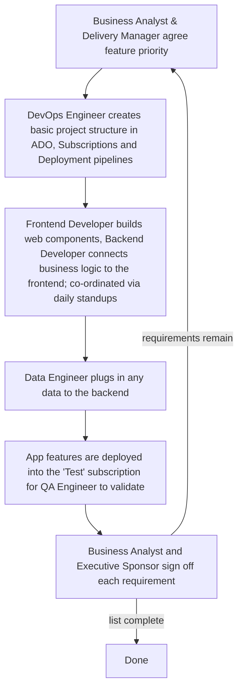
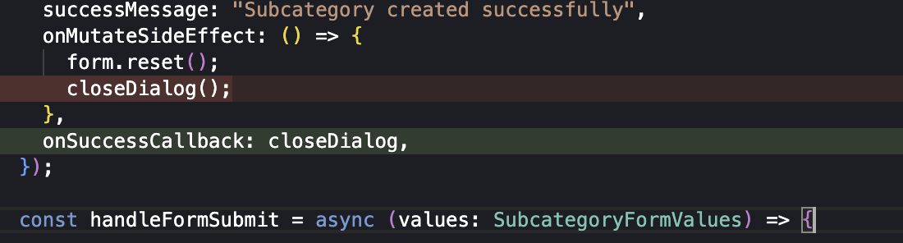
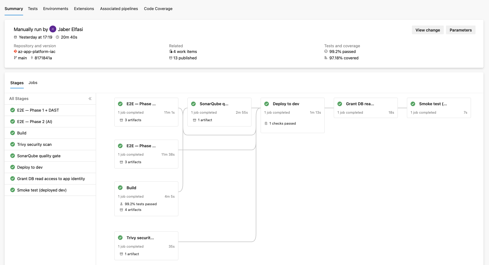
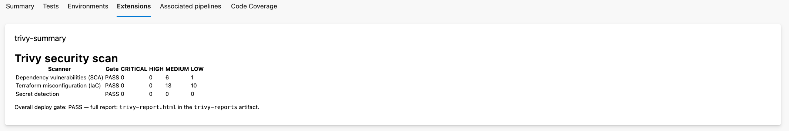
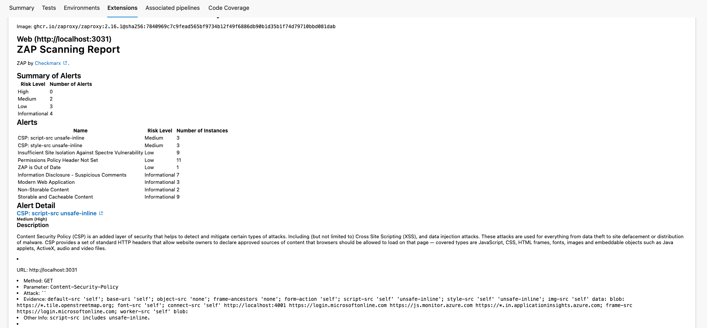
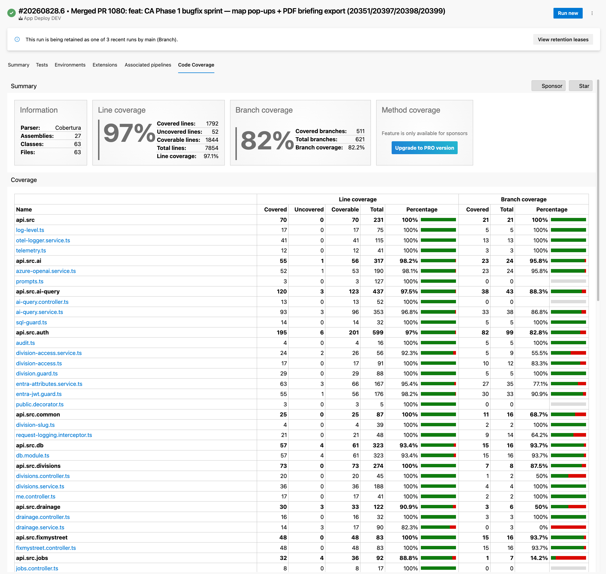
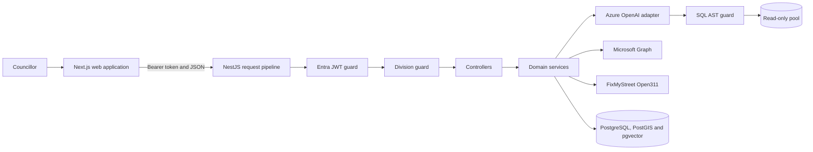
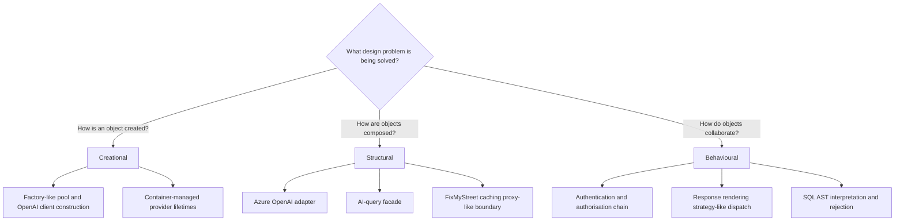
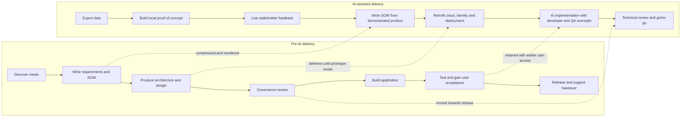

# Project 7 - Software Testing and Design Patterns

## Context

#### Quality Diagnosis <!-- 500 words -->

The organisation is seeking to speed up application delivery by leveraging AI in both product design and development. This has knock-on effects for how software quality is guaranteed, changing project delivery timescales and the legacy agile-based (Gitlab, n.d.) app design, governance, coding, testing and change management process. We look at the current process first, to compare it with the new AI-driven approach.

## K8: [Pass] Explains how teams work effectively to produce a digital and technology solution applying relevant organisational theories using up to date awareness of trends and innovations

### Evidence

##### Current Development Practice

Business analysts gather requirements driven by specific customer needs, which after a number of weeks or months becomes a Statement of Work (SOW).

A team is then formed around the SOW with each member having a role: Business Analyst, Executive Sponsor, Technical Architect, Frontend and Backend Developers, Data Engineer, QA Engineer, Delivery Manager and DevOps Engineer.

The team starts work on delivering against the SOW and producing a High Level Design (HLD) document.

This document goes to the Digital Design Authority (DDA) for technical review, then the Change Advisory Board (CAB) for business review, focused on whether security, testing and deployment policies have been followed to mitigate organisational risk and prevent major outages (Atlassian, n.d.).

Development _can_ start before the CAB has approved the approach but an App cannot be deployed into the production environment without approval. 

Generally all development follows the loop below: -



*Figure 1: Development Loop*


#### Stakeholder Communication and Professional Practice <!-- 700 words -->

##### How AI changed the software delivery process

As mentioned previously, the application was created through an AI-assisted design and delivery process. Historically, requirements would be gathered and a specification refined between a Product Owner and stakeholders before being handed to a development team. Having stakeholders directly involved in product definition via AI introduces new dynamics, not all of them positive.

###### Positive impacts

- Stakeholders are more involved in development, increasing their sense of ownership
- Requirements are communicated to developers through working code rather than documents
- Initial discovery can take as little as a day, rather than the weeks of conceptual discussion previously needed to produce a specification

##### Four-stage AI-assisted lifecycle

###### Stage 1: Stakeholder co-creation and proof of concept

- The client data team exports a point-in-time CSV dataset for the AI context.
- Leadership works with AI co-creation specialists to build a local proof of concept.
- OpenAI API calls demonstrate conversational interrogation of the data.
- Stakeholders make design decisions and give live feedback as the interface evolves.
- The commercial team writes the Statement of Work (SOW), including functional and
	non-functional requirements, once the proof of concept has established the concept.

> **Human-in-the-loop checkpoint 1:** Leadership and client stakeholders decide which
> prototype behaviour is valuable enough to formalise in the SOW; people, not the AI,
> remain accountable for product intent.

###### Stage 2: Engineering the prototype for Azure

- An application platform is established in the client's Azure tenant.
- The prototype code is imported into a repository and deployment automated.
- Engineers adapt code that was not cloud-native: PostgreSQL becomes hosted, OpenAI
	endpoints are replaced by Azure AI Foundry and Entra ID authentication is introduced.
- A development instance is deployed with controlled team access.

> **Human-in-the-loop checkpoint 2:** Engineers decide how the prototype must change to
> meet identity, data, hosting and deployment constraints; security and feasibility
> remain human accountabilities.

###### Stage 3: AI-assisted implementation and testing

- The SOW is converted into Azure DevOps user stories and supplied to the AI harness, which implements requirements and produces unit and functional tests.
- Developers and QA supervise the implementation loop; QA is the principal human-in-the-loop for test evidence (see [Testing Strategy and Implementation](#testing-strategy-and-implementation)).
- Product questions return to the client Product Owner rather than being inferred.
- A test group of end users receives early access and supplies usability feedback.
- Testing, security and networking evidence is presented to the technical oversight group.

> **Human-in-the-loop checkpoint 3:** QA assesses generated test evidence, developers
> review implementation quality, the Product Owner resolves product ambiguity and end
> users validate whether the application works in its real context.

Early on it became clear that non-desktop browser testing was missing so this was rolled into the manual test cases due to a lack of time to extend the automation into mobile and tablet screen based tests.

###### Stage 4: In-flight Development Collaboration

- Client product owners feature and full application weekly review
- Feature requests or application changes fed directly to the development team to be implemented by AI
- Technical oversight rely on AI generated High Level Design docs for checking and approval

> **Human-in-the-loop checkpoint 4:** Stakeholders become an adjunct to the development
> team and are given a chance give feedback as it goes with client technical 
> architects and security team members also able ask questions all leading to increased 
> confidence in the eventual deliverable

This falls firmly into the key agile manifesto principal:

> Working software is the primary measure of progress. (Beck, 2001)

A key piece of feedback here was that in the UI several different types of client jobs appeared with different colour codes. When the data team and product owner saw this they felt it was too confusing and decided to roll all the jobs into one color. 

###### Stage 5: Go/no-go and operational handover

- Stakeholders assess security, monitoring, support requirements, ongoing cost, high-
	and low-level design, and testing evidence.
- A human go/no-go decision controls wider enrolment and handover to the support team.

> **Human-in-the-loop checkpoint 5:** Accountable stakeholders accept or reject the
> residual business, technical and operational risk. AI provides delivery artefacts and
> evidence but does not authorise production use.

##### Critical evaluation of the communication strategy

###### What I would do differently

The primary communication challenge came from non-technical stakeholders vibe coding the app in the co-creation P.O.C session (Stage 1) and then expecting the same speed of delivery to translate directly into a deployable, cloud based and secure application. 

This lack of realistic understanding of the challenges of production quality, database connected and maintainable software resulted in a high pressure deadline being set by the organisation's CTO to the point where the project plan was being made to fit the pre-set deadline.


<!--
LO4 | K8, B1 | 700 words

CONTENT TO COVER:
- Communication of design decisions and quality outcomes to technical and non-technical stakeholders
- Evidence of at least two collaborative practices (e.g. peer review, design critique, test result presentation) with reference to their impact on the project
- Application of professional standards throughout the project
- Impact of the work on the team or organisation

TO REACH B:
- Analyse the effectiveness of stakeholder communication and collaborative practice
- Provide specific examples of how feedback received influenced design or testing decisions
- Demonstrate sustained commitment to quality throughout the project lifecycle
- Support approach with credible external evidence (peer-reviewed research, professional standards/frameworks) and explain how it informed audience adaptation and collaborative practices

TO REACH A:
- Critically evaluate the communication and collaboration strategy as a whole: what worked, what you would do differently, and how your approach reflects the professional standards expected of a senior software engineering practitioner
- Synthesise evidence from multiple credible sources to justify trade-offs in communication and collaboration strategy
-->


## K21: [Pass] Describes scenarios covering all stages of a development lifecycle, identifying techniques and methods are applied in each case

### Evidence

#### Quality Diagnosis <!-- 500 words -->

The organisation is seeking to speed up application delivery by leveraging AI in both product design and development. This has knock-on effects for how software quality is guaranteed, changing project delivery timescales and the legacy agile-based (Gitlab, n.d.) app design, governance, coding, testing and change management process. We look at the current process first, to compare it with the new AI-driven approach.

##### Current Development Practice

Business analysts gather requirements driven by specific customer needs, which after a number of weeks or months becomes a Statement of Work (SOW).

A team is then formed around the SOW with each member having a role: Business Analyst, Executive Sponsor, Technical Architect, Frontend and Backend Developers, Data Engineer, QA Engineer, Delivery Manager and DevOps Engineer.

The team starts work on delivering against the SOW and producing a High Level Design (HLD) document.

This document goes to the Digital Design Authority (DDA) for technical review, then the Change Advisory Board (CAB) for business review, focused on whether security, testing and deployment policies have been followed to mitigate organisational risk and prevent major outages (Atlassian, n.d.).

Development _can_ start before the CAB has approved the approach but an App cannot be deployed into the production environment without approval. 

Generally all development follows the loop below: -


*Figure 1: Development Loop*

##### Design and Testing as related to Software Quality Outcomes

Historically developers handed code to QA, which shuttled it back and forth fixing bugs before handing off to operations; their relationship with it ended at delivery.

`You build it, you run it` (Thoughtworks, 2016) has not been the operating model here, and design patterns were not used. 

Testing has been entirely manual, following a Test Plan managed inside Azure DevOps (ADO) that requires a QA Engineer to loop through every test to find bugs.

Given the organisation's move to both an AI driven product prototype phase and LLM coded applications how do we maintain software quality? According to Patil, A (2025) over 200 papers have been written on SQA with LLM's and research activity is accelerating. 

AI has been used to address existing design and testing quality gaps, especially where developers using AI may not fully understand the code the LLM outputs (Martin, 2026).

##### Current Quality Gaps

###### Application testing gaps 

Developers have not had to write unit tests because they could simply hand over their application changes to the QA Engineer. 

This is inadequate: a refactoring change to delete security tokens after use had a code path where 'cleanup' occurred before the page was resubmitted, breaking the application. 

```typescript
def cleanup(self):
    """Cleanup resources"""
    if hasattr(self, 'session'):
        self.session.close()
        logger.info("[AUTH][AZURE] HTTP session closed")
```

*Figure 2: token cleanup introduced*

Cleanup added to close the http session properly, which includes deleting the JWT security token.



*Figure 3: dialog close error*

CloseDialog() was subsequently called in an unmodified part of the code (in red), requiring a hotfix so it ran after OnSuccessCallBack — otherwise the session closed before the UI changes saved, returning a 'missing auth token' failure.

This change was committed into git on the day before the app was due to go live.

###### Developers not reading the application code

Another example of abdicating responsibility to AI: end users noticed the app's 'last updated' date was hard-coded to read "May 2025" in the HTML, unnoticed by the AI app creation team, who hadn't spent time reading the codebase. 

Other code queries were put to AI rather than investigated directly, risking a loss of critical thinking skills (Field, 2025).

###### Code quality and security scanning in deployment pipelines

Pipelines deployed code without automated checks (static analysis, security scanning, tests) so there was no consistent verification of new features as releases moved through environments. 

The team implemented SonarQube running in a container to exercise numerous automated tests, linting and other configuration checks. 

Misconfigured cloud resources are a leading cause of security breaches (Ashwood, 2024), so Trivy was added to scan the Terraform (IaC) resource pipeline before deployment to Azure.

###### Antiquated Change Process

Spending weeks writing a High Level Design (HLD) document, then asking people unfamiliar with the code to pronounce on risk, looks like security theatre (Deploy, n.d.).

Any retained change process should focus on automated security checks, test results, code review and release stage gates, not a manual process based on 2013 ITIL (Octopus Deploy, n.d.).

##### Why make improvements?
These are just some of the issues identified, even before AI developer tools were introduced. If AI's goal is to enhance developer productivity (Plandek.com, 2026), testing must improve to cope with this increased change rate — hence adding code quality scanning, test coverage metrics, security checks and other pipeline enhancements that previous non-test-based approaches could not support.

Comparing the previous process to the new AI-generated-code methodology using the ISO/IEC 25010 quality framework (Sonar, 2026) shows more testing is being introduced because: 

> Engineering teams can generate software faster than they can confidently verify its quality. (Sonar, 2026)

These checks are being baked into the pipeline because this speed of change demands it. Previously, developers had more psychological safety because they fully understood every change made. Coupling higher delivery speed and productivity demands with offloading coding to AI means results are trusted far less — pulling through an insistence on a much wider suite of automated tests.

<!--
LO1 | K21 | 500 words

CONTENT TO COVER:
- Organisation's current development practice located within the SDLC
- Relationship between design practices, testing activity, and software quality outcomes
- Identification of at least two specific quality gaps with business impact
- The case for the improvements explored in the rest of the project

TO REACH B:
- Analyse quality implications in depth using evidence from the organisation
- Connect identified gaps explicitly to specific SDLC stages
- Show how design and testing decisions interact to produce quality outcomes
- Support diagnosis with credible external evidence (peer-reviewed research, white/green papers,
  benchmarking studies, standards/frameworks) and explain how it applies to your SDLC context

TO REACH A:
- Critically evaluate current practice against professional standards and emerging approaches
  (e.g. shift-left testing, architectural review practices)
- Synthesise evidence from multiple credible sources, compare viewpoints, and justify trade-offs
- Produce original insight into the organisation's quality position that clearly motivates
  the project's scope and direction
-->


##### Four-stage AI-assisted lifecycle

###### Stage 1: Stakeholder co-creation and proof of concept

- The client data team exports a point-in-time CSV dataset for the AI context.
- Leadership works with AI co-creation specialists to build a local proof of concept.
- OpenAI API calls demonstrate conversational interrogation of the data.
- Stakeholders make design decisions and give live feedback as the interface evolves.
- The commercial team writes the Statement of Work (SOW), including functional and
	non-functional requirements, once the proof of concept has established the concept.

> **Human-in-the-loop checkpoint 1:** Leadership and client stakeholders decide which
> prototype behaviour is valuable enough to formalise in the SOW; people, not the AI,
> remain accountable for product intent.

###### Stage 2: Engineering the prototype for Azure

- An application platform is established in the client's Azure tenant.
- The prototype code is imported into a repository and deployment automated.
- Engineers adapt code that was not cloud-native: PostgreSQL becomes hosted, OpenAI
	endpoints are replaced by Azure AI Foundry and Entra ID authentication is introduced.
- A development instance is deployed with controlled team access.

> **Human-in-the-loop checkpoint 2:** Engineers decide how the prototype must change to
> meet identity, data, hosting and deployment constraints; security and feasibility
> remain human accountabilities.

###### Stage 3: AI-assisted implementation and testing

- The SOW is converted into Azure DevOps user stories and supplied to the AI harness, which implements requirements and produces unit and functional tests.
- Developers and QA supervise the implementation loop; QA is the principal human-in-the-loop for test evidence (see [Testing Strategy and Implementation](#testing-strategy-and-implementation)).
- Product questions return to the client Product Owner rather than being inferred.
- A test group of end users receives early access and supplies usability feedback.
- Testing, security and networking evidence is presented to the technical oversight group.

> **Human-in-the-loop checkpoint 3:** QA assesses generated test evidence, developers
> review implementation quality, the Product Owner resolves product ambiguity and end
> users validate whether the application works in its real context.

Early on it became clear that non-desktop browser testing was missing so this was rolled into the manual test cases due to a lack of time to extend the automation into mobile and tablet screen based tests.

###### Stage 4: In-flight Development Collaboration

- Client product owners feature and full application weekly review
- Feature requests or application changes fed directly to the development team to be implemented by AI
- Technical oversight rely on AI generated High Level Design docs for checking and approval

> **Human-in-the-loop checkpoint 4:** Stakeholders become an adjunct to the development
> team and are given a chance give feedback as it goes with client technical 
> architects and security team members also able ask questions all leading to increased 
> confidence in the eventual deliverable

This falls firmly into the key agile manifesto principal:

> Working software is the primary measure of progress. (Beck, 2001)

A key piece of feedback here was that in the UI several different types of client jobs appeared with different colour codes. When the data team and product owner saw this they felt it was too confusing and decided to roll all the jobs into one color. 

###### Stage 5: Go/no-go and operational handover

- Stakeholders assess security, monitoring, support requirements, ongoing cost, high-
	and low-level design, and testing evidence.
- A human go/no-go decision controls wider enrolment and handover to the support team.

> **Human-in-the-loop checkpoint 5:** Accountable stakeholders accept or reject the
> residual business, technical and operational risk. AI provides delivery artefacts and
> evidence but does not authorise production use.


#### Testing Strategy and Implementation <!-- 1100 words -->

Using an agentic AI harness to write automated tests, adding checks to deployment pipelines and even running a 'smoke test' post deploy leads to a high confidence that if application changes pass through this pipeline it will function as intended.

##### Testing strategy



*Figure 6: App Deployment Pipeline*

Code changes must pass through several stages before deployment: -

1. E2E - phase 1 - Runs OWASP (ZAP) against the app code
2. E2E - phase 2 - checks the OpenAI (Azure Foundry) endpoint
3. Build - creates zips for deployment & runs unit tests
4. Trivy - infra security scan
5. SonarQube quality gate - runs checks on previous tests and decides whether deployment should continue
6. Deploy to dev
7. Grant access to DB from Azure DevOps
8. Smoke test checks the deployed API and Web endpoints are healthy

This pipeline directly exercises the ADR safeguards from Section 2: unit tests target the SQL AST guard with malformed and multi-statement SQL, and the JWT/ward authorisation chain is tested for cache expiry and cross-division access.

Additionally there's a QA person who checks the AI generated test cases for relevance or issues and is responsible for the overall test process.

Importantly they are _still_ carrying out manual test, investigative (exploratory) tests and in this case are spending significant time making sure that non-standard client devices (mobiles, tablets) can render the frontend UI properly.

###### Additional deployment pipeline based checks

Deploying the Azure resources (infrastructure) and application using a CI/CD pipeline means that automated checks can be added to mitigate various issues that might not be uncovered through the normal code review process.

Trivy (Trivy, n.d.) is a Terraform code scanning tool used to look for configuration lapses in security. This checks all the infrastructure-as-code (IaC) for vulnerabilities. The various resources that are deployed to host the application may of course work but it could contain holes that a DevOps engineer might miss. 



*Figure 7: Trivy IaC security scan results.*

Where Trivy checks the infrastructure, OWASP ZAP (Severns, 2025) probes the running application itself. It acts as a proxy between a browser and the deployed web app, attacking it the way an external user would — spidering pages, fuzzing inputs and flagging common weaknesses such as missing security headers, cross-site scripting and injection points. This matters because an application can pass code review and still ship an exploitable flaw: a missing header or an unvalidated input only becomes visible once the app is actually running and responding to hostile requests.



*Figure 8: OWASP ZAP dynamic scan report.*



*Figure 9: OWASP code coverage scan*

##### Limitations in coverage

###### Client mobile devices

One area which ended up being extensively covered by manual tests was how the application rendered on a mobile device or tablet. This was because even with the assist of AI to generate test scripts the team writing prompts were not able to deliver a satisfactory solution to check HTML page rendering on mobile or non-desktop formats. QA members ended up checking page rendering on their phone or their own tablet(s). 

One could assume that since the app used a react framework (Next.js) that page rendering on different resolutions should 'just work' but non-technical team members seemed to insist that somehow real devices were used to check this.

With a little more time, this could probably be refined to include Chrome Dev Tools ability to render non-desktop devices (Chrome for Developers, n.d.)

##### Testing Strategy Evaluation

The additional pre-deployment test stages (see *Figure 6*), with the exception of Trivy, were entirely new to the organisation so clearly an improvement from the previous Development to QA and back loop.

Manual testing for different device sizes were added after the Product team pointed out that most users would be accessing the application from their phone.

While the original Statement of Work (SOW) contained commitments around page rendering and AI query response time, this wasn't included in the original test strategy. So application performance checking remains a real gap. Engineers did point out the challenge with making performance commitments about a phone based internet connection but it wasn't removed from the SOW.

In summary the pre-existing test approach was such a low bar that any additional application, scanning, smoke or end-to-end testing meant increased confidence in making changes. 

To re-state an earlier point. As AI driven development increases code change frequency, having all these guard rails in place becomes effectively mandatory, especially when developers may not intimately understand all the code since they haven't written it themselves.

<!-- connect design decisions, testing outcomes, and quality impact in an original and professionally convincing way -->

<!--
LO3 | S21 | 1,100 words

CONTENT TO COVER:
- Testing strategy mapped to relevant SDLC stages
- How design decisions from Section 2 shaped the testing approach
- Test suite implementation: automated tests, black-box and white-box techniques, boundary analysis
- CI/CD integration and tooling
- Test results and coverage
- Refinement of approach based on outcomes and evaluation of effectiveness

TO REACH B:
- Analyse testing outcomes and explicitly refine the approach based on results
- Evaluate the effectiveness of techniques used and identify limitations in coverage
- Connect testing findings explicitly to the quality improvements sought
- Support strategy evaluation with credible external evidence (peer-reviewed research white/green papers, standards/frameworks) and explain how it informed technique selection, refinement, and coverage decisions

TO REACH A:
- Critically evaluate the testing strategy as a whole: what it proved, what it missed,and what the results mean for software quality in the organisational context
- Synthesise evidence from multiple credible sources, compare testing approaches, and justify trade-offs
- Connect design decisions, testing outcomes, and quality impact in an original and professionally convincing way
-->


## K22: [Pass] Explains the principles of a range of development techniques, for each stage of the software development cycle that produce artefacts and the contexts in which they can be applied

### Evidence

#### Design Evaluation and Architectural Decisions <!-- 1100 words -->

The application was created using an AI agent harness to significantly reduce time to deployment from about 4 months to 8 weeks.

A component of the harness creates Architectural Decision Records (ADR's) as it proceeds through feature delivery.

##### Application and architectural analysis

The app is a TypeScript monorepo comprising a Next.js web client frontend and a modular NestJS API for connecting to a Postgresql database.

The browser accesses the backend through an API wrapper and NestJS controllers delegate to domain services for jobs, schemes, drainage, verges, knowledge retrieval and AI-assisted querying.

NestJS dependency injection (DI) composes these services and a global database module provides separate owner and read-only connection pools. 

This is basically a layered, modular-monolith architecture rather than microservices: deployment is simple and cross-feature calls remain local, but the API modules still establish boundaries from which services could later be separated if needed.



*Figure 4: Principal components and trust boundaries.*

The primary coupling is to abstractions supplied by NestJS and to locally defined service APIs, not directly between pages and data stores. 

This improves replaceability and permits tests to inject pool and credential doubles. However,`AiQueryService` coordinates prompt construction, retrieval, SQL execution and response formatting, making it a high-coupling orchestration point. 

`FixMyStreetController` similarly contains HTTP integration, cache state, geographic calculation and request handling. These choices worked for the proof of concept creation stage could cause issues later when more features or tests might need to be added.

##### Design-pattern evaluation

The three pattern categories are distinguished by the design problem they solve, not merely by pattern names. 

Creational patterns control **how objects are made**; structural patterns control **how objects are composed**; and behavioural patterns control **how objects communicate and allocate responsibility** (Gamma *et al.*, 1994). 

The classification below applies these categories to the app code.



*Figure 5: Pattern categories distinguished by concern and mapped to the application.*

The database module's `buildPoolConfig()` and the OpenAI service's `buildAzureClient()` both centralise construction in a single function, but neither is a true Factory Method — no subclass overrides the creation step. 

The clearest structural pattern is **Adapter**. `AzureOpenAiService` translates the application's existing `invoke` contract and Anthropic-style tool definitions into Azure OpenAI function calls. Callers therefore remained stable when AWS Bedrock was replaced in refactoring the application to run using Azure Foundry.

`AiQueryService` acts as a **Facade**, presenting controllers with one operation while coordinating LLM, knowledge-base and spatial services. 

##### Quality implications

These patterns aid security and testability. Centralised authentication prevents controllers from inconsistently enforcing identity, while DI allows guards and services to be tested using fake dependencies.

The OpenAI adapter localises vendor-specific APIs, and the database factory enforces bounded pools and fail-fast configuration. 
 
Together these support ISO/IEC 25010 characteristics of maintainability, security and reliability (ISO, 2023). 

The main trade-offs are concentration of responsibility and runtime dependency. `AiQueryService` is easier for controllers to consume but has a broad test surface. 

Ward authorisation depends on Microsoft Graph; caching improves performance and availability but permits entitlement revocation to remain stale for up to 15 minutes on each application instance. 

Failing closed on an empty cache favours confidentiality over availability, consistent with zero-trust guidance (Rose *et al.*, 2020). 

##### Architectural Decision Record recommendations

###### ADR 1: Retain Entra-issued JWT authentication and attribute-based ward authorisation

**Status:** Recommended, reflecting implemented ADR-004 and ADR-013. **Context:** Ward data must not be anonymous or visible across councillor boundaries. Entra does not replace JWT: Entra is the identity provider that issues JWT access tokens, which the global guard validates by issuer, audience and signature. Because Custom Security Attributes are not token claims, the API retrieves ward assignments from Graph using the stable object ID and applies deny-by-default authorisation.

**Decision:** Retain global authentication followed by a separate division guard; use the configured ward attribute as the single access source, cache it for 15 minutes and fail closed when an entitlement cannot be established. **Alternatives:** per-controller checks risk inconsistent enforcement; email identity is mutable; and fail-open caching could disclose data during a Graph outage. **Consequences and tests:** Graph is an availability dependency and revocation is not immediate. Unit tests should verify invalid issuer/audience, absent attributes, cache expiry and 401/403/503 distinctions; integration tests should prove one ward cannot read another. This supports councillor reuse of managed accounts while reducing both administration and data-protection risk.

###### ADR 2: Retain defence-in-depth for LLM-generated PostgreSQL queries

**Status:** Recommended, reflecting implemented ADR-009. **Context:** A language model can be manipulated through prompt injection, so generated SQL cannot be trusted merely because the user is authenticated. A previous string-prefix `SELECT` check would not reliably detect stacked or disguised statements.

**Decision:** Parse generated SQL into an abstract syntax tree, permit exactly one `SELECT`, execute it through a separately provisioned read-only pool and preserve row level ward scoping. **Alternatives:** prompt instructions alone provide no enforceable boundary; a parser alone can contain defects; and removing natural-language querying would discard its business value. **Consequences and tests:** the parser and second pool add dependency and configuration cost, but independent controls limit impact when one fails. Parameterised application queries should remain the default outside this exception (OWASP, 2025). Tests should include comments, malformed SQL, multiple statements, DDL/DML, CTEs and cross-division attempts, plus a database integration test proving the read-only role cannot write. This is proportionate because the threatened data and AI-generated execution boundary justify stronger controls than ordinary fixed-query endpoints.

<!--
LO2 | K22, K23 | 1,100 words

CONTENT TO COVER:
- Analysis of the design and architectural characteristics of the chosen system
- Evaluation of design patterns present or absent - creational, structural, behavioural
- Assessment of coupling, structural decisions, and quality implications
- Architectural Decision Record (ADR) documenting at least two recommended improvements with testability implications and business justification

TO REACH B:
- Analyse how design decisions (pattern selection, coupling, structural choices) interact to affect software quality and testability
- Justify recommendations with context-specific evidence
- Demonstrate proportionality - show awareness of when simpler solutions are preferable to complex pattern implementations
- Support evaluation with credible external evidence (peer-reviewed research, white/green papers, standards/frameworks) and explain how it strengthens judgement about proportionality

TO REACH A:
- Critically evaluate the system's design against organisational quality requirements
- Synthesise an ADR demonstrating sophisticated professional judgement: e.g. where a pattern introduces unnecessary complexity, where deferred decisions are strategically sound, or where competing design forces require explicit trade-off reasoning
- Synthesise evidence from multiple credible sources to justify architectural trade-offs
-->


#### Testing Strategy and Implementation <!-- 1100 words -->

Using an agentic AI harness to write automated tests, adding checks to deployment pipelines and even running a 'smoke test' post deploy leads to a high confidence that if application changes pass through this pipeline it will function as intended.

##### Testing strategy


*Figure 6: App Deployment Pipeline*

Code changes must pass through several stages before deployment: -

1. E2E - phase 1 - Runs OWASP (ZAP) against the app code
2. E2E - phase 2 - checks the OpenAI (Azure Foundry) endpoint
3. Build - creates zips for deployment & runs unit tests
4. Trivy - infra security scan
5. SonarQube quality gate - runs checks on previous tests and decides whether deployment should continue
6. Deploy to dev
7. Grant access to DB from Azure DevOps
8. Smoke test checks the deployed API and Web endpoints are healthy

This pipeline directly exercises the ADR safeguards from Section 2: unit tests target the SQL AST guard with malformed and multi-statement SQL, and the JWT/ward authorisation chain is tested for cache expiry and cross-division access.

Additionally there's a QA person who checks the AI generated test cases for relevance or issues and is responsible for the overall test process.

Importantly they are _still_ carrying out manual test, investigative (exploratory) tests and in this case are spending significant time making sure that non-standard client devices (mobiles, tablets) can render the frontend UI properly.

###### Additional deployment pipeline based checks

Deploying the Azure resources (infrastructure) and application using a CI/CD pipeline means that automated checks can be added to mitigate various issues that might not be uncovered through the normal code review process.

Trivy (Trivy, n.d.) is a Terraform code scanning tool used to look for configuration lapses in security. This checks all the infrastructure-as-code (IaC) for vulnerabilities. The various resources that are deployed to host the application may of course work but it could contain holes that a DevOps engineer might miss. 


*Figure 7: Trivy IaC security scan results.*

Where Trivy checks the infrastructure, OWASP ZAP (Severns, 2025) probes the running application itself. It acts as a proxy between a browser and the deployed web app, attacking it the way an external user would — spidering pages, fuzzing inputs and flagging common weaknesses such as missing security headers, cross-site scripting and injection points. This matters because an application can pass code review and still ship an exploitable flaw: a missing header or an unvalidated input only becomes visible once the app is actually running and responding to hostile requests.


*Figure 8: OWASP ZAP dynamic scan report.*


*Figure 9: OWASP code coverage scan*

##### Limitations in coverage

###### Client mobile devices

One area which ended up being extensively covered by manual tests was how the application rendered on a mobile device or tablet. This was because even with the assist of AI to generate test scripts the team writing prompts were not able to deliver a satisfactory solution to check HTML page rendering on mobile or non-desktop formats. QA members ended up checking page rendering on their phone or their own tablet(s). 

One could assume that since the app used a react framework (Next.js) that page rendering on different resolutions should 'just work' but non-technical team members seemed to insist that somehow real devices were used to check this.

With a little more time, this could probably be refined to include Chrome Dev Tools ability to render non-desktop devices (Chrome for Developers, n.d.)

##### Testing Strategy Evaluation

The additional pre-deployment test stages (see *Figure 6*), with the exception of Trivy, were entirely new to the organisation so clearly an improvement from the previous Development to QA and back loop.

Manual testing for different device sizes were added after the Product team pointed out that most users would be accessing the application from their phone.

While the original Statement of Work (SOW) contained commitments around page rendering and AI query response time, this wasn't included in the original test strategy. So application performance checking remains a real gap. Engineers did point out the challenge with making performance commitments about a phone based internet connection but it wasn't removed from the SOW.

In summary the pre-existing test approach was such a low bar that any additional application, scanning, smoke or end-to-end testing meant increased confidence in making changes. 

To re-state an earlier point. As AI driven development increases code change frequency, having all these guard rails in place becomes effectively mandatory, especially when developers may not intimately understand all the code since they haven't written it themselves.

<!-- connect design decisions, testing outcomes, and quality impact in an original and professionally convincing way -->

<!--
LO3 | S21 | 1,100 words

CONTENT TO COVER:
- Testing strategy mapped to relevant SDLC stages
- How design decisions from Section 2 shaped the testing approach
- Test suite implementation: automated tests, black-box and white-box techniques, boundary analysis
- CI/CD integration and tooling
- Test results and coverage
- Refinement of approach based on outcomes and evaluation of effectiveness

TO REACH B:
- Analyse testing outcomes and explicitly refine the approach based on results
- Evaluate the effectiveness of techniques used and identify limitations in coverage
- Connect testing findings explicitly to the quality improvements sought
- Support strategy evaluation with credible external evidence (peer-reviewed research white/green papers, standards/frameworks) and explain how it informed technique selection, refinement, and coverage decisions

TO REACH A:
- Critically evaluate the testing strategy as a whole: what it proved, what it missed,and what the results mean for software quality in the organisational context
- Synthesise evidence from multiple credible sources, compare testing approaches, and justify trade-offs
- Connect design decisions, testing outcomes, and quality impact in an original and professionally convincing way
-->


## K23: [Pass] Explains the principles of a range of development methods and approaches and the contexts in which they can be applied

### Evidence

#### Critical Evaluation and Recommendations <!-- 600 words -->


##### Downsides to the introduction of AI

Non-technical stakeholders can develop an very optimistic view of delivery timescales after watching a working proof of concept appear in a day while unaware it that ran without the real-world constraints of cloud deployment, security access, GDPR obligations, or live data. 

This makes expectation-management conversations challenging, since they contradict that lived experience.

##### What the accelerated process changed



*Figure 10: Comparison of the pre-AI sequence and the AI-assisted lifecycle.*

| Pre-AI activity | Change in the AI-assisted process | Quality implication |
| --- | --- | --- |
| Requirements elicitation before implementation | **Compressed and reordered:** the prototype preceded the formal SOW | Faster discovery and more tangible feedback, but prototype choices may become requirements without sufficient challenge |
| High- and low-level design before construction | **Deferred:** cloud architecture was addressed after local code existed | Rapid validation of value, but later rework was required for PostgreSQL, Azure AI Foundry and Entra ID |
| Architecture, security and governance review before build | **Initially bypassed, later restored:** technical oversight occurs after development deployment | Decisions use working evidence, but material risks may be discovered after sunk effort |
| Cloud and deployment constraints | **Missed from the initial prototype:** it ran locally against static data | Low-cost experimentation, but the proof of concept did not establish deployability, scalability or live-data behaviour |
| Test design alongside requirements | **Deferred to Stage 3:** AI generated tests under developer and QA oversight | Automation can accelerate coverage, but late test design may preserve ambiguous or untestable requirements |
| End-user acceptance near the end | **Brought forward:** a test group accesses the development instance | Earlier usability evidence reduces the risk of technically correct but unsuitable features |
| Monitoring, support and cost planning | **Deferred to go/no-go:** assessed before wider release | Avoids over-engineering an unproven idea, but late operational findings can delay or prevent release |

*Table 1: Activities compressed, deferred, omitted initially or moved earlier.*

The process shortened discovery-to-demonstration time but did not eliminate the work a supportable service needs; it changed when that work occurred and who carried its risks. 

Continuous access to a tangible product for stakeholder feedback was the strongest feature. 

The principal weakness was that architecture, security, testing and operational questions followed the prototype, creating pressure to retrofit quality into code that stakeholders already perceived as nearly complete.

##### AI & Quality trade offs

While AI increases iteration speed and collaboration (Stage 4), it may result in a product that only continued AI use can maintain. 

Code quality still matters (Yu N, 2026), but _how_ a result is achieved may become secondary to _whether it works_. Maybe using enough LLM tokens can eventually produce a shippable product that achieves a business goal but without objectively high-quality code.

##### Summary

Development has moved from 'Big Design up Front' (months of development), through 'Agile' (two-week iterations) and AI has now reduced the apparent change time to less than a day. 

Faster, lower-cost change without a parallel increase in testing and security checking will increase bugs, precisely because of this higher change frequency (CodeRabbit, 2026).
 
##### Recommendations for the future

If this AI-accelerated development process is reused, keep these points in mind:

- Rapid code changes have knock on effects for the developers (stackoverflow, 2026) in terms of stress and psychological safety
- Complex applications don't suddenly become faster to deliver just because AI is being used and this shouldn't result in abdicating responsibility for managing client expectations around delivery dates
- AI use must be accompanied by an _increase_ in testing to compensate for the evidence that developers heavy use of AI doesn't guarantee they have paid attention to changes

<!--
LO3, LO4 | S21, K8, B1 | 600 words

CONTENT TO COVER:
- Critical evaluation of design decisions made - were they the right choices?
- Critical evaluation of the testing strategy - was it effective, what did it miss?
- Assessment of quality improvements achieved and gaps that remain
- Recommendations for next steps and future iterations
- Lessons learnt

NOTE: This section draws on both LO3 and LO4 - it should synthesise the whole project,
not introduce new evidence. Use it to show depth of reflection.

TO REACH B (LO3):
- Connect testing findings explicitly to the quality improvements sought
- Show determination, refinement, and adaptation in your approach

TO REACH B (LO4):
- Show sustained commitment to quality throughout the project lifecycle
- Apply professional standards with clear awareness of their purpose

TO REACH A:
- Produce original, professionally convincing conclusions that connect design decisions, testing outcomes, and quality impact across the project as a whole
- Synthesise evidence from multiple credible sources to justify trade-offs
- Reflect on how your professional practice shaped outcomes and what you would do differently
-->


## S21: [Pass] Explains how they determine, refine, adapt and use appropriate software engineering methods, approaches and techniques to evaluate software engineering project outcomes

### Evidence

#### Testing Strategy and Implementation <!-- 1100 words -->

Using an agentic AI harness to write automated tests, adding checks to deployment pipelines and even running a 'smoke test' post deploy leads to a high confidence that if application changes pass through this pipeline it will function as intended.

##### Testing strategy


*Figure 6: App Deployment Pipeline*

Code changes must pass through several stages before deployment: -

1. E2E - phase 1 - Runs OWASP (ZAP) against the app code
2. E2E - phase 2 - checks the OpenAI (Azure Foundry) endpoint
3. Build - creates zips for deployment & runs unit tests
4. Trivy - infra security scan
5. SonarQube quality gate - runs checks on previous tests and decides whether deployment should continue
6. Deploy to dev
7. Grant access to DB from Azure DevOps
8. Smoke test checks the deployed API and Web endpoints are healthy

This pipeline directly exercises the ADR safeguards from Section 2: unit tests target the SQL AST guard with malformed and multi-statement SQL, and the JWT/ward authorisation chain is tested for cache expiry and cross-division access.

Additionally there's a QA person who checks the AI generated test cases for relevance or issues and is responsible for the overall test process.

Importantly they are _still_ carrying out manual test, investigative (exploratory) tests and in this case are spending significant time making sure that non-standard client devices (mobiles, tablets) can render the frontend UI properly.

###### Additional deployment pipeline based checks

Deploying the Azure resources (infrastructure) and application using a CI/CD pipeline means that automated checks can be added to mitigate various issues that might not be uncovered through the normal code review process.

Trivy (Trivy, n.d.) is a Terraform code scanning tool used to look for configuration lapses in security. This checks all the infrastructure-as-code (IaC) for vulnerabilities. The various resources that are deployed to host the application may of course work but it could contain holes that a DevOps engineer might miss. 


*Figure 7: Trivy IaC security scan results.*

Where Trivy checks the infrastructure, OWASP ZAP (Severns, 2025) probes the running application itself. It acts as a proxy between a browser and the deployed web app, attacking it the way an external user would — spidering pages, fuzzing inputs and flagging common weaknesses such as missing security headers, cross-site scripting and injection points. This matters because an application can pass code review and still ship an exploitable flaw: a missing header or an unvalidated input only becomes visible once the app is actually running and responding to hostile requests.


*Figure 8: OWASP ZAP dynamic scan report.*


*Figure 9: OWASP code coverage scan*

##### Limitations in coverage

###### Client mobile devices

One area which ended up being extensively covered by manual tests was how the application rendered on a mobile device or tablet. This was because even with the assist of AI to generate test scripts the team writing prompts were not able to deliver a satisfactory solution to check HTML page rendering on mobile or non-desktop formats. QA members ended up checking page rendering on their phone or their own tablet(s). 

One could assume that since the app used a react framework (Next.js) that page rendering on different resolutions should 'just work' but non-technical team members seemed to insist that somehow real devices were used to check this.

With a little more time, this could probably be refined to include Chrome Dev Tools ability to render non-desktop devices (Chrome for Developers, n.d.)

##### Testing Strategy Evaluation

The additional pre-deployment test stages (see *Figure 6*), with the exception of Trivy, were entirely new to the organisation so clearly an improvement from the previous Development to QA and back loop.

Manual testing for different device sizes were added after the Product team pointed out that most users would be accessing the application from their phone.

While the original Statement of Work (SOW) contained commitments around page rendering and AI query response time, this wasn't included in the original test strategy. So application performance checking remains a real gap. Engineers did point out the challenge with making performance commitments about a phone based internet connection but it wasn't removed from the SOW.

In summary the pre-existing test approach was such a low bar that any additional application, scanning, smoke or end-to-end testing meant increased confidence in making changes. 

To re-state an earlier point. As AI driven development increases code change frequency, having all these guard rails in place becomes effectively mandatory, especially when developers may not intimately understand all the code since they haven't written it themselves.

<!-- connect design decisions, testing outcomes, and quality impact in an original and professionally convincing way -->

<!--
LO3 | S21 | 1,100 words

CONTENT TO COVER:
- Testing strategy mapped to relevant SDLC stages
- How design decisions from Section 2 shaped the testing approach
- Test suite implementation: automated tests, black-box and white-box techniques, boundary analysis
- CI/CD integration and tooling
- Test results and coverage
- Refinement of approach based on outcomes and evaluation of effectiveness

TO REACH B:
- Analyse testing outcomes and explicitly refine the approach based on results
- Evaluate the effectiveness of techniques used and identify limitations in coverage
- Connect testing findings explicitly to the quality improvements sought
- Support strategy evaluation with credible external evidence (peer-reviewed research white/green papers, standards/frameworks) and explain how it informed technique selection, refinement, and coverage decisions

TO REACH A:
- Critically evaluate the testing strategy as a whole: what it proved, what it missed,and what the results mean for software quality in the organisational context
- Synthesise evidence from multiple credible sources, compare testing approaches, and justify trade-offs
- Connect design decisions, testing outcomes, and quality impact in an original and professionally convincing way
-->


#### Critical Evaluation and Recommendations <!-- 600 words -->


##### Downsides to the introduction of AI

Non-technical stakeholders can develop an very optimistic view of delivery timescales after watching a working proof of concept appear in a day while unaware it that ran without the real-world constraints of cloud deployment, security access, GDPR obligations, or live data. 

This makes expectation-management conversations challenging, since they contradict that lived experience.

##### What the accelerated process changed


*Figure 10: Comparison of the pre-AI sequence and the AI-assisted lifecycle.*

| Pre-AI activity | Change in the AI-assisted process | Quality implication |
| --- | --- | --- |
| Requirements elicitation before implementation | **Compressed and reordered:** the prototype preceded the formal SOW | Faster discovery and more tangible feedback, but prototype choices may become requirements without sufficient challenge |
| High- and low-level design before construction | **Deferred:** cloud architecture was addressed after local code existed | Rapid validation of value, but later rework was required for PostgreSQL, Azure AI Foundry and Entra ID |
| Architecture, security and governance review before build | **Initially bypassed, later restored:** technical oversight occurs after development deployment | Decisions use working evidence, but material risks may be discovered after sunk effort |
| Cloud and deployment constraints | **Missed from the initial prototype:** it ran locally against static data | Low-cost experimentation, but the proof of concept did not establish deployability, scalability or live-data behaviour |
| Test design alongside requirements | **Deferred to Stage 3:** AI generated tests under developer and QA oversight | Automation can accelerate coverage, but late test design may preserve ambiguous or untestable requirements |
| End-user acceptance near the end | **Brought forward:** a test group accesses the development instance | Earlier usability evidence reduces the risk of technically correct but unsuitable features |
| Monitoring, support and cost planning | **Deferred to go/no-go:** assessed before wider release | Avoids over-engineering an unproven idea, but late operational findings can delay or prevent release |

*Table 1: Activities compressed, deferred, omitted initially or moved earlier.*

The process shortened discovery-to-demonstration time but did not eliminate the work a supportable service needs; it changed when that work occurred and who carried its risks. 

Continuous access to a tangible product for stakeholder feedback was the strongest feature. 

The principal weakness was that architecture, security, testing and operational questions followed the prototype, creating pressure to retrofit quality into code that stakeholders already perceived as nearly complete.

##### AI & Quality trade offs

While AI increases iteration speed and collaboration (Stage 4), it may result in a product that only continued AI use can maintain. 

Code quality still matters (Yu N, 2026), but _how_ a result is achieved may become secondary to _whether it works_. Maybe using enough LLM tokens can eventually produce a shippable product that achieves a business goal but without objectively high-quality code.

##### Summary

Development has moved from 'Big Design up Front' (months of development), through 'Agile' (two-week iterations) and AI has now reduced the apparent change time to less than a day. 

Faster, lower-cost change without a parallel increase in testing and security checking will increase bugs, precisely because of this higher change frequency (CodeRabbit, 2026).
 
##### Recommendations for the future

If this AI-accelerated development process is reused, keep these points in mind:

- Rapid code changes have knock on effects for the developers (stackoverflow, 2026) in terms of stress and psychological safety
- Complex applications don't suddenly become faster to deliver just because AI is being used and this shouldn't result in abdicating responsibility for managing client expectations around delivery dates
- AI use must be accompanied by an _increase_ in testing to compensate for the evidence that developers heavy use of AI doesn't guarantee they have paid attention to changes

<!--
LO3, LO4 | S21, K8, B1 | 600 words

CONTENT TO COVER:
- Critical evaluation of design decisions made - were they the right choices?
- Critical evaluation of the testing strategy - was it effective, what did it miss?
- Assessment of quality improvements achieved and gaps that remain
- Recommendations for next steps and future iterations
- Lessons learnt

NOTE: This section draws on both LO3 and LO4 - it should synthesise the whole project,
not introduce new evidence. Use it to show depth of reflection.

TO REACH B (LO3):
- Connect testing findings explicitly to the quality improvements sought
- Show determination, refinement, and adaptation in your approach

TO REACH B (LO4):
- Show sustained commitment to quality throughout the project lifecycle
- Apply professional standards with clear awareness of their purpose

TO REACH A:
- Produce original, professionally convincing conclusions that connect design decisions, testing outcomes, and quality impact across the project as a whole
- Synthesise evidence from multiple credible sources to justify trade-offs
- Reflect on how your professional practice shaped outcomes and what you would do differently
-->


## B1: [Pass] Applies relevant legal, ethical, social and professional standards to digital and technology solutions considering both technical and non-technical audiences and in line with organisational guidelines

### Evidence

#### Stakeholder Communication and Professional Practice <!-- 700 words -->

##### How AI changed the software delivery process

As mentioned previously, the application was created through an AI-assisted design and delivery process. Historically, requirements would be gathered and a specification refined between a Product Owner and stakeholders before being handed to a development team. Having stakeholders directly involved in product definition via AI introduces new dynamics, not all of them positive.

###### Positive impacts

- Stakeholders are more involved in development, increasing their sense of ownership
- Requirements are communicated to developers through working code rather than documents
- Initial discovery can take as little as a day, rather than the weeks of conceptual discussion previously needed to produce a specification

##### Four-stage AI-assisted lifecycle

###### Stage 1: Stakeholder co-creation and proof of concept

- The client data team exports a point-in-time CSV dataset for the AI context.
- Leadership works with AI co-creation specialists to build a local proof of concept.
- OpenAI API calls demonstrate conversational interrogation of the data.
- Stakeholders make design decisions and give live feedback as the interface evolves.
- The commercial team writes the Statement of Work (SOW), including functional and
	non-functional requirements, once the proof of concept has established the concept.

> **Human-in-the-loop checkpoint 1:** Leadership and client stakeholders decide which
> prototype behaviour is valuable enough to formalise in the SOW; people, not the AI,
> remain accountable for product intent.

###### Stage 2: Engineering the prototype for Azure

- An application platform is established in the client's Azure tenant.
- The prototype code is imported into a repository and deployment automated.
- Engineers adapt code that was not cloud-native: PostgreSQL becomes hosted, OpenAI
	endpoints are replaced by Azure AI Foundry and Entra ID authentication is introduced.
- A development instance is deployed with controlled team access.

> **Human-in-the-loop checkpoint 2:** Engineers decide how the prototype must change to
> meet identity, data, hosting and deployment constraints; security and feasibility
> remain human accountabilities.

###### Stage 3: AI-assisted implementation and testing

- The SOW is converted into Azure DevOps user stories and supplied to the AI harness, which implements requirements and produces unit and functional tests.
- Developers and QA supervise the implementation loop; QA is the principal human-in-the-loop for test evidence (see [Testing Strategy and Implementation](#testing-strategy-and-implementation)).
- Product questions return to the client Product Owner rather than being inferred.
- A test group of end users receives early access and supplies usability feedback.
- Testing, security and networking evidence is presented to the technical oversight group.

> **Human-in-the-loop checkpoint 3:** QA assesses generated test evidence, developers
> review implementation quality, the Product Owner resolves product ambiguity and end
> users validate whether the application works in its real context.

Early on it became clear that non-desktop browser testing was missing so this was rolled into the manual test cases due to a lack of time to extend the automation into mobile and tablet screen based tests.

###### Stage 4: In-flight Development Collaboration

- Client product owners feature and full application weekly review
- Feature requests or application changes fed directly to the development team to be implemented by AI
- Technical oversight rely on AI generated High Level Design docs for checking and approval

> **Human-in-the-loop checkpoint 4:** Stakeholders become an adjunct to the development
> team and are given a chance give feedback as it goes with client technical 
> architects and security team members also able ask questions all leading to increased 
> confidence in the eventual deliverable

This falls firmly into the key agile manifesto principal:

> Working software is the primary measure of progress. (Beck, 2001)

A key piece of feedback here was that in the UI several different types of client jobs appeared with different colour codes. When the data team and product owner saw this they felt it was too confusing and decided to roll all the jobs into one color. 

###### Stage 5: Go/no-go and operational handover

- Stakeholders assess security, monitoring, support requirements, ongoing cost, high-
	and low-level design, and testing evidence.
- A human go/no-go decision controls wider enrolment and handover to the support team.

> **Human-in-the-loop checkpoint 5:** Accountable stakeholders accept or reject the
> residual business, technical and operational risk. AI provides delivery artefacts and
> evidence but does not authorise production use.

##### Critical evaluation of the communication strategy

###### What I would do differently

The primary communication challenge came from non-technical stakeholders vibe coding the app in the co-creation P.O.C session (Stage 1) and then expecting the same speed of delivery to translate directly into a deployable, cloud based and secure application. 

This lack of realistic understanding of the challenges of production quality, database connected and maintainable software resulted in a high pressure deadline being set by the organisation's CTO to the point where the project plan was being made to fit the pre-set deadline.


<!--
LO4 | K8, B1 | 700 words

CONTENT TO COVER:
- Communication of design decisions and quality outcomes to technical and non-technical stakeholders
- Evidence of at least two collaborative practices (e.g. peer review, design critique, test result presentation) with reference to their impact on the project
- Application of professional standards throughout the project
- Impact of the work on the team or organisation

TO REACH B:
- Analyse the effectiveness of stakeholder communication and collaborative practice
- Provide specific examples of how feedback received influenced design or testing decisions
- Demonstrate sustained commitment to quality throughout the project lifecycle
- Support approach with credible external evidence (peer-reviewed research, professional standards/frameworks) and explain how it informed audience adaptation and collaborative practices

TO REACH A:
- Critically evaluate the communication and collaboration strategy as a whole: what worked, what you would do differently, and how your approach reflects the professional standards expected of a senior software engineering practitioner
- Synthesise evidence from multiple credible sources to justify trade-offs in communication and collaboration strategy
-->


##### Recommendations for the future

If this AI-accelerated development process is reused, keep these points in mind:

- Rapid code changes have knock on effects for the developers (stackoverflow, 2026) in terms of stress and psychological safety
- Complex applications don't suddenly become faster to deliver just because AI is being used and this shouldn't result in abdicating responsibility for managing client expectations around delivery dates
- AI use must be accompanied by an _increase_ in testing to compensate for the evidence that developers heavy use of AI doesn't guarantee they have paid attention to changes

<!--
LO3, LO4 | S21, K8, B1 | 600 words

CONTENT TO COVER:
- Critical evaluation of design decisions made - were they the right choices?
- Critical evaluation of the testing strategy - was it effective, what did it miss?
- Assessment of quality improvements achieved and gaps that remain
- Recommendations for next steps and future iterations
- Lessons learnt

NOTE: This section draws on both LO3 and LO4 - it should synthesise the whole project,
not introduce new evidence. Use it to show depth of reflection.

TO REACH B (LO3):
- Connect testing findings explicitly to the quality improvements sought
- Show determination, refinement, and adaptation in your approach

TO REACH B (LO4):
- Show sustained commitment to quality throughout the project lifecycle
- Apply professional standards with clear awareness of their purpose

TO REACH A:
- Produce original, professionally convincing conclusions that connect design decisions, testing outcomes, and quality impact across the project as a whole
- Synthesise evidence from multiple credible sources to justify trade-offs
- Reflect on how your professional practice shaped outcomes and what you would do differently
-->


#### References

Ashwood, P. (2024). The Common Cloud Misconfigurations That Lead to Cloud Data Breaches. [online] Crowdstrike.com. Available at: https://www.crowdstrike.com/en-us/blog/common-cloud-security-misconfigurations/ [Accessed 6 Sept. 2026].

Atlassian (n.d.). Change Advisory Board: Insights and Best Practices. [online] Atlassian. Available at: https://www.atlassian.com/itsm/change-management/change-advisory-board [Accessed 6 Sept. 2026].

Beck, K. (2001). Principles behind the Agile Manifesto. [online] Agilemanifesto.org. Available at: https://agilemanifesto.org/principles.html [Accessed 6 Sept. 2026].

Chrome for Developers. (n.d.). Simulate mobile devices with device mode | Chrome DevTools. [online] Available at: https://developer.chrome.com/docs/devtools/device-mode [Accessed 6 Sept. 2026].

CodeRabbit. (2026). AI vs human code gen report: AI code creates 1.7x more issues. [online] Available at: https://www.coderabbit.ai/blog/state-of-ai-vs-human-code-generation-report [Accessed 8 Sept. 2026].

Deploy, O. (n.d.). Change Advisory Boards Don’t Work. [online] Octopus Deploy. Available at: https://octopus.com/blog/change-advisory-boards-dont-work [Accessed 8 Sept. 2026].

Field, M. (2025). Using AI makes you stupid, researchers find. [online] The Telegraph. Available at: https://www.telegraph.co.uk/business/2025/06/17/using-ai-makes-you-stupid-researchers-find/ [Accessed 8 Sept. 2026].

Gamma, E., Helm, R., Johnson, R. and Vlissides, J. (1994) *Design Patterns: Elements of Reusable Object-Oriented Software*. Reading, MA: Addison-Wesley.

GitLab. (n.d.). What is Agile Delivery. [online] Available at: https://about.gitlab.com/topics/agile-delivery/ [Accessed 5 Sept. 2026].

ISO (2023) *ISO/IEC 25010:2023 Systems and software engineering — Systems and software Quality Requirements and Evaluation (SQuaRE) — Product quality model*. Geneva: International Organization for Standardization. Available at: https://www.iso.org/standard/78176.html (Accessed: 22 August 2026).

Martin, L. (2026). Dear Vibe Coder: Your Code Is the Problem. [online] DEV Community. Available at: https://dev.to/holasoymalva/dear-vibe-coder-your-app-works-your-code-is-the-problem-5fdc [Accessed 6 Sept. 2026].

Octopus Deploy. (n.d.). Change Advisory Boards Don’t Work. [online] Octopus Deploy. Available at: https://octopus.com/blog/change-advisory-boards-dont-work [Accessed 6 Sept. 2026].

OWASP (2025) *Query Parameterization Cheat Sheet*. Available at: https://cheatsheetseries.owasp.org/cheatsheets/Query_Parameterization_Cheat_Sheet.html (Accessed: 22 August 2026).

Patil, A. (2025). Advancing Software Quality: A Standards-Focused Review of LLM-Based Assurance Techniques. [online] arXiv.org. Available at: https://arxiv.org/abs/2505.13766 [Accessed 5 Sept. 2026].

Plandek.com. (2026). 2026 Engineering Productivity Benchmarks: What AI Is Really Changing in Software Delivery. [online] Available at: https://plandek.com/blog/what-ai-is-really-changing-in-software-delivery [Accessed 6 Sept. 2026].


Trivy. (n.d.). Trivy Home. [online] Available at: https://trivy.dev/ [Accessed 6 Sept. 2026].

Rose, S., Borchert, O., Mitchell, S. and Connelly, S. (2020) *Zero Trust Architecture*. NIST Special Publication 800-207. Gaithersburg, MD: National Institute of Standards and Technology. Available at: https://doi.org/10.6028/NIST.SP.800-207 (Accessed: 22 August 2026).

Severns, R. (2025). Guide to ZAP Application Security Testing. [online] StackHawk. Available at: https://www.stackhawk.com/blog/guide-to-zap-application-security-testing/ [Accessed 6 Sept. 2026].

Sonar (2026). Understanding the ISO/IEC 25010: framework for software quality. [online] SonarSource. Available at: https://www.sonarsource.com/resources/library/iso-iec-25010-explained/ [Accessed 6 Sept. 2026].

stackoverflow. (2026). Coding agents are giving everyone decision fatigue - Stack Overflow. [online] Available at: https://stackoverflow.blog/2026/05/21/coding-agents-are-giving-everyone-decision-fatigue/ [Accessed 8 Sept. 2026].

Thoughtworks (2016). You build it, you run it | Decoder. [online] Thoughtworks. Available at: https://www.thoughtworks.com/en-gb/insights/decoder/y/you-build-it-you-run-it [Accessed 5 Sept. 2026].

Yu, N. (2026). In the age of AI coding, code quality still matters. [online] Thoughtworks. Available at: https://www.thoughtworks.com/en-gb/insights/blog/generative-ai/in-the-age-of-AI-coding-code-quality-still-matters [Accessed 6 Sept. 2026].
